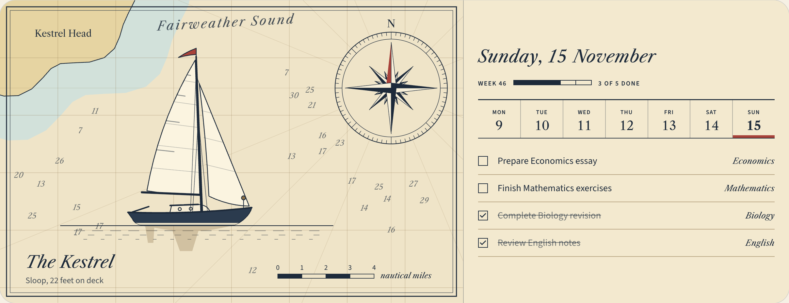
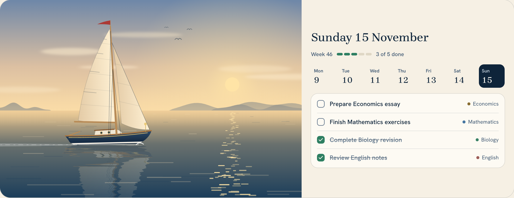
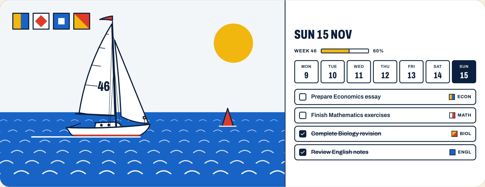
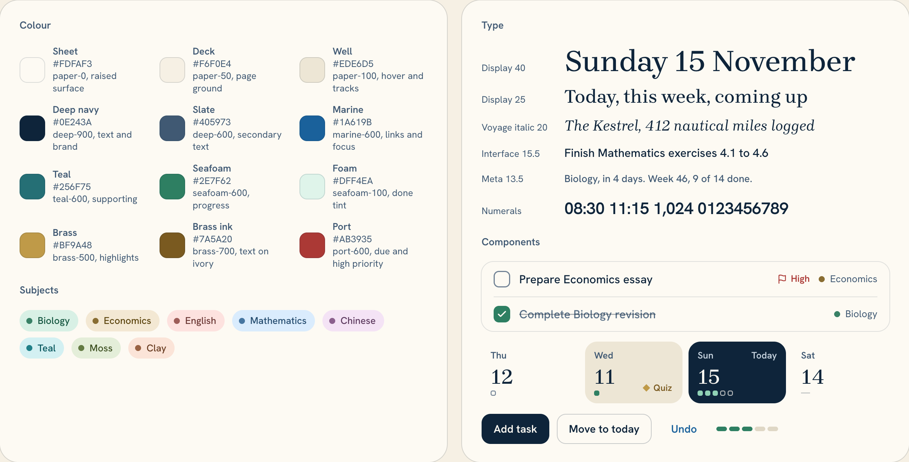
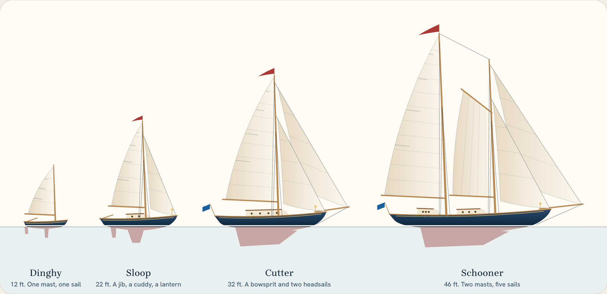
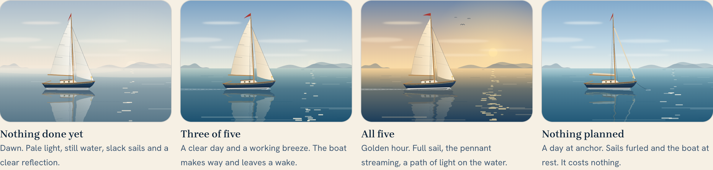
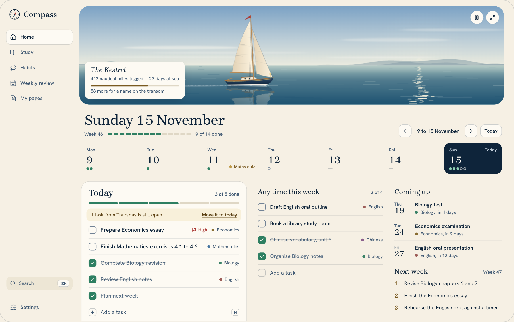
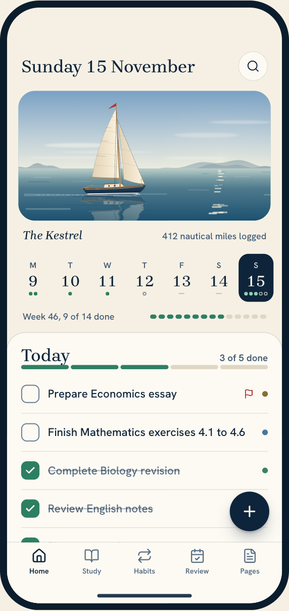

# Compass art direction

| | |
|---|---|
| Status | **Approved by Oliver, 16 November 2026**, including the four decisions in section 19. Build in progress. |
| Date | 15 November 2026 |
| Scope | Phase 1: visual identity, the boat, and the Home screen |
| Companion | [home-screen-spec.md](home-screen-spec.md) |
| Review boards | Published as a private page, "Compass Art Direction". The same boards are saved as images in [art-direction/](art-direction/). |

## 1. Summary

Compass should be recognisable from one screenshot: **a living sea in a wide window, and a quiet ivory planner beneath it.**

Three readings of "premium nautical meets modern adventure" were explored. The recommendation is **B, Fair weather**:

- The product spends its boldness in one place, the light on the water. Everything around it stays plain, so the planner is fast to read.
- Each day starts at a still, pale dawn. Every finished task moves the day on. Finishing the day brings golden hour and a boat under full sail.
- Progress is counted in nautical miles logged. Miles never go down. A missed day brings a storm the next day that clears as you work, and takes nothing away.
- The plan is set in upright type. The boat's name and the words that describe the sea are set in italic, the way a nautical chart letters water and anything afloat.

Four decisions are needed before the build starts. They are listed in [section 19](#19-decisions-needed).

## 2. What exists today

### Repository

One commit on `main`, clean working tree, tracking `origin/main`. Three files:

| File | What it is |
|---|---|
| `README.md` | Tagline and how to open the prototypes |
| `compass-intro.html` | The compass mark drawing itself: ring, ticks, needle swing, wordmark. About 2.3 s, with a reduced-motion path. |
| `compass-boat.html` | Three.js (r160 from a CDN) boat and ocean seen bow-on, driven by a streak slider with a "Break streak" button |

There is no package manifest, build tooling, application code, tests or documentation. The recommended stack in the brief is adopted as written, because there is no existing architecture to preserve.

### What the prototypes decided, and what happens to it

| Existing decision | Verdict | Why |
|---|---|---|
| Compass mark (ring, ticks, cardinal diamonds, two-tone needle) and its intro animation | **Keep**, recolour | A good mark, and the animation already handles reduced motion |
| Golden, calm water as the reward | **Keep** | It is the emotional idea of the product |
| Lantern at the bow | **Keep**, as an earned fitting | A warm, memorable detail |
| Boat rides the same wave function the shader draws | **Keep** | The right technique |
| Damped, target-based transitions; device pixel ratio cap; reduced-motion check | **Keep** | Good engineering habits |
| Streak drives the weather, and breaking it brings a storm and camera shake | **Keep the storm, drop the loss** (founder decision, 16 November) | The storm stays as weather on the day after a missed day. It clears as tasks are done, there is no camera shake, and nothing earned is lost, which keeps to the brief. See [section 12](#12-the-sea-and-the-light). |
| Bow-on camera, flat-shaded boat built from an extruded trapezoid and single-triangle sails | **Replace** | A sailboat's silhouette is its profile. Bow-on hides it, and the geometry reads as primitives. |
| Near-black background with a blurred glass panel | **Replace** for Phase 1 | The brief asks for ivory surfaces and restraint with glass. The dark palette returns later as a night theme. |
| README tagline about streaks and storms | **Update** once the direction is approved | It describes the mechanic being retired |

### Tooling

| Tool | State | Use on this project |
|---|---|---|
| Anthropic Frontend Design skill | Installed (plugin) | Primary design skill, as the brief asks |
| UI UX Pro Max skill | Installed (user level) | Used selectively. For a student planner it recommends claymorphism, Varela Round with Nunito Sans, and amber, and it lists muted colours as an anti-pattern. That is the children's-app look the brief rules out, so its style, palette and type advice is set aside. Its accessibility, touch-target and navigation rules are used. |
| Impeccable skill | Already installed | Not needed as a third source of direction. Reserved for the critique and polish pass in Phase E. |
| Playwright MCP | Connected and working | Used to render and screenshot the boards in this document. It blocks `file:` URLs, so pages are served from a local server. |
| Node 26.13, npm 11.20 | Present | Meets Vite 8's engine requirement |

Order of authority for design decisions: the brief, then this document once approved, then the Frontend Design skill, then UI UX Pro Max for UX rules only.

## 3. Three directions

Each board shows the same sloop and the same Sunday in the planner, so what differs is the direction and nothing else.

### A. Chart room



The planner as a navigator's table: buff chart paper, engraved line, soundings, and a logbook's ruled pages. The boat is a plate in the book, drawn and not lit.

- **Boldness goes into** the paper. The planner carries the identity and the boat is an illustration beside it.
- **Does well:** could only be nautical; rich typography; calm; almost free to render.
- **Fails:** tips into costume quickly. Cream paper with a classical serif is a crowded look. A drawn boat cannot respond to what the user does, so the central feature of the product goes quiet.
- Palette: chart buff `#EFE4C8`, land `#E6D4A2`, shoal `#D2E1DA`, ink `#1D2A3A`, sepia `#8A6F47`, buoy red `#A8423A`. Type: Libre Caslon Text with Source Sans 3.

### B. Fair weather (recommended)



A living sea seen through a saloon window, with a quiet ivory planner beneath it. Every day starts at a still, pale dawn. Finishing what you planned brings golden hour.

- **Boldness goes into** one place: the light on the water.
- **Does well:** the boat is alive and answers the user's work. Recognisable from a screenshot. Progress shows without a chart.
- **Fails:** if the scene is merely fine, the idea falls flat. It costs battery, so it needs performance tiers, a pause control and a still image to fall back on.
- Palette and type: sections 5 and 6.

### C. Regatta



Modern sport sailing: white sailcloth, hard navy line, sail numbers, and signal flags as the colour code for subjects.

- **Boldness goes into** a graphic system of flags and numerals.
- **Does well:** fresh, energetic, very systematic. The cheapest boat to draw. Holds up at icon size.
- **Fails:** only works with saturated signal colours, which the brief rules out. Reads as a sports brand, with little warmth and less calm.
- Palette: white, race navy `#0B1F3F`, signal blue `#1763C6`, signal yellow `#F2B70F`, signal red `#E03A2B`. Type: Archivo, condensed to regular.

### Comparison

| | A. Chart room | B. Fair weather | C. Regatta |
|---|---|---|---|
| Boat is alive and responds to work | No | **Yes** | Partly |
| Calm | Yes | **Yes** | No |
| Mature without being stiff | Stiff | **Yes** | Yes |
| Fits the brief's palette | Mostly | **Yes** | No |
| Recognisable in a screenshot | Yes | **Yes** | Yes |
| Rendering cost | Lowest | Highest | Low |
| Risk | Costume | Scene must be excellent | Reads as sport |

### Recommendation

Build **B**. It is the only direction where the boat is alive, which is the reason to have a boat. Its risk is execution, and execution can be tested early: the 3D sloop is built and reviewed first, before the rest of Home is built around it.

B keeps one idea from A. On a nautical chart, upright lettering marks features that stay dry, and slanted lettering marks water and anything afloat. Compass follows the same rule (section 6).

B takes nothing visual from C, only its discipline: every boat stage must be recognisable as a black silhouette.

## 4. Brand personality

| Compass is | Which means | It is never |
|---|---|---|
| **Steady** | Calm, unhurried, the same every day. It does not nag. | Urgent, guilt-inducing, gamified to the point of anxiety |
| **Seaworthy** | Well made and precise. Things line up. Numbers are right. | Decorative at the expense of use |
| **Companionable** | Warm and on the user's side. Quiet about success, silent about failure. | A cheerleader, a mascot, a children's game |
| **Outward-looking** | There is somewhere to go. Progress is a voyage, not a score. | A leaderboard |

### Voice

- Plain, second person, sentence case. Active verbs. No exclamation marks.
- Planner words stay ordinary: Today, This week, Task, Subject, Assessment, Habits, Weekly review, My pages.
- Nautical words belong only to the boat, and are used literally: voyage, nautical miles, days at sea, at anchor, logbook, fittings.
- No pirate talk, no puns, no "Ahoy".
- Success is stated, not celebrated: "All five done."
- Failure is not mentioned. A missed task reads "1 task from Thursday is still open", with a button to move it.

| Moment | Copy |
|---|---|
| Daily progress | 3 of 5 done |
| A day with no tasks | Nothing planned for Saturday. Add a task, or leave the day at anchor. |
| Day complete | All five done. |
| Carry-over | 1 task from Thursday is still open. Move it to today |
| Delete | Task deleted. Undo |
| Next fitting | 88 more for a name on the quarter |

## 5. Colour

The palette follows the brief: deep navy, marine blue, muted teal, ivory and cream, seafoam, and brass. One colour is added, **port**, for the few places that need attention. On a boat the port light is red and the starboard light is green, so the pair maps naturally onto "needs attention" and "done".

Colours are defined in OKLCH and shipped as hex. Text is never black: it is deep navy ink.

### Core palette

| Token | Hex | OKLCH | Role |
|---|---|---|---|
| `paper-0` | `#FDFAF3` | 0.985 0.010 90 | Sheet: the one raised surface, popovers, inputs |
| `paper-50` | `#F6F0E4` | 0.957 0.018 88 | Deck: the page ground |
| `paper-100` | `#EDE6D5` | 0.925 0.024 88 | Well: hover, sunken fields |
| `paper-200` | `#DFD7C5` | 0.880 0.026 88 | Progress track, solid hairline |
| `paper-300` | `#C5BDAA` | 0.800 0.028 88 | Disabled marks |
| `deep-950` | `#04101E` | 0.170 0.035 252 | Night sky (later dark theme) |
| `deep-900` | `#0E243A` | 0.255 0.050 250 | **Ink.** Primary text, brand navy, selected day, primary button |
| `deep-800` | `#19334E` | 0.315 0.058 250 | Pressed state on navy |
| `deep-700` | `#2A4663` | 0.385 0.060 250 | Hover on navy |
| `deep-600` | `#405973` | 0.455 0.052 250 | Secondary text, completed task titles |
| `deep-500` | `#566D84` | 0.525 0.046 250 | Tertiary text on sheet and deck only |
| `deep-400` | `#7E91A6` | 0.650 0.038 250 | Decorative only |
| `marine-700` | `#0D4D80` | 0.410 0.105 249 | Link hover |
| `marine-600` | `#1A619B` | 0.480 0.115 248 | **Interactive.** Links, focus ring, today marker |
| `marine-300` | `#88B7DE` | 0.760 0.075 244 | Focus ring on navy |
| `marine-100` | `#E0EDF8` | 0.940 0.020 240 | Selection tint |
| `teal-600` | `#256F75` | 0.500 0.072 203 | Supporting accent, subject colour |
| `teal-100` | `#E0F1F1` | 0.945 0.018 196 | Tint |
| `seafoam-700` | `#1C6048` | 0.440 0.078 166 | Positive text |
| `seafoam-600` | `#2E7F62` | 0.540 0.092 166 | **Progress.** Filled segments, checked boxes |
| `seafoam-300` | `#90D1B5` | 0.810 0.078 166 | Progress on navy |
| `seafoam-100` | `#DFF4EA` | 0.950 0.026 166 | Done tint |
| `brass-800` | `#5C4215` | 0.400 0.070 78 | Text on brass tint |
| `brass-700` | `#7A5A20` | 0.490 0.085 80 | Brass text on ivory, fitting progress |
| `brass-500` | `#BF9A48` | 0.705 0.110 85 | **Highlight.** Assessment markers, earned items. Never text. |
| `brass-300` | `#E5CB8D` | 0.850 0.085 88 | Brass on navy |
| `brass-100` | `#F8F0DA` | 0.955 0.030 90 | Notice tint |
| `port-700` | `#8C2D2B` | 0.440 0.130 25 | Attention text on tint |
| `port-600` | `#AB3935` | 0.510 0.150 26 | **Attention.** High priority, due today, destructive, compass needle |
| `port-100` | `#FBE9E6` | 0.948 0.020 30 | Attention tint |
| `control` | `#718295` | 0.600 0.035 250 | Borders of checkboxes and inputs |

Full scales (300, 200 and so on for each family) are in the token source in section 17.

### Semantic tokens

Components use these, never the raw palette.

| Semantic token | Value | 
|---|---|
| `surface-deck` / `surface-sheet` / `surface-well` / `surface-inverse` | `paper-50` / `paper-0` / `paper-100` / `deep-900` |
| `text` / `text-muted` / `text-subtle` / `text-inverse` / `text-link` | `deep-900` / `deep-600` / `deep-500` / `paper-0` / `marine-600` |
| `line` / `line-strong` / `control-border` | `deep-900` at 12% / at 22% / `control` |
| `focus` | `marine-600`, 2 px ring with a 2 px gap |
| `positive` / `positive-text` / `positive-tint` | `seafoam-600` / `seafoam-700` / `seafoam-100` |
| `attention` / `attention-text` / `attention-tint` | `port-600` / `port-700` / `port-100` |
| `highlight` / `highlight-text` / `highlight-tint` | `brass-500` / `brass-700` / `brass-100` |
| `track` | `paper-200` |

### Contrast (WCAG 2.2)

Measured, not estimated. Text needs 4.5:1. Graphics and control borders need 3:1.

| Foreground | On sheet `paper-0` | On deck `paper-50` | On well `paper-100` | Use |
|---|---|---|---|---|
| `deep-900` | 15.1 | 13.9 | 12.7 | All text |
| `deep-600` | 7.0 | 6.4 | 5.8 | Secondary text |
| `deep-500` | 5.1 | 4.7 | 4.3 | Tertiary text. Not on wells. |
| `marine-600` | 6.2 | 5.7 | | Links |
| `teal-600` | 5.6 | 5.1 | | Text and graphics |
| `seafoam-700` | 7.2 | 6.6 | | Positive text |
| `seafoam-600` | 4.7 | 4.3 | 3.9 | Fills and icons. Text on sheet only. |
| `brass-700` | 6.1 | 5.6 | | Brass text |
| `port-600` | 6.0 | 5.5 | | Attention text |
| `control` | 3.8 | 3.5 | | Control borders |

| Pair | Ratio | Use |
|---|---|---|
| `paper-0` on `deep-900` | 15.1 | Selected day, primary button |
| `paper-0` on `seafoam-600` | 4.7 | Tick on a checked box |
| `paper-0` on `port-600` | 6.0 | Destructive button |
| `seafoam-600` against `paper-200` | 3.4 | Progress fill against its track |
| `seafoam-300` on `deep-900` | 9.0 | Marks inside the selected day |
| `brass-800` on `brass-100` | 8.2 | Carry-over notice |
| `port-700` on `port-100` | 7.1 | Attention notice |

`brass-500` is below 3:1 on ivory. It is used only as decoration beside a text label, never as the sole carrier of meaning.

### Subject colours

Eight muted hues at one lightness and chroma, so no subject shouts. Each has a dot, a tint and a text colour. Colour is never the only identifier: the subject name is always shown.

| Name | Dot | Tint | Text on tint |
|---|---|---|---|
| Marine | `#4776A1` | `#DAECFD` | `#234B6E` |
| Teal | `#208088` | `#D3F0F2` | `#00535A` |
| Seafoam | `#398166` | `#D8F0E5` | `#12543E` |
| Moss | `#637B43` | `#E4EED9` | `#3C4F20` |
| Brass | `#896D32` | `#F3E8D3` | `#5B440D` |
| Clay | `#996243` | `#FBE4D8` | `#683B20` |
| Rose | `#9D5D58` | `#FDE2DF` | `#6A3633` |
| Heather | `#8B608D` | `#F4E3F5` | `#5C395E` |

Every dot is at least 4.4:1 on the sheet, and every text colour at least 7.3:1 on its tint. Sample data uses Seafoam for Biology, Brass for Economics, Rose for English, Marine for Mathematics and Heather for Chinese.

### Rules of use

1. Ivory and cream cover most of the interface. The scene is the only large field of blue.
2. One accent per region. A row does not carry seafoam, brass and port together.
3. Seafoam means done. Brass means an assessment or something earned. Port means it needs attention. Marine means you can act on it. None of them is decoration.
4. No gradients in the interface. Gradients exist only inside the scene.
5. No pure black, no pure white, no neutral grey.

## 6. Typography

Two families, clearly different, both under the SIL Open Font License and self-hosted from npm so that no request leaves for a font service.

| Role | Family | Package | Why |
|---|---|---|---|
| Display and voyage | **Libre Caslon Text**, static 400 and 700, with the 400 italic | `@fontsource/libre-caslon-text` 5.3.0 | A sturdy text cut of a classic printed face, moderate in contrast so its hairlines hold up at 20 px on an ordinary laptop screen. It reads as a printed nautical almanac, and its italic is the voyage's voice. Headings are set in the 400. |
| Interface | **Source Sans 3**, variable 200 to 900, roman and italic | `@fontsource-variable/source-sans-3` 5.3.1 | A narrow, even humanist sans that stays clear at 13 to 16 px and keeps task titles and dates on one line. Tabular figures are switched on in the base styles, which suits a planner full of dates and counts. |

**Changed on 18 November 2026, by Oliver for the three founders.** Josh and Aditya have agreed to go with Oliver's decisions unless he says otherwise, and Oliver approved this one. The first pairing, Brygada 1918 with Hanken Grotesk, read as too generic and AI-made. Three pairings were rendered on the real Home screen and Oliver chose Libre Caslon Text with Source Sans 3 (the others were Bricolage Grotesque with Public Sans, and Spectral with Karla; both were wider and cut off labels that Source Sans 3 keeps whole). Nothing else about type changes. The reasoning below is from the first choice and still describes how candidates were judged.

Forty-two candidates were rendered with real Compass content and compared before choosing. Playfair Display and Cormorant were ruled out before testing, and Fraunces, Newsreader and Instrument Serif after it, as the faces everyone reaches for. High-contrast display serifs were set aside because their hairlines break up on low-density laptop screens, which is what many students use.

### The chart rule

On a nautical chart, upright lettering marks features that stay dry at high water. Slanted lettering marks water, underwater features and anything afloat. Compass does the same:

- **Upright** for the plan: dates, headings, tasks, counts.
- **Italic** for the voyage's names and narration: the boat's name, the name of a stage or a fitting when it is announced, and lines that describe the sea.
- Numbers and their units stay upright in the interface face, including miles and days at sea, so they keep tabular figures.

Italic is not used for anything else in the interface.

### Scale

| Token | Size / line | Weight | Family | Use |
|---|---|---|---|---|
| `display-xl` | 40 / 44, tracking -0.012em | 500 | Display | Date headline on desktop |
| `display-lg` | 28 / 30 | 500 | Display | Day numerals in the week strip |
| `display-md` | 25 / 30 | 500 | Display | Primary list title, date headline on phone |
| `display-sm` | 20 / 26 | 500 | Display | Secondary titles |
| `voyage` | 20 / 24 | 400 italic | Display | Boat name, sea state. Never numbers. |
| `body` | 15.5 / 22 on desktop, 16 / 24 on touch | 500 for task titles, 400 for prose | Interface | Tasks, text |
| `meta` | 13.5 / 18 | 500 | Interface | Counts, subject names, relative dates |
| `label` | 12.5 / 16 | 600 | Interface | Weekday names, small labels |
| `numeral` | 22 / 26 | 600 | Interface | Counters |

Rules:

- Nothing below 12.5 px. Inputs are 16 px on touch devices so the page does not zoom.
- Sentence case everywhere. No all-caps labels and no letter-spaced labels.
- `font-variant-numeric: tabular-nums` wherever digits change or line up.
- Headings use `text-wrap: balance`. Running text stays under 68 characters a line.
- Fallback stacks: `"Libre Caslon Text", "Iowan Old Style", Palatino, Georgia, serif` and `"Source Sans 3 Variable", system-ui, -apple-system, "Segoe UI", Roboto, "PingFang SC", "Microsoft YaHei", "Noto Sans CJK SC", sans-serif`. The Chinese fallbacks matter, because students will type Chinese into task titles.
- Fonts load with `font-display: swap`, the two Latin files are preloaded, and the fallback faces are metric-adjusted to avoid layout shift.

## 7. Space, shape and elevation

| Token | Values |
|---|---|
| Spacing (4 px base) | 2, 4, 6, 8, 12, 16, 20, 24, 32, 40, 48, 64 |
| Radius | 6 (marks, key hints), 12 (rows, buttons, inputs, plate), 16 (day cells), 22 (sheet), 28 (window), full (pills, round buttons). Checkbox 7. |
| Hairline | 1 px `line` |
| Control border | 1.5 px `control-border` |
| Row height | 46 desktop, 54 touch |
| Page gutter | 28 desktop, 20 tablet, 16 phone |
| Breakpoints | phone below 640, tablet 640 to 1023, laptop 1024 to 1439, desktop 1440 and up |

- **Concentric corners.** An inner radius equals the outer radius minus the gap between them. The plate inside the window is 28 minus 16, so 12.
- **Continuous corners.** Where the browser supports `corner-shape: squircle` it is applied as an enhancement. `border-radius` is the baseline. Support must be checked when building.
- **Three levels of elevation, and no more.**

| Level | Used by | Treatment |
|---|---|---|
| 0, deck | Page, secondary columns, week strip | Flat `paper-50` |
| 1, sheet | The selected day's list | `paper-0`, hairline, `0 1px 2px rgb(14 36 58 / 0.04)` |
| 2, floating | Voyage plate, popovers, toasts, the add button on phones | `paper-0`, `0 1px 2px rgb(14 36 58 / 0.12), 0 10px 26px -12px rgb(14 36 58 / 0.45)` |

Shadows are tinted navy, never grey. There is no background blur anywhere.

## 8. Components



**The one-sheet rule.** A screen has one raised sheet, for the thing being worked on. Everything else sits on the deck, separated by space and hairlines. This is what keeps Home from becoming a grid of equal cards.

| Component | Specification |
|---|---|
| **Task row** | Grid: checkbox, title, meta. 46 px high (54 on touch). Hairline between rows, none above the first. Title `body` 500, truncates with an ellipsis. Meta on the right: priority flag if high, then subject dot and name. Hover: `paper-100` and quick actions appear. Done: title `deep-600` with a strike-through, box filled. `deep-600` is used because it still passes on the hover background. |
| **Checkbox** | 22 px (26 on touch) inside a 44 px target. Radius 7. Border 1.5 px `control`. Checked: `seafoam-600` fill, ivory tick. A real `<input type="checkbox">`. |
| **Segmented progress** | One segment per task: 6 px high, radius 3, 3 px gaps. Done `seafoam-600`, remaining `paper-200`. Above 20 tasks it becomes one continuous bar. Always paired with text such as "3 of 5 done". |
| **Day cell** | 86 px high, radius 16. Weekday `label`, numeral `display-lg`, then one 7 px mark per task: filled seafoam when done, outlined when open, a short dash when the day is empty. An assessment adds a brass diamond and a short label. Selected: `deep-900` fill, ivory text. Today when not selected: the weekday in `marine-600` with a small dot. Hover: `paper-100`. |
| **Buttons** | 40 px high (44 on touch), radius 12, `body` 600. Primary: navy fill, ivory text. Secondary: sheet fill, `line-strong` border. Quiet: `marine-600` text only. Destructive: `port-600`. |
| **Icon button** | 36 px (44 on touch), round or radius 12. Always has an accessible name. |
| **Input** | 44 px high, radius 12, `paper-0`, `control-border`. Visible label. Focus ring. |
| **Priority** | Three levels: high, normal, low. High shows a port flag and the word "High". Normal shows nothing. Low shows the word "Low" in `text-muted`. Priority is never carried by colour or weight alone. |
| **Voyage plate** | Solid `paper-0`, radius 12, level 2. Boat name in `voyage`, then miles and days at sea, then a 4 px brass bar to the next fitting. It is a button. |
| **Notice** | Inline, never a pop-up. Tint background, 12 px radius, one action. |
| **Toast** | Bottom centre (above the tab bar on phones). One line and one action, such as Undo. Leaves after 6 s, or stays while focused. |
| **Focus** | 2 px `marine-600` ring with a 2 px gap in the surface colour, on every interactive element. On navy it is `marine-300`. Never removed. |
| **Navigation** | Rail of five destinations with icon and label on laptop and desktop. Icon-only rail on tablet. Five-item bottom bar on phones. |
| **Command menu** | Opens with Cmd or Ctrl and K. Jump to a destination or date, add a task, open the voyage. |

Icons are Lucide at 18 to 20 px with a 1.75 px stroke and round caps. No emoji. Custom glyphs (pennant, lantern) are drawn on the same grid.

## 9. Materials and textures

**Interface.** Paper and ink. Flat tints, hairlines and type. No noise, no paper texture, no glass, no gloss. The only material cue is the two-tone layering of sheet on deck.

**Scene.** Four materials, each simple:

| Material | Look | Notes |
|---|---|---|
| Painted hull | Deep navy, satin | A lighter band at the sheer, an ivory boot stripe at the waterline, a thin brass cove stripe |
| Varnished wood | Warm honey to mahogany, satin | Rail, cabin roof, spars, tiller. Slight tone variation, no photographic grain. |
| Sailcloth | Ivory, matte | Faint panel seams. Lets light through, so sails glow when the sun is behind them. |
| Brass | Warm, soft highlights | Portlight rings, lantern, small fittings only |

The brief asks for natural materials and textures. They are made in the shader and in vertex colour, not from image files: a soft grain along the wood, a faint weave and panel seams in the sails, a slight unevenness in the paint. This keeps the download small and lets users recolour the boat instantly.

## 10. Illustration

One illustration style, taken from the naval architect's sail plan: **a boat in profile, to scale, with flat tints and a fine line.** It is used for:

- The stage storyboard and every "you earned this" card.
- Empty states.
- The still image shown while the 3D scene loads and when WebGL is unavailable. With reduced motion the 3D scene still loads and holds a still frame.

The boards in this document were drawn by a small generator that builds each boat from a table of measurements. That table is checked into the app as `src/features/voyage/boat/specs.ts`, and both the `BoatPoster` still image and the 3D model are built from it, so the two cannot drift apart.

No mascots and no characters with faces. Small, simple figures appear only in port, loading supplies. They are plain models in the palette's colours, not personalities.

## 11. The boat



### Stages

Four hulls from one family. Each stage changes the silhouette.

| Stage | Type | Length on deck | Rig | What is new |
|---|---|---|---|---|
| 1 | **Dinghy** | 3.8 m (12 ft) | One unstayed mast, one sail | An open boat with a tiller. The humble start. |
| 2 | **Sloop** | 6.8 m (22 ft) | Mainsail and jib | A cuddy cabin, a boom, standing rigging, a fin keel |
| 3 | **Cutter** | 9.8 m (32 ft) | Mainsail, staysail and jib | A bowsprit, a full cabin with portlights, a long keel, an ensign |
| 4 | **Schooner** | 14.2 m (46 ft) | Two masts: mainsail, gaff foresail, two headsails | A second mast, a second deckhouse, long overhangs |

Default livery: deep navy hull, ivory boot stripe, brass cove stripe, varnished rail and spars, ivory sails, a port-red pennant.

### View

- Seen from the starboard side with the camera raised 10 degrees and the boat turned about 17 degrees toward the bow, so you look down onto the deck, cabin and cockpit. This was changed at the first look review, where the side-on view read as too flat.
- The horizon sits a third of the way down the window, leaving more water around the boat.
- The still image stays a profile drawing with the same horizon and boat position. It is a fallback, so a small change when the 3D scene takes over is accepted.
- A long lens (about 28 degrees field of view) so the proportions stay calm.
- The boat heads to the right of the frame, placed left of centre with open water ahead of it.
- In the voyage view the user can turn the boat up to 35 degrees either way.

### Construction

Procedural geometry, built in code from a small parts kit. No downloaded models.

| Part | How it is made | Budget |
|---|---|---|
| Hull | A surface lofted through 9 to 11 cross-sections along the keel and sheer curves. Smooth-shaded. | 2,500 to 6,000 triangles |
| Deck and cabin | Capped loft with a slight camber. Cabin is a rounded box with bevelled edges. | 1,000 |
| Spars | Tapered cylinders, 8 to 12 sides | 400 |
| Sails | Parametric surfaces, about 16 by 24 segments, with camber and twist driven by one "fill" value | 800 each |
| Rigging | Thin tubes or constant-width lines | 300 |
| Fittings | Lantern, portlights, tiller, rudder, pennant with a cloth wave | 1,500 |

Whole boat: at most 12,000 triangles at stage 4. Whole scene: at most 60,000 triangles and 40 draw calls.

### Lighting and materials in 3D

- One directional key light for the sun. Its colour, height and strength come from the light table in section 12.
- A hemisphere fill, sky colour above and sea colour below.
- One soft shadow map for the boat's own shadow on the high tier. None on the low tier.
- No bloom, no ambient occlusion pass, no depth of field.
- Standard materials with the roughness values implied by section 9. Sails get a cheap back-light term.

### Customisation

Earned and chosen stay separate.

| Chosen freely, from day one | Earned, and kept for good |
|---|---|
| The boat's name | The stage (the hull itself) |
| Hull colour: deep navy, marine, teal, ivory, bottle green, oxblood | Fittings: pennant, lantern, portlights, ratlines, tender and so on |
| Sail colour: ivory, flax, tanbark, slate, seafoam, rose | Flags for dressing ship |
| Pennant colour: port, brass, marine, seafoam, ivory, heather | New waters and seasonal keepsakes (later) |

Phase 1 implements the name, the three colour choices, all four stages, and five fittings: masthead pennant, bow lantern, painted sheer stripe, the name lettered on the quarter, and brass portlights. The later fittings are listed in the voyage view as upcoming and are not modelled yet.

**Stage 7 drew the other six,** on 17 November: flags to dress ship, ratlines and lazy jacks, the stern lantern, the tender on deck, the topsail and the gilded cove stripe. A fitting goes on every boat that has a place for it. Three need something the smaller boats lack: portlights a cabin, the tender a cabin top long enough to carry her (the cutter and the schooner), and the topsail a gaff to set it above (the schooner). The voyage view says so beside a fitting the boat being looked at cannot carry. Josh and Aditya have not yet reviewed how the six look.

**The dress flags fly in port only.** Oliver decided this on 17 November. They are the one fitting that does not show at once: a boat dresses overall only at rest, with her sails furled, and under sail the flags would cross the sails. So they fly on a day with nothing planned, when the boat is moored, and the voyage view says so beside them.

The name was first specified on the transom. Oliver moved it to the quarter on 16 November, because the transom faces away from the usual view. It is lettered in the voyage's italic, in gold leaf on a dark hull and navy on a light one.

## 12. The sea and the light



### The rule

The scene shows the selected day.

| State of the day | Light | Wind and boat |
|---|---|---|
| Nothing done yet | **Dawn.** Pale, pearly, a little mist. | Idle: still water, slack sails, a clear reflection, pennant hanging |
| Part done | **Clear day.** Warming as the share done rises. | Under way from the first finished task, and faster with each one: water streams past, a wake trails astern, the islands slide by. |
| All done | **Golden hour.** Low sun and a path of light on the water. | Full sail, pennant streaming, two or three gulls |
| Nothing planned | Soft daylight | **In port.** Moored to a timber pier, sails furled, with small figures carrying crates, sacks and barrels aboard. A beach, palms, a boathouse and a lighthouse behind. It costs nothing. |
| The day after a missed day | **Storm.** Slate sky, rain, breaking crests. | The boat rides it out. Each finished task clears it, and finishing the day still reaches golden hour. |

Nothing is taken away, ever. A new day starts at dawn because it is a new day, not as a penalty. The dawn has to be as good to look at as the gold, because it is the state people will see most.

**The storm.** A day is missed when it had tasks planned and none were completed. The next day opens in a storm. It is weather, not a penalty: no miles, fittings or boats are lost, there is no camera shake and no lightning, and it lifts in step with the share of today's tasks done. A day with nothing planned is spent in port and never shows the storm. This keeps the first prototype's storm and its golden water, without the loss.

### Light table

Used by both the 3D scene and the still image. Values between rows are interpolated.

| | Sky top | Sky middle | Sky at horizon | Water at horizon | Deep water | Sun | Haze | Distant land |
|---|---|---|---|---|---|---|---|---|
| Dawn, 0% | `#A9BBCB` | `#DADFD9` | `#F3E4D2` | `#CFD9D6` | `#587789` | `#FFF3DF` | `#F4EBDD` | `#93A8B8` |
| Day, 50% | `#7DA7CB` | `#B9D4E5` | `#E4EEEC` | `#8FBCC8` | `#1C5676` | `#FFFCEE` | `#EAF1EF` | `#5F8499` |
| Golden, 100% | `#6E87A8` | `#DCC0A2` | `#FBDCA6` | `#EBC68E` | `#1B3D5A` | `#FFE4A6` | `#F8DBA9` | `#4A5F78` |

Dusk and night are designed later, with the dark theme.

### Water and atmosphere

- One water surface with three or four gentle waves. Amplitude runs from 6 cm at dawn to 22 cm in a breeze. Never rough.
- Colour comes from the angle of view: deep water colour looking down, sky colour near the horizon.
- A sparkle path under the sun, strongest at golden hour.
- The boat's reflection, sharp at dawn and broken in a breeze.
- A wake and a small bow wave when the boat is under way.
- A haze band at the horizon and two layers of distant land, so there is depth without detail.
- A few soft clouds, and gulls wheeling over the water.
- Distant islands in several layers: a far range of peaks, a mesa, wooded hills with beaches, sea stacks, and a lighthouse on a point.
- Rain and heavy cloud only in the storm. No lightning.

### Motion in the scene

- Continuous and slow: bobbing, a little pitch, sails breathing, pennant, water.
- When progress changes, every value eases to its new target over about 1.6 s. A second change mid-way simply moves the target. Nothing queues.
- A pause control stops the motion and holds a still frame. The choice is remembered.

## 13. Progression

### What is counted

| Counter | Meaning | Can it go down? |
|---|---|---|
| **Nautical miles logged** | The running total of everything earned | No |
| **Days at sea** | The number of different days on which anything was earned. Not consecutive. | No |

There is no streak counter on Home.

### Earning miles

Starting values, to be tuned with real use.

| Action | Miles |
|---|---|
| Complete a task | 2 |
| Complete a high-priority task | 3 |
| Finish everything planned for a day | 3 more |
| Tick a habit (when Habits is built) | 1 |
| Save a weekly review (when Weekly review is built) | 10 |

- Each task earns once. Reopening a task does not take miles away, and completing it again does not earn twice.
- The bonus for finishing a day is earned once for each date.
- The scene is different from the total. It shows the selected day as it stands, so reopening a task cools the light a little. The miles stay.
- A cap of 40 miles a day from tasks stops the total being farmed with trivial tasks.
- A steady week logs about 110 miles.

### Stages and fittings

A stage needs both miles and days at sea, so it cannot be reached in one binge.

| Stage | Gate | Fittings on the way to the next stage |
|---|---|---|
| Dinghy | From the first day | 25 masthead pennant. 60 bow lantern. 120 painted sheer stripe. |
| Sloop | 250 miles and 10 days at sea | 350 brass portlights. 500 name lettered on the quarter. 700 flags to dress ship. |
| Cutter | 1,000 miles and 40 days at sea | 1,300 ratlines and lazy jacks. 1,700 stern lantern. 2,200 a tender on deck. |
| Schooner | 3,000 miles and 120 days at sea | 3,600 a topsail. 4,500 gilded cove stripe. |

Fittings carry forward: a lantern earned on the dinghy is on every later boat. The cutter and schooner come with an ensign.

**When something is earned** nothing pops up. The voyage plate shows a small brass dot and one line, such as "New: bow lantern", until the voyage is opened, where the fitting is marked as new. A fitting appears on the boat at once. A new stage does not replace the boat by itself: the plate says "The cutter is ready" and the user chooses to sail it from the voyage view, and can go back to an earlier boat at any time.

At a steady pace: the sloop in about two and a half weeks, the cutter in about a school term, the schooner in most of a school year.

### Guarantees

1. Anything unlocked stays unlocked.
2. Miles and days at sea never decrease.
3. Missing a day, a week or a month changes nothing that has been earned.
4. The user can always choose to sail an earlier boat they have earned.

Environments and seasonal decoration are designed after Phase 1. The intent is that new waters are earned by distance and seasonal items appear with the calendar, and both are kept once seen.

**Built on 18 November:** three waters are reached along the way and not after the last fitting: the coral shallows at 800 miles, the northern fjords at 2,000 and the ice at 3,300. There is no water after the ice yet. See [new-waters-spec.md](new-waters-spec.md).

**Decided for Stage 7, by Oliver on 17 November.** New waters are earned along the way, from about 800 miles, and not only after the last fitting as the table above has it; an earned water can be chosen, as an earned boat can. Each season leaves one keepsake. Night comes with a dark theme, which runs from dusk through stars to moonrise by the same share of the day done. The eleven decisions are listed in [next-stages.md](next-stages.md), Stage 7, and none is built yet. Josh and Aditya have not weighed in.

## 14. Motion

1. **Motion answers an action or shows a change.** Nothing in the planner moves on its own.
2. **The sea is the only ambient motion,** and it can be paused.
3. **Everything is interruptible.** Transitions move toward a target. They never lock input and never queue.
4. **Exits are faster than entrances.**

| Token | Duration | Curve | Use |
|---|---|---|---|
| `press` | 90 ms | ease-out | Button and row press |
| `quick` | 140 ms | ease-out | Checkbox fill and tick, hover |
| `base` | 200 ms in, 150 ms out | `cubic-bezier(0.23, 1, 0.32, 1)` | Popovers, notices, toasts |
| `move` | 320 ms | `cubic-bezier(0.77, 0, 0.175, 1)` | Rows changing place, week changing |
| `sheet` | Spring, no overshoot | | Bottom sheet on phones, follows the finger |
| `scene` | 1,600 ms | Critically damped | Light and wind easing to a new state |

The two curves are carried over from the intro prototype.

**The one orchestrated moment** is completing a task: the box fills and the tick draws (140 ms), the title is struck through, one progress segment fills, and the scene begins to warm. All of it starts within 100 ms of the tap.

**Never:** confetti, bouncing, staggered entrance of a whole page, parallax on scroll, looping attention-seekers, shimmer that runs for more than a second.

**Reduced motion.** With `prefers-reduced-motion: reduce`, movement becomes a cross-fade of 200 ms or less, rows do not slide, and the scene shows a still frame for each state. The pause control gives the same result on demand.

## 15. Composition



**Desktop and laptop.** A navigation rail on the left. To its right, the sea in a wide window with rounded corners, like the long window of a deck saloon. Below the window the calendar leads: the date, the week strip, then three unequal columns. The selected day's tasks sit on the only raised sheet. Tasks for any time this week, what is coming up, and next week's priorities sit beside it on the deck.

The window is placed above the planner and not beside it for three reasons. It leaves room for three list columns of readable width. A panoramic sea is the most recognisable picture the product can make. The same composition carries to a phone without being rethought.

The window can be folded down to a 64 px strip of horizon when the user wants the room.



**Phone.** The same order, restacked: date, window, week strip, the day's sheet, then the other lists below. A five-item bar at the bottom and an add button within reach of the thumb. The boat's name and miles sit under the window and not on it. The week strip stays pinned while the lists scroll.

Measurements and behaviour at every breakpoint are in [home-screen-spec.md](home-screen-spec.md).

## 16. References and anti-references

Named for what to take from each, not as a mood board.

| Reference | Take | Leave |
|---|---|---|
| Admiralty charts and Chart No. 1 | The upright and slanted lettering rule. Scale bars as a model for segmented progress. | Paper texture, compass roses as decoration |
| Naval architects' sail plans | The profile drawing style for all illustration | Technical annotation |
| Alto's Odyssey | Calm, atmospheric depth from a few flat layers, time of day as mood | Endless-runner pacing |
| Far: Changing Tides | A vessel as companion, muted painterly palette | Melancholy |
| Sea of Thieves, for its water only | Stylised water that still reads as water | Everything else: scale, saturation, noise |
| Spiritfarer | A boat that grows with you, warmth | Hand-drawn character art |
| Things 3 | The craft of task interactions, restraint | Its grey neutrality |
| TeuxDeux and Tweek | A week you can see at a glance | Seven cramped columns |
| Classic yachts by Herreshoff and Fife | Sheer lines, overhangs, navy and varnish | Realism |

| Anti-reference | Why |
|---|---|
| Duolingo's streak pressure | Guilt as a retention mechanic is the opposite of this product |
| Habitica and pixel RPG planners | Game overwhelms the planner |
| Children's educational apps: rounded type, primary colours, mascots | The audience includes university students and adults |
| Generic SaaS dashboards: equal cards, grey shadows, a gradient hero | Not recognisable as anything |
| Glass panels over a 3D background | Unreadable and dated, and ruled out by the brief |
| Pirate and "ye olde" nautical kitsch | Costume, not identity |
| Photoreal ocean simulation | Heavy, and uncanny next to a planner |

## 17. Token source

This block is the single source for the build, in Tailwind 4's CSS-first format. Components use the semantic names.

```css
@theme {
  /* paper */
  --color-paper-0: #FDFAF3;  --color-paper-50: #F6F0E4;  --color-paper-100: #EDE6D5;
  --color-paper-200: #DFD7C5; --color-paper-300: #C5BDAA;
  /* deep: ocean navy ink */
  --color-deep-950: #04101E; --color-deep-900: #0E243A; --color-deep-800: #19334E;
  --color-deep-700: #2A4663; --color-deep-600: #405973; --color-deep-500: #566D84;
  --color-deep-400: #7E91A6;
  /* marine */
  --color-marine-800: #073964; --color-marine-700: #0D4D80; --color-marine-600: #1A619B;
  --color-marine-500: #3379B4; --color-marine-300: #88B7DE; --color-marine-200: #BFDAF0;
  --color-marine-100: #E0EDF8;
  /* teal */
  --color-teal-700: #17555C; --color-teal-600: #256F75; --color-teal-500: #398A8F;
  --color-teal-300: #86C0C2; --color-teal-200: #BDDFDF; --color-teal-100: #E0F1F1;
  /* seafoam: starboard, done */
  --color-seafoam-800: #154736; --color-seafoam-700: #1C6048; --color-seafoam-600: #2E7F62;
  --color-seafoam-500: #499F7E; --color-seafoam-300: #90D1B5; --color-seafoam-200: #BEE8D5;
  --color-seafoam-100: #DFF4EA;
  /* brass */
  --color-brass-800: #5C4215; --color-brass-700: #7A5A20; --color-brass-600: #9B772E;
  --color-brass-500: #BF9A48; --color-brass-300: #E5CB8D; --color-brass-200: #EFE0B8;
  --color-brass-100: #F8F0DA;
  /* port: attention */
  --color-port-800: #6D2323; --color-port-700: #8C2D2B; --color-port-600: #AB3935;
  --color-port-500: #CA564D; --color-port-200: #F6CFC9; --color-port-100: #FBE9E6;
  --color-control: #718295;

  /* semantic */
  --color-surface-deck: var(--color-paper-50);
  --color-surface-sheet: var(--color-paper-0);
  --color-surface-well: var(--color-paper-100);
  --color-surface-inverse: var(--color-deep-900);
  --color-text: var(--color-deep-900);
  --color-text-muted: var(--color-deep-600);
  --color-text-subtle: var(--color-deep-500);
  --color-text-inverse: var(--color-paper-0);
  --color-text-link: var(--color-marine-600);
  --color-line: rgb(14 36 58 / 0.12);
  --color-line-strong: rgb(14 36 58 / 0.22);
  --color-focus: var(--color-marine-600);
  --color-positive: var(--color-seafoam-600);
  --color-attention: var(--color-port-600);
  --color-highlight: var(--color-brass-500);
  --color-track: var(--color-paper-200);

  /* type */
  --font-display: "Libre Caslon Text", "Iowan Old Style", Palatino, Georgia, serif;
  --font-sans: "Source Sans 3 Variable", system-ui, -apple-system, "Segoe UI", Roboto,
    "PingFang SC", "Microsoft YaHei", "Noto Sans CJK SC", sans-serif;

  /* shape */
  --radius-xs: 6px; --radius-md: 12px; --radius-lg: 16px; --radius-xl: 22px; --radius-2xl: 28px;
  --shadow-sheet: 0 1px 2px rgb(14 36 58 / 0.04);
  --shadow-float: 0 1px 2px rgb(14 36 58 / 0.12), 0 10px 26px -12px rgb(14 36 58 / 0.45);

  /* motion */
  --ease-out: cubic-bezier(0.23, 1, 0.32, 1);
  --ease-in-out: cubic-bezier(0.77, 0, 0.175, 1);
  --duration-press: 90ms; --duration-quick: 140ms; --duration-base: 200ms; --duration-move: 320ms;
}
```

Subject colours and the scene's light table are kept as typed constants in code, because the scene reads them as numbers.

## 18. How it gets built

These are implementation choices made on the team's behalf. They are recommendations, not things the founders have agreed.

| Question | Options considered | Choice | Why |
|---|---|---|---|
| How the boat is made | (1) Procedural parts kit in code. (2) Models authored in Blender and loaded as glTF. (3) A licensed or CC0 model, restyled. | **1** | Stages, fittings and recolouring fall out of parameters. Nothing to license. A few kilobytes. If the 3D sloop fails its look review, fall back to 2, which the brief anticipates. Option 3 would never look like ours. |
| How the scene is drawn | (1) React Three Fiber on WebGL 2 with a custom water shader. (2) WebGPU. (3) Pre-rendered video or sprites. | **1** | Works everywhere, including older phones. WebGPU adds a second code path for no visible gain at this scale. Video cannot respond to progress. |
| Where the window sits | Above the planner, or beside it | **Above** | Section 15 |
| App state | (1) Zustand with its persist middleware. (2) React context and a reducer. (3) A query library over IndexedDB. | **1** | Small, typed, keeps logic out of components, and persistence to local storage is one line. No server exists to justify 3. |
| Still image | A pre-rendered picture for each stage, or an SVG drawn from the boat's measurements | **SVG** | One source of truth for 2D and 3D, any colour, any stage, tiny |

Stack, at versions current on 15 November 2026 and checked for compatibility: React 19.3, TypeScript 7.0, Vite 8.3, Tailwind CSS 4.3, three 0.187, React Three Fiber 9.8, Drei 10.7, Motion 14.14, Lucide React 1.73, React Router 8.5, Zustand 5.1, date-fns 4.4, Vitest 5.1, Playwright 1.65. React Three Fiber 9.8 requires React 19.0 to 19.3, which matches. TypeScript 7 is new, so if a tool in the chain does not support it yet the fallback is the latest 6.x.

## 19. Decisions needed

All four were approved by Oliver on 16 November 2026.

1. **Which direction?** B, with the chart's lettering rule from A.
2. **Retire the streak storm?** First answered yes, then changed by Oliver at the first look review: the storm stays, the day after a missed day, clearing as tasks are done. Miles still only go up.
3. **Window above the planner, or beside it?** Above.
4. **This boat family and default livery?** Yes, with a look review of the 3D sloop before the rest of Home is built around it.

**The look review passes when** the 3D sloop is recognisable as the board's sloop when filled solid black at 64 px tall; its forms read as smooth surfaces and not as primitives; the water reads as water at dawn and at golden hour; and the window holds the display's frame rate on a founder's laptop. If it does not pass after one round of changes, the fallback is authored models (section 18), and who makes them is a decision for the founders at that point.

Smaller calls made here that the founders can overrule: adding port red to the palette, Libre Caslon Text and Source Sans 3 (changed from Brygada 1918 and Hanken Grotesk on 18 November), the mileage numbers, and showing no streak counter on Home.

## 20. Not in Phase 1

- Dark theme and the night scene.
- Environments, seasons and seasonal decoration.
- Study, Habits, Weekly review and My pages beyond an honest page that says what will live there.
- Accounts, sync, payments, notifications.
- The final logo. The existing compass mark is used as it stands, recoloured.
