# Fitness: specification

| | |
|---|---|
| Status | **Designed on 19 November 2026 and approved by Oliver the same day. Built the same day, on the branch `fitness`.** Oliver chose the approach on 18 November and the recommended side of all seven decisions in section 4 on 19 November, from the mock, then approved this document. Josh and Aditya have not weighed in. The calls in section 16 were made here and are open to change. Section 19 says where the build differs. |
| Scope | The third piece of Aditya's plan: an optional place for a training week, a record of what was done, and a short list of bests and measures. It also puts today's training on Home, adds one figure to the Weekly review, and adds a switch to Settings. |
| Companions | [habits-spec.md](habits-spec.md), [home-screen-spec.md](home-screen-spec.md), [review-spec.md](review-spec.md), [my-pages-spec.md](my-pages-spec.md), [home-and-review-additions-spec.md](home-and-review-additions-spec.md), [compass-art-direction.md](compass-art-direction.md) |
| Mock | [Fitness in Compass](https://claude.ai/artifact/4Fe74TZBYbNVKJg9YXfXcy), a private page. It needs sharing from its Share menu before Josh and Aditya can open it. |

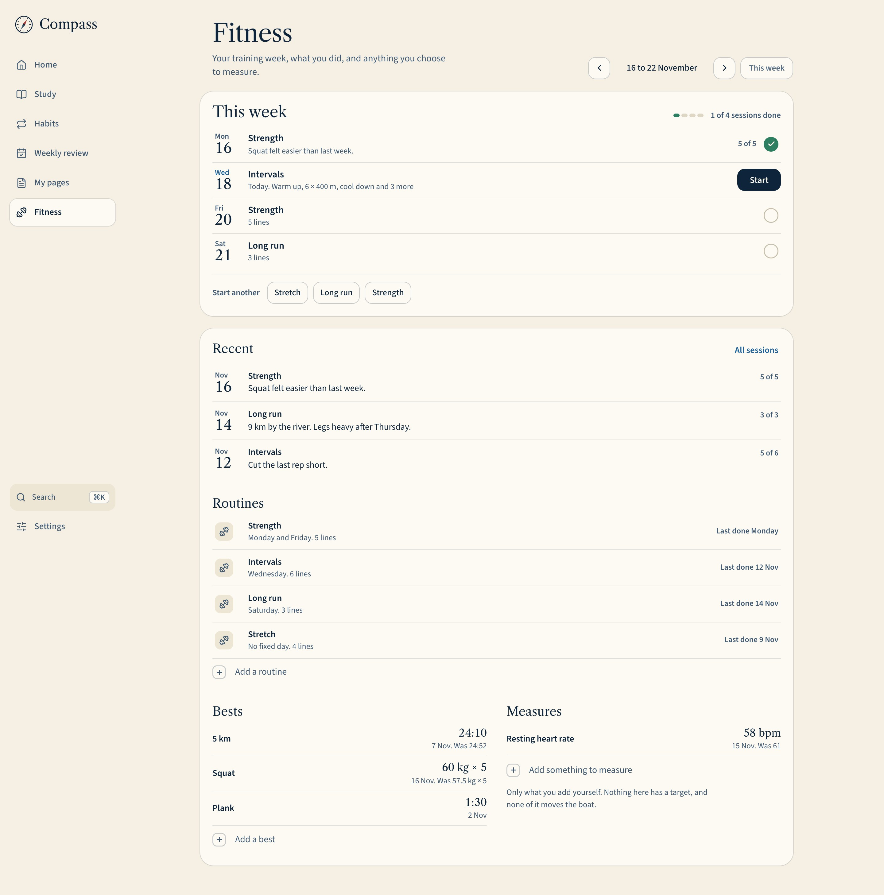

The picture is a mock, drawn onto the running app. The training week, the bests and the measure in it are invented samples. Where a picture and this document differ, this document is right: section 16 lists the differences.

## 1. Where this comes from

This is piece 3 of the five in [next-stages.md](next-stages.md), Stage 8. The brief already lists fitness as an optional feature of the planner. The plan asks for a fitness dashboard: today's workout, a workout log, personal records and health numbers.

Pieces 1 and 2 are built. Piece 1 is in `main`, and piece 2 is pull request 15.

What the plan asks for, and where it is in this piece:

| The plan | This piece |
|---|---|
| Today's workout, on the dashboard and in its own place | Today's session in "This week", ready to start, and on Home |
| A log of recent sessions | "Recent", and every finished session behind "All sessions" |
| Exercises to tick off, with sets, reps, weight and time | A routine's lines, ticked in a session. The numbers are in the line's own words: "Squat, 3 × 5 at 60 kg". |
| Notes on a session | One note on each session |
| Personal records | "Bests", kept by hand |
| A usual day for each kind of training | A routine's days |
| A suggestion that does not repeat the same session too often | The routine not done for longest is offered first |
| A rest day | The day says "Rest day" |
| A missed session waits until it is moved or marked as skipped | **Not followed.** A missed session stays unticked and nothing else happens (decision 4). |
| Body measurements and a resting heart rate | "Measures". The student adds each one, and none is preset (decision 6). |
| Calories and protein by meal | **Left out** of this piece (decision 6) |
| A different layout for each kind of training | **Left out.** A routine's lines say what its sport needs. |

## 2. What this piece is for

A student who trains wants three things from a planner: to see what is set for today, to tick it off while doing it, and to look back on what was done. Fitness does those three for any sport, in the student's own words, and stays out of the way of everyone who does not switch it on.

## 3. Goals, and what to stay away from

**Goals**

- Fitness is off until someone switches it on. With it off, all that shows of it is the switch in Settings and one command in search.
- A routine is written once and used again. Starting today's session is one press.
- A session can be ticked off on a phone, one line at a time, with one hand.
- What was done is kept, with a note, and can be read again.
- Nothing is preset. The routines, bests and measures are the student's own, so running, a gym and a martial art are all served by the same parts.
- A finished session moves the boat. A missed one takes nothing away.

**Not goals**

- Sets, reps and weights kept as numbers, with charts or records worked out from them.
- Calories, protein or anything else about food.
- A layout for each sport.
- Anything brought in from a watch or another app.
- Reminders.
- A plan for a session on a day to come, or moving a session to another day.

**What would make this a failure**

- Anything that judges a body. A measure has no target, no colour, no arrow and no chart, and nothing suggests what to measure.
- Guilt. A missed session is not marked, counted against anything or carried forward.
- Training that changes the rest of the planner. A session is not a task: it does not count in a day's progress, change the light or the sea, or bring the storm.
- A switch that loses data. Switching Fitness off hides it and keeps everything.
- A second copy of anything. Home and the Weekly review read the same records the place does.

## 4. Approaches

### How training is kept

| | Approach | Trade-off |
|---|---|---|
| A | Training as ordinary tasks. A routine is a task that repeats on its days, as a study session is, and the place lists them. | The smallest build and no new records. There are no lines to tick, the record is a tick and nothing more, and training would count in a day's progress and bring the storm when missed. |
| **B** | **Routines kept as checklists.** A routine is a name, its days and its lines. A session is a dated copy to tick off, with a note. Bests and measures are short lists kept by hand. | New records beside tasks. In return every line is in the student's own words, so any sport fits, and nothing is worked out or judged. |
| C | A full workout log: sets, reps, weight and time as numbers, with charts and records worked out from them. | Closest to the plan. The biggest build, a form for each kind of training, and numbers that grade the student. |

**Oliver chose B.**

### The seven decisions in this piece

Oliver chose the recommended side of each, from the mock.

| | Decision | Chosen | The other way |
|---|---|---|---|
| 1 | Whether a finished session moves the boat | It logs 2 nautical miles, as a task does, and one session a day counts. Bests and measures never log miles. | 1 mile, as a habit's tick earns, or none |
| 2 | Fitness in the phone's bar | A sixth place, when it is switched on | Keep five, and reach Fitness from Home and from search |
| 3 | Today's training on Home | Its name opens the session in Fitness, and its ring finishes the session as it stands. It is on the habits line on wide screens and under the habits on narrow ones. | The name only, with no ring |
| 4 | A missed session | Nothing happens. It stays unticked in its week. Any routine can be started today, whatever its days, so a missed one can be done tomorrow. | It waits until it is moved or marked as skipped |
| 5 | A rest day | The day says "Rest day" and offers every routine, the one not done for longest first | The routines in their own order, or nothing |
| 6 | How far measures go | The student adds each one, with its own name and unit. It shows its latest value and the one before. No suggestions, target, colour, chart or miles, and no food diary. | Suggested measures, a chart for each, or none at all |
| 7 | The Weekly review | One more figure with Fitness on: sessions done out of sessions set | The review as it is |

## 5. Words, and records

**Two words for one thing.** On screen a session is a "session". In the saved data and the code it is a `workout`, because `sessions` already holds the study sessions that repeat. The two never meet.

New parts of the saved data. Everything stays on the device.

| Record | Fields | Limits |
|---|---|---|
| `settings.fitness` | True while the place is shown | Absent means off |
| `routines` | A list of `{ id, name, days, lines, createdOn }`, in the order they were made. `lines` is a list of `{ id, text }`. | Up to 20. Name 1 to 40 characters. `days` are weekdays, 0 for Sunday to 6 for Saturday, and may be empty, which means no fixed day. Up to 40 lines, each 1 to 140 characters. |
| `workouts` | A list of `{ id, routineId, name, date, lines, note, finishedAt, milesAwarded }`. `lines` is a list of `{ id, text, done }`. | One at most for each routine on each day. `name` and `lines` are copied from the routine when the session is started. Up to 40 lines. `note` up to 2,000 characters. `finishedAt` present means finished. `milesAwarded` is set the first time it is finished and never cleared. |
| `bests` | A list of `{ id, name, value, date, was }`, in the order they were added. `was` is `{ value, date }`. | Up to 20. Name 1 to 40 characters. Value 1 to 24. |
| `measures` | A list of `{ id, name, unit, value, date, was }`, in the order they were added | Up to 12. Name 1 to 40 characters. Unit up to 12, and may be empty. Value 1 to 12. |
| `log` | Gains the source `workout` | One entry at most for each day |

**At a limit, the row to add another is not shown.**

**Words are kept as typed.** A name, a line, a value and a unit lose the spaces at either end, a run of spaces or a line break becomes one space, and they are cut at their limit. Nothing else is changed: no capital letters, no units added, no number read out of the words. A value is words, not a number, so "24:10", "60 kg × 5" and "7 h 40" are all values.

**A session is a copy.** Starting a session copies the routine's name and lines into it. Changing or deleting the routine afterwards changes nothing in a session already started.

**A set session** is a routine on one of its days, on or after the day the routine was made. Nothing is saved for it until it is started: the weeks are worked out from the routines and the sessions, as a habit's week is.

**A save is not trusted.** When a save is opened, a routine is kept only with an id and a name, a session only with an id, a name and a date, and a best or a measure only with an id, a name, a value and a date. A line without an id and words is dropped, days that are not weekdays are dropped, and `was` is dropped unless it has a value and a date. A second session for the same routine and day is dropped.

## 6. The place

Fitness is one column, as Habits is, at `/fitness`. Every bar in it is the app's own, which draws a segment for each part up to 20 and one plain bar above that. The parts in order:

| Part | What it holds |
|---|---|
| Heading | "Fitness", one line about it, and the week's controls |
| A session | Only while one is open |
| This week | The week's sessions, and the routines that can be started today |
| Recent | The last three finished sessions |
| Routines | Every routine, and a row to add one |
| Bests and Measures | Side by side from 640 px, one under the other below that |

### The heading

- "Fitness", then: "Your training week and what you did. Finishing a session logs 2 nautical miles, for one session a day. A missed one takes nothing away."
- The week's controls are the ones Habits has: previous week, the week's dates, next week, and "This week".

### This week

The sheet is titled "This week", or "Week 47" for another week. Its count reads "1 of 4 sessions done", with a segment for each session.

**Its rows** are the week's sessions in date order. A day lists its set sessions first, in the order of the routines, then any other session started for that day. A set session that has been started is listed once, as its session.

| The session is | The line under its name | At the right |
|---|---|---|
| Set for a day still to come | "5 lines" | An empty ring that cannot be pressed |
| Set for today, not started | "Today. 6 lines" | "Start" |
| Set for a day that has passed, not started | "5 lines" | "Log it", as a quiet button |
| Started, not finished | "Started. 3 of 6 so far." | "Open" |
| Finished | Its note, cut to one line, or nothing | "5 of 5" and a ticked ring |

- **"Start"** and **"Log it"** make the session for that day and open it. **"Open"**, or pressing a started or finished row, opens it.
- **The rings here are marks, not controls.** A session is finished and reopened in the session itself, and on Home.
- **A finished session with no line ticked shows no count,** only its ring. That is a session finished from Home by someone who does not tick lines.
- **The count** is finished sessions out of every session in the week: each set session, and each session started that was not set. The "Rest day" row is not a session.
- **A missed session** is a set session whose day has passed. It keeps its row, and nothing else happens.

**Today, under the rows.** Only when the week shown is this week:

- With a session set or started today: "Start another", then a button for each routine that is not in today's rows.
- On a rest day, which is a day with no session set and none started: the day has a row of its own, "Rest day. Nothing is set for today.", and under the rows "Start one anyway", then a button for every routine, and the line "The one you have not done for longest comes first. Stretch was last done 9 days ago."
- With no routine that has a fixed day, there is no "Rest day" row, and the buttons are under "Start one".
- **The order of the buttons** is always the same: a routine never done comes first, then the one whose last finished session is longest ago. Routines level on that are in their own order.
- **"Last done" goes by the day a session is for,** not the day it was finished, here and in the list of routines.
- Pressing a button starts that routine for today and opens it.

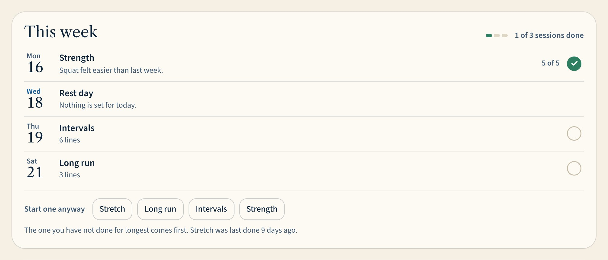

**Nothing yet.** With no routines: "No routines yet. A routine is a checklist you write once, such as a run or a gym session. Add one under Routines." and the count reads "No routines yet". With routines but nothing in the week: "No sessions set".

### A session

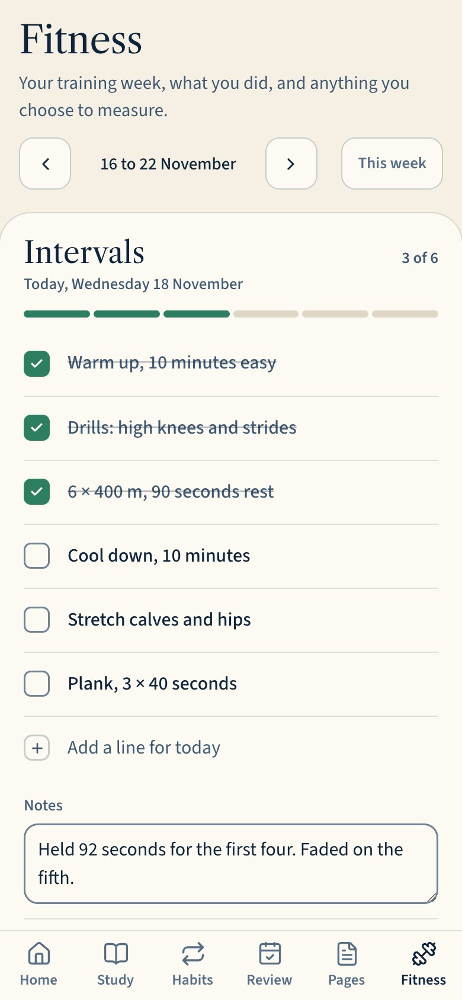

An open session is a sheet at the top of the place, above "This week". One is open at a time.

- **Its heading** is its name, with "3 of 6" beside it and a bar with a segment for each line. Under it is its day: "Today, Wednesday 18 November", or the day alone.
- **Its lines** are a list like a page's list in My pages: a box to tick, the words, and a row to add a line. Pressing a line's words changes them in place, with move up, move down and delete beside them. Deleting offers Undo.
- **"Add a line for today"** adds a line to this session only. On another day's session it reads "Add a line".
- **"Notes"** is one box, kept as it is typed.
- **Everything is kept as it is done.** Leaving the place, or closing the sheet with its Close mark, leaves the session started, with its ticks and its note.
- **"Finish session"** finishes it, closes the sheet, and says "Session finished. 2 nautical miles logged.", or "Session finished." when it logs none. Any number of lines may be ticked, including none.
- **"Not today"** removes a session that is not finished, with Undo: "Session put away." On another day's session it reads "Remove it".
- **A finished session** opens in the same sheet. Its lines and its note can still be changed. In place of the two buttons it reads "Finished", then "Reopen" and "Delete session". "Reopen" makes it a started session again and takes nothing from the log. "Delete session" removes it, with Undo.
- **A session with no lines** reads "No lines. Add one, or finish it as it is."
- **Its address** is `/fitness/` then its id, so Back closes it and a reload keeps it open. The address of a session that is gone shows the place with nothing open.
- When a session opens, the page moves to its heading, which takes focus.

### Recent

- The last three finished sessions, newest first by the day they are for: the month over the day, the name, the whole note, and the count of lines at the right. Of two for the same day, the one finished later comes first.
- Pressing one opens it.
- "All sessions" shows every finished session in the same list, and then reads "Show fewer".
- With none: "None yet. A finished session is kept here, with its note."

### Routines

- **A row** has the dumbbell mark, the routine's name, and a line: its days as Habits writes them ("Mon, Fri", "Weekdays", "Every day") or "No fixed day", then "5 lines". At the right, from 640 px: "Last done Mon 16 Nov", or "Not done yet".
- **"Add a routine"** is a box at the foot of the list, as "Add a habit" is. Typing a name and pressing Enter makes the routine, with no days and no lines, and opens its editor ready for its first line.
- **Pressing a row** opens the routine's editor.

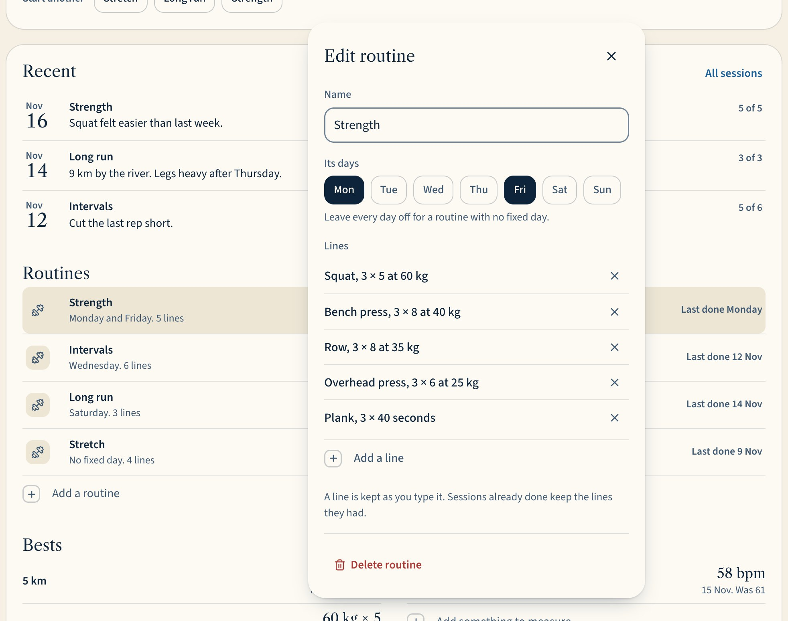

**The editor** is the pop-up the other editors use, and a sheet from the foot of the screen on a phone. Changes are kept as they are made.

- "Name". An empty name keeps the last good one.
- "Days": seven buttons in the order of the student's week. Any of them may be on, and all may be off. Under them: "Leave every day off for a routine with no fixed day."
- "Lines": the routine's lines, changed as a page's list is, without the box to tick: press a line to change it, with move up, move down and delete beside it, and a row to add a line. Deleting a line here is at once, with no Undo.
- "A line is kept as you type it. Sessions already done keep the lines they had."
- "Delete routine" closes the editor and offers Undo.

### Bests and Measures

Two short lists with the same shape.

- **A row** has a name at the left. At the right is the value in the display type, and under it the day and the value before: "7 Nov. Was 24:52". A measure's unit follows its value: "58 bpm".
- **"Add a best"** and **"Add something to measure"** open an editor with empty boxes: "Name", "Value" and "Date", which starts as today. A measure also has "Unit". It is added when its name and its value both have something in them.
- **Pressing a row** opens the same editor. The name, the value, the date and the unit can be corrected there, which changes nothing else.
- **"New best"**, and **"New reading"** on a measure, is a box in that editor. Typing a value and pressing Enter, or "Keep", makes it the value, dated today. The value it replaces, and its date, move beneath as "Was". Only the one before is kept.
- **Keeping a new value closes the editor and offers Undo,** which puts the value, its date and "Was" back as they were. "Was" cannot be changed any other way.
- **"Delete"** closes the editor and offers Undo.
- **Nothing about a measure is suggested or judged.** There is no list to pick from, no example in the boxes and no unit to start with. A reading is not coloured, compared or drawn. Under the list: "Only what you add yourself. Nothing here has a target, and none of it moves the boat."
- With no bests: "None yet. Keep a time, a distance or a weight here, and the one it beat."

### Switched off

With Fitness off, `/fitness` shows the heading and one line, "Fitness is switched off. It is a place for your training week, what you did and anything you choose to measure.", with a button, "Switch on Fitness".

### In the dark theme

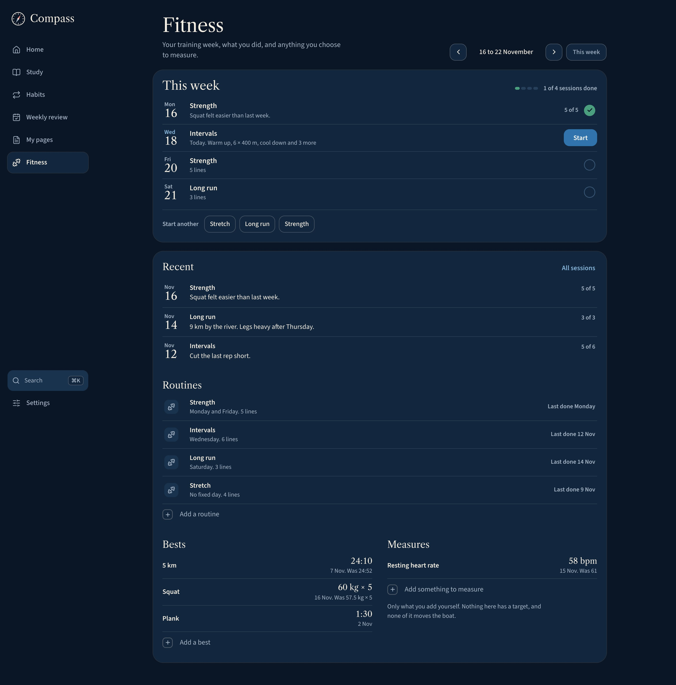

Every part uses the colour roles, so the dark theme needs nothing of its own.

## 7. Home

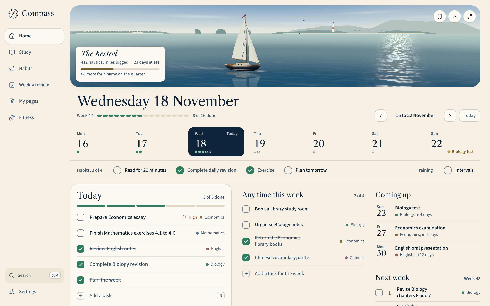

With Fitness on, Home shows the selected day's sessions: the ones "This week" lists for that day.

- **Where.** From 1280 px it is at the right end of the habits line, after a rule, under the word "Training". Below that it is a part of its own under the habits, at the foot of the day's sheet.
- **A day with no session shows nothing.** A day with sessions and no habits shows the training alone.
- **Each session** is a ring and its name.

| The session is | Its ring | Pressing the ring |
|---|---|---|
| Not started | Empty | Starts it and finishes it as it stands, with no line ticked |
| Started | Empty | Finishes it as it stands |
| Finished | Ticked | Reopens it. Nothing is taken from the log. |
| On a day still to come | Empty, and cannot be pressed | Nothing |

- **Its name** opens the session in Fitness, and starts it first if it has not been started. On a day still to come the name goes to Fitness and starts nothing.
- A day that has passed can be finished here, as a habit's past day can be ticked.
- Finishing here says nothing: the ring is the answer, as a habit's is.
- Up to three sessions are shown. More than that reads "1 more", which goes to Fitness.

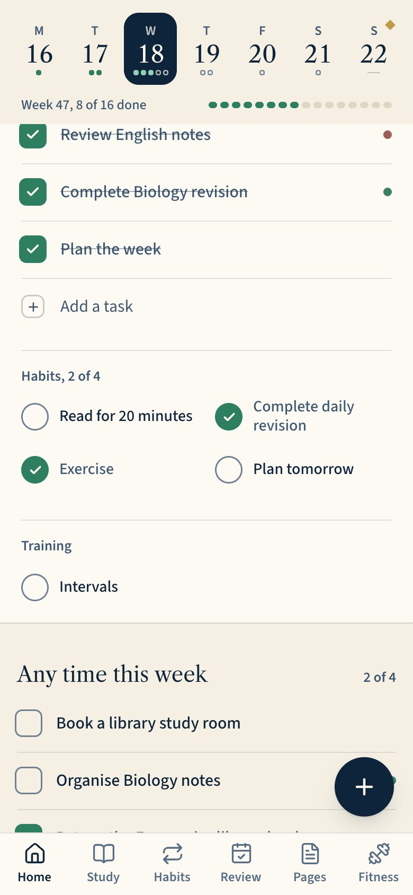

Nothing else on Home changes. The day's count, the week's count, the week strip, the light and the sea do not know about training.

## 8. The Weekly review

With Fitness on, the week's figures gain a fourth, "Training sessions": the number finished, "of 4", and a bar, from the same count "This week" shows. A week with no sessions reads 0 and "None set".

The four figures are two rows of two on a phone and one row from 640 px. With Fitness off there are three, as now.

## 9. Settings, the rail and search

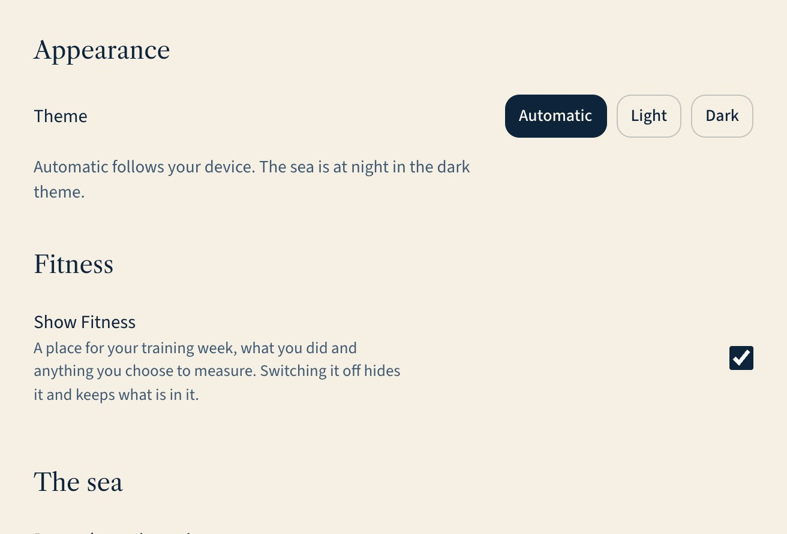

- **Settings** gains a part, "Fitness", between "Appearance" and "The sea", with one switch: "Show Fitness. A place for your training week, what you did and anything you choose to measure. Switching it off hides it and keeps what is in it."
- **The rail** lists Fitness last, after My pages, with a dumbbell. **The phone's bar** has six places with it on and five with it off.
- **Search** offers "Go to Fitness" with it on, and "Switch on Fitness" with it off, which switches it on and goes there.

## 10. Deleting, and Undo

| Deleted | What goes | What stays | Undo |
|---|---|---|---|
| A routine | The routine, and its set sessions that were never started, in every week | Every session started from it, under the name it had | Puts it back |
| A session that is not finished ("Not today") | The session, its ticks and its note | Its routine | Puts it back |
| A finished session | The session | The miles it logged. The log only grows. | Puts it back |
| A line in a session | The line | | Puts it back where it was |
| A line in a routine | The line | Sessions already started keep theirs | None |
| A best or a measure | It, and the value before | | Puts it back |

Switching Fitness off deletes nothing.

## 11. Miles, and the sea

- **A session earns when it is first finished, or not at all.** Finishing it logs 2 nautical miles, dated the day it is finished, unless a session has already logged miles that day. Reopening it takes nothing away, and finishing it again earns nothing.
- So one session a day earns. A second session on the same day, and a session logged late on a day that already has one, are kept and earn nothing.
- A day on which a session earned is a day at sea.
- **A session is not a task.** It is not in the day's count or the week's, it does not change the light or the sea on Home, it does not clear a day, and missing one brings no storm.
- Lines, bests and measures earn nothing.
- The miles a session logs are in the Weekly review's "Miles logged", as every entry in the log is.

## 12. Sample data and earlier saves

- **The sample** gains an invented training week, placed around today as the sample's tasks are: four routines (Strength on two days, Intervals today, Long run, and Stretch with no fixed day), four finished sessions in the last nine days, three bests and one measure, a resting heart rate. No task, habit or log entry is added or changed. The sample's sessions have logged no miles and cannot earn any.
- **Fitness is off in the sample,** so the first run looks as it does today. Switching it on shows the training week.
- **A save from before this piece** opens with Fitness off and nothing lost. If it is still the sample it gains the sample's training week, and if it is the student's own it has none.
- **"Clear everything"** clears the routines, sessions, bests and measures. **The switch stays as it was,** through "Clear everything" and "Reset the sample data".

## 13. Accessibility

- Each part has a heading, in the page's order. An open session's heading takes focus when it opens.
- A line's box is a real checkbox named by its words. A ring on Home is a real checkbox named as training, so it cannot be taken for a habit of the same name: "Training: Intervals, Wednesday 18 November".
- A session's name on Home is a button that says what it does: "Open Intervals in Fitness".
- A ring in "This week" is a picture with words beside it for a screen reader: "Finished" or "Still to come".
- The day buttons in a routine's editor say whether they are on.
- A session's count is read out when it changes.
- On phones every control is at least 44 px tall, and each of the six places in the bar is at least 53 px wide at 320 px.
- Long words in a name, a line, a note or a value wrap, and never push a phone's page sideways.
- The dumbbell is a picture beside a word wherever it appears.

## 14. Done when

- With Fitness off, the rail, the phone's bar, Home and the Weekly review are as they are today, search offers "Switch on Fitness" and nothing else of it, and every existing test passes unchanged.
- Switching it on adds the place to the rail and the bar, and switching it off hides it and keeps everything in it.
- A routine added by name, given days and lines, shows on its days in "This week", and on Home on those days.
- "Start" makes today's session with the routine's lines. Its ticks and its note are still there after a reload.
- Finishing a session logs 2 nautical miles once. A second session finished the same day logs none, and reopening and finishing again logs none.
- A session finished by its ring on Home shows as finished in Fitness, and pressing the ring again reopens it there.
- Changing a routine's lines, or deleting the routine, leaves a session already started as it was.
- A missed session stays unticked, and nothing on Home or the sea changes because of it.
- On a day with nothing set, the day reads "Rest day" and the routine not done for longest is offered first.
- A new best keeps the one before it as "Was". A measure shows its unit, its latest value and the one before.
- The Weekly review shows "Training sessions" with the same count as "This week", only while Fitness is on.
- A save from before this piece opens with nothing lost, and a save edited by hand to hold a routine or a session without its words opens with that one dropped.
- There is no sideways scroll at 320, 375, 390, 768, 1024 and 1440 px with every part at its longest.
- Every part reads correctly in the dark theme, and no new colour is named outside the roles.
- The new rules have unit tests of their own, and the place, Home, the review and the switch have browser tests.

## 15. Limits to know about

- **Sessions logged late earn once.** Three sessions from earlier in the week, all logged on Sunday, earn 2 miles between them.
- **An earlier week's count can change.** It is worked out from the routines as they are now, so changing a routine's days, or deleting a routine, changes the unstarted rows of weeks gone by. Sessions that were started never change.
- **Two routines can share a day.** Each is its own session, and the first one finished that day is the one that earns.
- **A session cannot be set for one day only, or moved.** A routine has its weekdays, and any routine can be started today.
- **Only a set session can be logged late.** A routine done on a day it was not set for, or one with no fixed day, can be logged on the day and not afterwards.
- **Only the value before is kept** for a best or a measure. There is no history to look back on.
- **A line deleted in a routine's editor cannot be undone,** because the editor shuts out the page behind it, where Undo is shown.
- **Home's ring can finish a session that was never opened,** so "finished" means the student says so, as a ticked task does.

## 16. Calls made here, open to change

| Call | Why | The other way |
|---|---|---|
| A session is a `workout` in the saved data | `sessions` is taken by study sessions | Rename the study sessions |
| A set session whose day has passed can still be logged, with "Log it". A routine that was not set for that day cannot. | Training is often done away from the phone, and a habit's past day can be ticked. A set session has a row to log it from, and an unset one has none. | Only today's can be started, or a day to choose on every session |
| "Last done" goes by the day a session is for | It is the date its row shows | The day it was finished |
| Keeping a new best or reading closes the editor and offers Undo | A value typed by mistake would otherwise push the real one out for good | Leave the editor open |
| Today's row reads "Today. 6 lines" | A line is kept as typed, so its first words cannot be shortened into a summary | The mock's summary of the first lines |
| Miles are dated the day a session is finished, and a session earns on its first finish or not at all | The same two rules a task follows, and old weeks cannot be mined for miles | Earn for the day the session was for |
| A session's name on Home starts it if it has not been started | Pressing the name is asking for the session | The name goes to Fitness, where "Start" is |
| A finished session with no line ticked shows no count | "0 of 6" would read as a failure for someone who does not tick lines | Always show the count |
| Lines are changed as a page's list is: press a line, then move it or delete it | Lines need putting in order, and it is a list the app already has | The mock's remove mark on every line |
| A session has a Close mark | To look at the rest of the place without finishing or removing the session | Only "Not today" and "Finish session", as in the mock |
| A week's count is of the whole week | It matches the week's count of tasks on Home | Only the days that have come, as Habits counts |
| A routine is added by typing its name, as a habit is | One box and Enter, then its editor | An empty editor first |
| A best and a measure keep one earlier value | It is what the row shows, and no hidden history of a body's numbers is kept | Keep every reading |
| The review's figure is labelled "Training sessions" | "Sessions" alone could be read as study sessions | "Sessions done" |
| "Clear everything" leaves the switch as it was | The switch says which places are wanted, not what is in them | Off again, with the rest of Settings |
| Search offers "Switch on Fitness" while it is off | Someone looking for it should find it | Settings only |
| The sample has one measure, a resting heart rate | It shows the part without a number about weight or food | No sample measure |
| A routine's days are written as Habits writes them: "Mon, Fri" | The same words for the same thing | "Monday and Friday", as in the mock |
| The "Rest day" row needs a routine with a fixed day | With no fixed days, every day would be called a rest day | Always show it |
| Finishing on Home says nothing, and finishing in Fitness says what was logged | On Home the ring is in view. In Fitness the sheet closes. | The same message in both |
| Up to three sessions on Home | Room on the habits line | All of them |
| The limits: 20 routines, 40 lines, 20 bests, 12 measures | Far more than a student needs, and a save cannot grow without end | Higher, or none |
| The heading says what a session earns | Habits' heading says what a tick earns | The mock's line, which does not mention miles |

**Where the pictures differ from this document.** The rows above say why.

- The routine's editor draws a remove mark on every line, and calls its days "Its days".
- The session has no Close mark.
- Today's row summarises its first lines.
- The list of routines writes days in full, and "Last done Monday".
- The rest day's buttons put Long run before Intervals. By the rule, Intervals was done longer ago and comes first.
- The heading's line does not mention miles.

## 17. Not in this piece

- Sets, reps and weights as numbers, charts, and records worked out, as in section 3.
- Calories and protein by meal.
- A layout for each sport, a watch or another app, and reminders.
- Putting routines in another order. They are listed in the order they were made.
- A session planned for one day to come, or moved to another day.
- A history or a chart of a measure.
- Finding a routine, a session or a best by search. That is piece 5.
- Training in the week strip, in "Coming up" or in the day's count.

## 18. Left to the build

- Exact spacing, within the tokens and the pictures.
- The names of the new functions and files.
- Whether a session's and a routine's lines are the page list's rows made general, or rows of their own that look and behave the same.
- Whether a best and a measure share one editor.
- How the session's sheet arrives and leaves, within the motion system and with reduced motion respected.
- The exact words of a date in a row, within the forms the app already uses.

## 19. As built

Built on 19 November 2026, on the branch `fitness`. Every line of section 14 is met, each by a test. The pictures of the built pages are the numbered files in `screenshots/fitness/`, beside the mocks. What was tested is in [testing-report.md](testing-report.md), section 16.

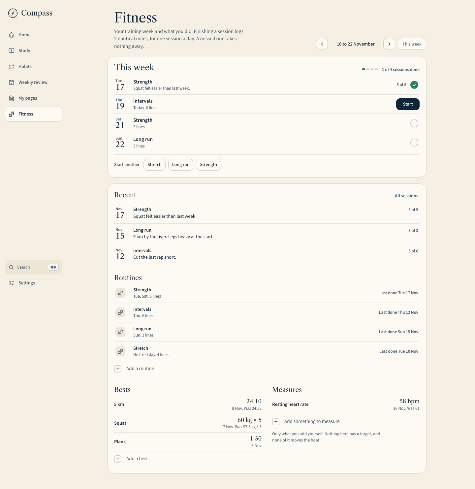

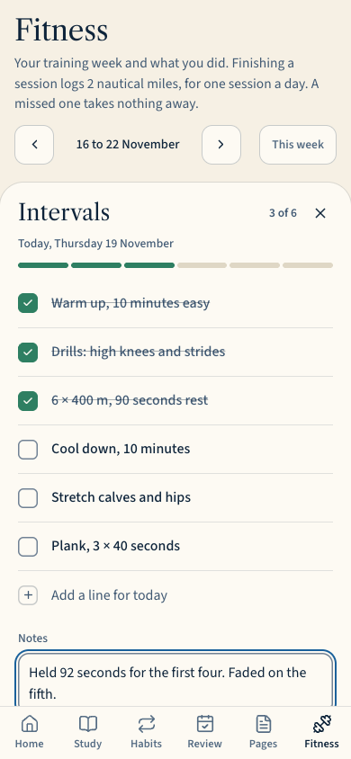

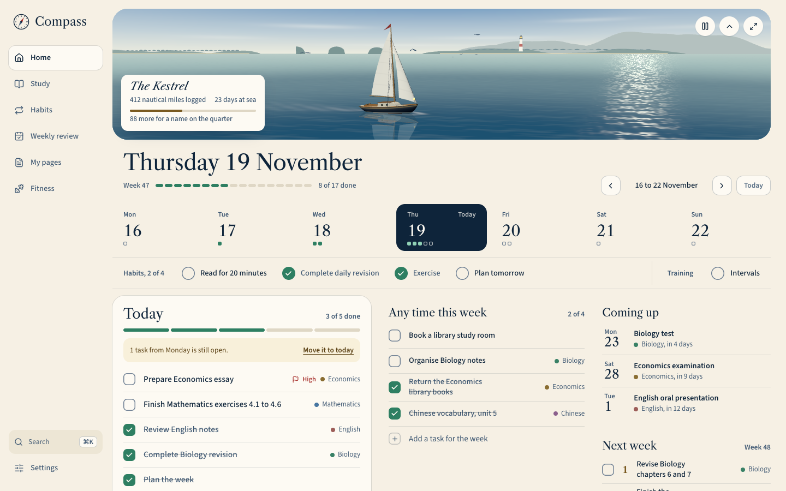

### Where the build differs from this document

| This document | The build | Why |
|---|---|---|
| A save keeps its lists as they are, and section 5 gives each a limit | A list is never cut to its limit when a save is opened. A limit is held where things are added. | Deleting a line at the limit, adding one and pressing Undo leaves one more than the limit. Cutting on the way in would have dropped what was typed. |
| A session's address means Back closes it | It does. Closing a session with a button is then one step back when it was opened from inside the place, and otherwise its address gives way to the place's. Opening a second session while one is open takes its place. | So that Back never reopens a session that was closed, finished or put away |
| Section 6 does not say where focus goes when a session closes | To the session's row in the week, or to the week's heading when it has no row now | A keyboard was left at the top of the page |
| A line is changed "as a page's list is" in a routine's editor | Delete and Backspace on a line do nothing there. The Delete button still removes it. | There is no Undo in the editor, so a stray key should cost nothing. In a session, where a line can be put back, the keys work. |
| The buttons under the week read as the routine's name | They still read so, and are spoken as "Start Stretch" | A name alone does not say what pressing it does |
| The Weekly review gains "a fourth" figure | It is the third of the four, before "Miles logged" | On a phone the four are two rows: tasks and habits over training and miles |
| "All sessions" is beside "Recent" | It shows only when there are more than three finished sessions | With three or fewer there is nothing more to show |

### Calls made in the build, open to change

- A row in the week is spoken as what it opens and where it stands: "Open Intervals, Thursday 19 November. Started, 1 of 6 so far."
- On Home the ring has room of its own for a thumb, because the name beside it is a button and not its label.
- A routine's or a session's lines, and a page's items in My pages, are now the same rows, in `src/ui/ListRows.tsx`.
- New ids start with `rt-` (a routine), `ln-` (a line), `wk-` (a session), `bs-` (a best) and `ms-` (a measure).
- A routine from a save with no day it was made is taken to have been there all along.

### One change that reaches beyond this piece

My pages' list rows were moved into a shared file so that Fitness could use them. My pages behaves as it did, and its own tests pass unchanged. Two things are different there: a long word in an item now wraps, and Escape while changing an item is kept from anything around it.

### The review of the whole change

A fresh reviewer read the whole change against this document before it was committed. What it found, what was fixed and what was left is in the testing report, section 16.

### Found on the way

Home is 21 px wider than a 320 px screen, with or without Fitness: its date and its two round buttons do not fit below about 341 px. It is older than this piece and was left alone. Fitness's own pages fit at 320 px.
