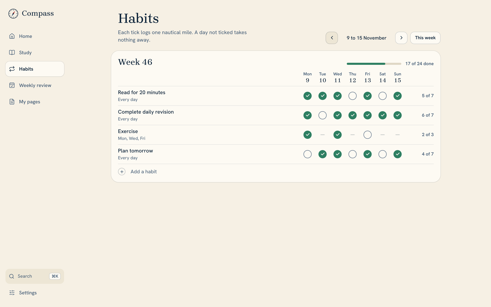
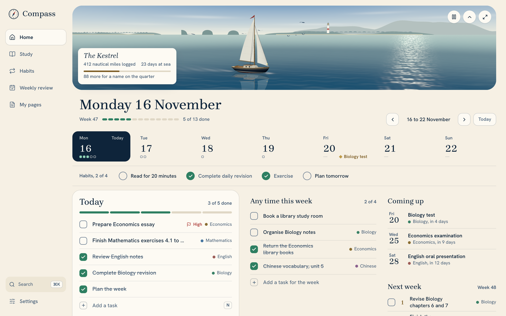
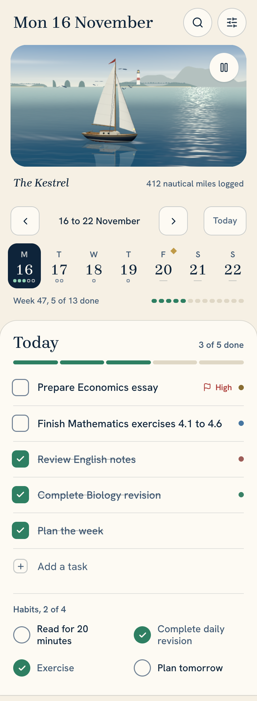

# Habits specification

| | |
|---|---|
| Status | **Built on 16 November 2026, and accepted by Oliver as a first version the same day.** Oliver also decided where habits sit on Home. Josh and Aditya have not reviewed it. |
| Scope | The Habits page, the day's habits on Home, and how habits earn miles |
| Companions | [compass-art-direction.md](compass-art-direction.md), [home-screen-spec.md](home-screen-spec.md), [testing-report.md](testing-report.md) |

## 1. What a habit is

Something to do on most days. It comes back on each of its days, so it is never finished, only ticked for a day.

| | Rule |
|---|---|
| Name | 1 to 60 characters. An empty name is not saved. |
| Days | Every day, or chosen weekdays. At least one. |
| First day | The day the habit is made. Earlier days are not days for it, so a new habit starts with a clean record. |
| Tick | One habit on one day. It can be made on the day or any day after, and removed again. A day still to come cannot be ticked. |

Habits have round ticks. Tasks have square boxes. A ticked habit fades and is not struck through, because it comes back tomorrow.

## 2. What habits never do

- No streak count, anywhere.
- No red, no warning and no reminder for a habit not done.
- A day's habits do not change the sea. The light follows tasks only, so a day of unticked habits can never bring the storm.
- A week in progress is counted only up to today, so it is never marked down for days that have not come.

## 3. Miles

| Action | Miles |
|---|---|
| Tick a habit for a day | 1, once for each habit and day |
| Untick it | Nothing is taken back, and ticking again earns nothing more |
| A tick for an earlier day | Logged on the day the tick is made |
| Daily limit | 8 miles a day from habits, so a long list of habits cannot be farmed |

The one mile comes from the art direction. The limit of 8 is new and is a call the founders can change.

## 4. On Home

Decided by Oliver on 16 November, from the [mock](https://claude.ai/artifact/MqFDefCBQVsYLmYd8JPm3b).

| Width | Where the day's habits sit |
|---|---|
| 1280 px and up | A line of its own between the week and the lists |
| Below 1280 px, tablets and phones included | A two-column grid at the foot of the day's sheet |

- The habits belong to the selected day, like the tasks.
- The count reads "Habits, 2 of 4", and "Habits, all four done" when they are.
- Up to six show. Beyond that, a count that opens the Habits page.
- A day with no habits shows nothing.

## 5. The Habits page

One raised sheet holding the week as a grid: a row for each habit, a column for each day.

| Mark | Meaning |
|---|---|
| Filled round tick | Done |
| Ring | Due, not ticked. It can be ticked. |
| Faint ring | Due on a day still to come. It cannot be ticked yet. |
| Short dash | Not a day for this habit |

- Each row ends with its count for the week, such as "4 of 5". The sheet's header has the count for all habits.
- The week can be moved back and forward. Earlier weeks are the record, and their ticks can still be changed.
- The last row adds a habit: type a name and press Enter. It is for every day until its days are chosen.
- Selecting a habit's name opens its editor, in the same frame as the task editor: name, days, and Delete with Undo. Changes save as they are made.
- On phones each habit's seven days sit under its name, so every tick is a full-size target.

## 6. Sample data

The four habits named in the brief, with three weeks of ticks behind them. Three are for every day. Exercise is for three days a week, one of which is always today, so the first run shows all four with two ticked.

## 7. Not in this version

- A view of consistency across many weeks. The brief asks for weekly consistency summaries; this version gives a count for each habit in each week, one week at a time.
- Reordering habits, and pausing one without deleting it.
- Habits changing the sea. See the open decision in [next-stages.md](next-stages.md).
