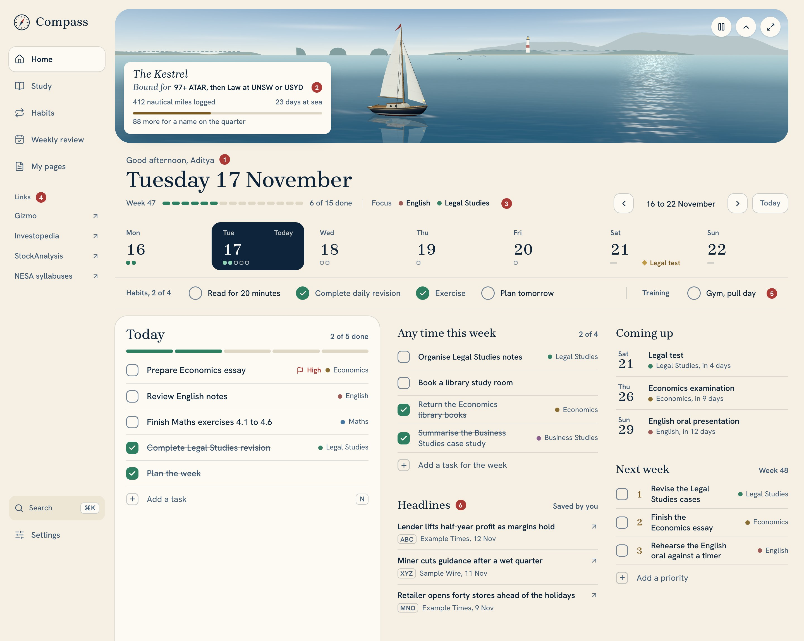
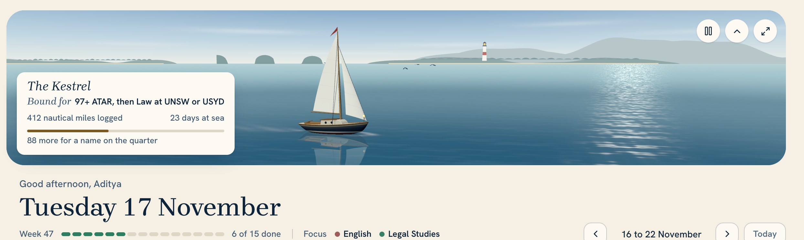
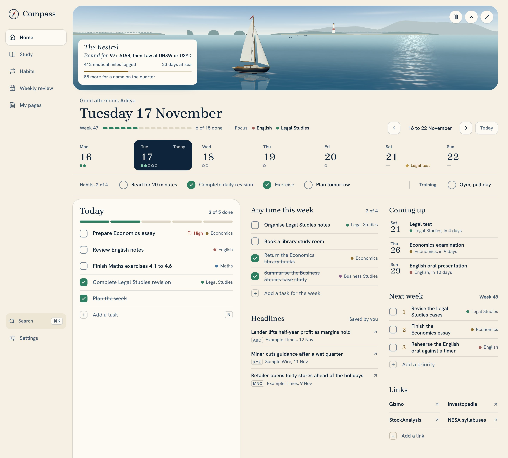
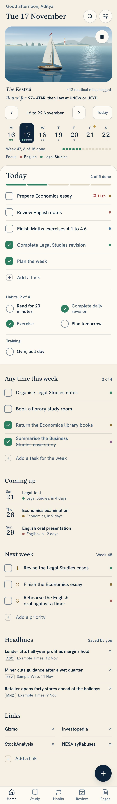
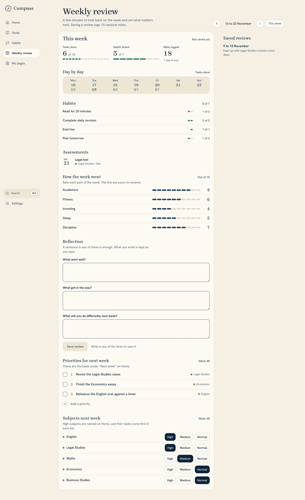
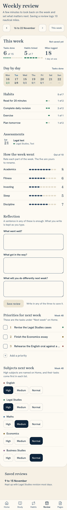
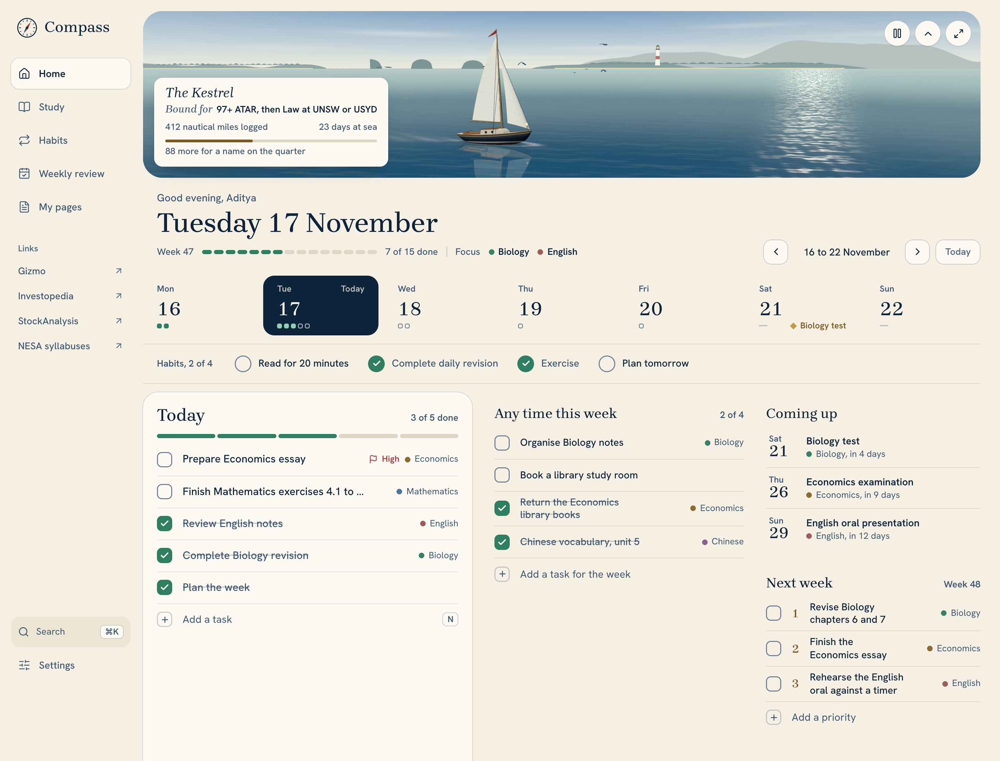
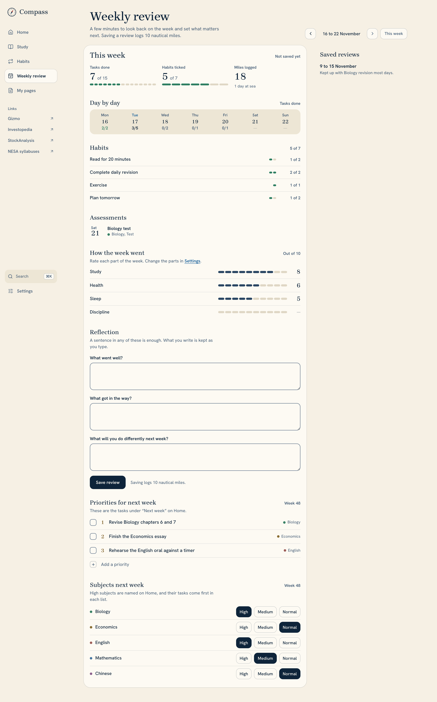

# Home and Weekly review additions: specification

| | |
|---|---|
| Status | **Built on 17 November 2026, as a first version, on the branch `home-review-additions`.** Oliver chose the approach and all six decisions in section 4 from the mock, then approved this document, the same day. Josh and Aditya have not weighed in. The calls in section 12 were made here and are still open to change. Where the build differs from this document is in section 19. |
| Scope | The first piece of Aditya's plan: a greeting, a long-term goal and quick links on Home; ratings and subject priorities in the Weekly review |
| Companions | [compass-master-brief.md](compass-master-brief.md), [compass-art-direction.md](compass-art-direction.md), [home-screen-spec.md](home-screen-spec.md), [review-spec.md](review-spec.md), [study-spec.md](study-spec.md) |
| Mock | [Aditya's Plan in Compass](https://claude.ai/artifact/TzbYHALrhnx46UbYp1KJot), a private page. It needs sharing from its Share menu before Josh and Aditya can open it. |

The picture is a mock, drawn onto the running app. It shows Home once all five pieces of the plan are in. The red numbers are for the mock only. Numbers 1 to 4 are this piece; 5 (training) and 6 (headlines) come later.

## 1. Where this comes from

Aditya wrote a plan for a complete personal planner. The plan itself is kept by the founders and is not in this repository, because the repository is public and the plan is personal. On 17 November Oliver decided how it comes into Compass:

- **Compass keeps its main idea.** The boat, the navy and ivory look, and a planner any student could use all stay. Aditya's extras come in around them.
- **Fitness becomes a place that is switched on.** The brief already lists it as optional.
- **Investing and Law Journey become interests.** An interest is a folder in My pages that holds ready-made forms (a company, a trade, a case, a headline) beside ordinary pages.
- **Not coming in:** the green and cream palette, and emoji icons.
- **Not now:** headlines that refresh by themselves. That would be the first time Compass talks to an outside service, so it gets its own decision.

The work is five pieces, designed and reviewed one at a time:

| Piece | What it holds |
|---|---|
| **1. Home and the Weekly review** | This document |
| 2. Study detail | Current topic, teacher feedback, a revision checklist, past papers, links on tasks and assessments |
| 3. Fitness | The training week, a workout log and measurements, in a place of its own |
| 4. Interests | Investing and Law Journey in My pages, and saved headlines on Home |
| 5. Search and backup | Search across everything, and a full export and import |

Home goes first because every later piece adds something to it, and its layout should be settled once.

## 2. What this piece is for

Compass knows the week. After this piece it also knows three things about the person: where they are headed, which subjects matter most this week, and what they reach for most often. It shows each in one quiet place.

## 3. Goals, and what to stay away from

**Goals**

- A long-term goal that is always in sight, tied to the boat.
- A Sunday habit: rate the week, and say which subjects matter next week. Home then follows that.
- Links to outside sites one click away.
- A new user's Home is unchanged. Nothing here appears until the person sets it.

**Not goals**

- A chart of ratings across weeks.
- A motto that can be changed. The goal line does that job.
- Homework grouped by subject on Home. Study already groups tasks by subject.
- Categories for links.

**What would make this a failure**

- Home reads as a dashboard. The calendar stays the main thing, and nothing added is a card.
- Anything that nags: a reminder to review, a mark for a week not rated, a score.
- The ratings are added up or averaged. The art direction says progress is a voyage and not a score.
- The page jumps when another day is chosen.
- Anything is fetched from another site. Links only open; Compass asks nothing of them.

## 4. Approaches

### How the plan comes in

| | Approach | Trade-off |
|---|---|---|
| A | Everything in My pages, as pages that start with Aditya's headings | Smallest build. No watchlist, no journal that can be sorted, nothing on Home. |
| B | Fitness, Investing and Law Journey as three new places that are switched on | Closest to the plan. The biggest build, and two places most students never open. |
| **C** | **Fitness as a place; Investing and Law Journey as interests in My pages** | Everything in the plan, from parts another student can reuse. Each overview is a folder, not a designed dashboard. |

**Oliver chose C.**

### The six decisions in this piece

Oliver chose the recommended side of each, from the mock.

| | Decision | Chosen | The other way |
|---|---|---|---|
| 1 | Where the long-term goal sits | On the boat's plate, as "Bound for" | Beside the greeting |
| 2 | A greeting on Home | A small line above the date once a name is set | No greeting |
| 3 | Where quick links sit | The rail on wide screens, the foot of Home on narrow ones | The foot of Home at every width |
| 4 | What a High subject does | Named on Home, first in each list, first in Study | Named on Home only |
| 5 | The rating areas | Each person's own, up to six | Aditya's five for everyone |
| 6 | The review's three questions | Keep the ones built | Aditya's wording |

### Where subject levels are kept (my call)

| | Approach | Trade-off |
|---|---|---|
| A | One level on each subject, changed in the review | Simplest. Last week's levels are overwritten, so nothing is kept by week. |
| B | On the review of the week before | Kept by week. But the review's priorities are not kept on the review; they are next week's tasks. Levels would be the odd one out. |
| **C** | **A record for each week they apply to** | Kept by week, and the review edits next week's record the same way it edits next week's tasks. One more list in the save. |

**Built as C**, because the plan asks for levels to be kept by week, and because it lets Study change this week's levels without going through a review.

## 5. Records

New parts of the saved data. Everything stays on the device.

| Record | Fields | Limits |
|---|---|---|
| `settings.name` | The person's name | Up to 30 characters, trimmed. Empty means not set. |
| `boat.boundFor` | The long-term goal | Up to 60 characters, trimmed. Empty means not set. |
| `links` | A list of `{ id, name, url }`, in the order shown | Up to 6. Name 1 to 24 characters. |
| `areas` | A list of `{ id, name }`: the parts of a week that are rated, in order | Up to 6, and may be none. Name 1 to 24 characters. |
| `review.ratings` | Area id to a whole number from 1 to 10 | An area with no entry is not rated. |
| `levels` | Week start to `{ subject id: 'high', 'medium' or 'normal' }` | A subject with no entry has no level. |

**A link's address.** It is trimmed. If it has no scheme, `https://` is put in front. It must then read as an `http` or `https` address, or it is not saved and the field says "That does not look like a web address." A link with no name takes its host as the name, without `www.`.

**Which levels apply to a week.** The record for that week if there is one. Otherwise the latest record for an earlier week, which is then **carried over**. With no record at all, no subject has a level. Entries for a subject that no longer exists are ignored, so Undo on a deleted subject brings its levels back.

**Changing a level** for a week that has no record of its own starts that week's record from the carried one, with the change applied.

**Normal and no level** behave the same everywhere. The difference is only whether it has been chosen.

## 6. Home

### The greeting

- One line above the date: "Good morning, Aditya". Morning is 05:00 to 11:59, afternoon 12:00 to 17:59, and evening the rest, by the device's clock.
- Shown once a name is set, on every width, whichever day is selected. It does not come and go as days are chosen, so the page never jumps.
- Small and muted (15 px, medium weight, the muted text colour). It is not a heading. The date stays the page's heading.

### Bound for

The long-term goal is written as where the boat is headed.

| Width | Where |
|---|---|
| 1024 px and up | A second line on the plate, under the boat's name |
| Below 1024 px | A line under the boat's name beneath the sea window |
| The voyage page | Under the boat's name, above the miles |

- **Lettering.** "Bound for" is in the display face, italic and muted, because it is the voyage speaking. The goal itself is upright in the interface face, semibold, because it is the plan. This is the chart rule in the art direction.
- **Length.** The plate grows to 420 px at most. A longer goal ends in an ellipsis there and is shown in full on the voyage page.
- **Not set:** the line is absent and the plate is as it is today.
- **Folded sea:** the plate is hidden as it is today, and the goal with it, at every width.
- The plate's spoken label gains "Bound for" and the goal.

### Focus

The subjects set to High for the week being viewed, named beside the week's progress.

| Width | Where |
|---|---|
| 640 px and up | On the week's line, after the count: "Week 47, 6 of 15 done" then "Focus", then each subject with its dot |
| Below 640 px | A line of its own under the week's progress, beneath the week strip |

- Up to four subjects are named, in the order of the subject list. More than four ends "and 2 more".
- **Carried over:** when the levels come from an earlier week, the line ends with "from week 45" in the muted colour, naming the week they were set for. Nothing else marks it.
- **No High subject:** the line is absent.
- Medium is not named on Home. It only affects order.
- Read aloud as "Focus: English, Legal Studies". The dots are decoration.

### The order of lists

Open tasks are ordered by the task's own priority, then by its subject's level (High, then Medium, then the rest), then by their order. The level is the one for the week the task falls in. Done tasks are unchanged.

- It applies to the day's list and to "Any time this week".
- A task's own priority wins. A High task in a Normal subject stays above a Normal task in a High subject.
- A task with no subject sorts with the rest.
- The numbered lists do not change: "Next week" on Home and the priorities in the review. Their order is the point.
- Nothing is hidden, and nothing changes colour.

### Links

The picture shows the foot-of-Home layout, which is what narrow screens get. On wide screens the same links sit in the rail, as in the first picture.

| Width | Where |
|---|---|
| 1024 px and up | In the rail, under the five places, under a small "Links" label |
| Below 1024 px | A "Links" section at the foot of Home, after "Next week", in two columns, with "Add a link" as its last row |

- Each link opens in a new tab and carries a small arrow. It is read aloud as "Gizmo, opens in a new tab".
- **In the rail,** the "Links" label goes to the Links part of Settings. **At the foot of Home,** "Add a link" does.
- **No links:** nothing is shown, at any width.
- Compass fetches nothing from a link: no icon, no preview, no check that it works.
- The rail must keep Search and Settings reachable in a short window.

### On a phone

Top to bottom: the greeting, the date, the sea, the boat's name and goal, the week, the focus line, the day's sheet, then the lists, with links last.

### What a new user sees

With no name, no goal, no links and no levels, Home is exactly as it is today.

## 7. The Weekly review

Two parts are added. The summary, the three questions and the numbered priorities stay as built.

### How the week went

- **Where:** between "Assessments" and "Reflection". The aside reads "Out of 10".
- **A row for each area:** its name, ten segments, and the number. A row not yet rated shows empty segments and a short dash.
- **Setting one:** press a segment, or use the arrow keys. Taking it back to nothing clears it. On a phone the segments are narrower and the row is 50 px tall.
- **Colour:** filled segments are deep navy, not seafoam. Seafoam means done, and a rating is not progress.
- **Kept with the review** of that week, as it is set. Rating a week that has no review yet starts one. Older weeks can be rated, as they can be written.
- **No total and no average** is worked out or shown.
- **Under the heading:** "Rate each part of the week. Change the parts in Settings.", where Settings is a link.
- **No areas:** the part is absent.

### Subjects next week

- **Where:** after the numbered priorities, and shown by the same rule: while the week after the one reviewed is this week or later. The review of this week says "Subjects next week". The review of last week says "Subjects this week".
- **A row for each subject,** in the subject list's own order, so rows do not move as levels are pressed: its dot and name, then High, Medium and Normal.
- **Pressing** a level sets it. Pressing the one already set clears it.
- **Under the heading:** "High subjects are named on Home, and their tasks come first in each list."
- **Carried over:** when the levels shown come from an earlier week, a line says "Carried over from week 45."
- **On a phone** the name has a line of its own and the three levels sit under it.
- **No subjects:** the part is absent.

### Saving and miles

- A review can now be saved with something written **or** at least one rating. The hint by the button reads "Write in any of the three, or rate the week, to save it."
- A saved review with ratings and no words is listed with "Rated, nothing written." in place of an excerpt.
- Miles are unchanged: 10 for the first save of this week or last week. Ratings and levels earn nothing.
- Levels are not part of saving. They are a plan for the week ahead, kept as they are set.

## 8. Study

- **The list of subjects** is ordered by this week's levels: High, then Medium, then the rest, each in their existing order. A High or Medium subject shows that word at the right of its row, small and muted.
- **A subject's sheet** gains "This week" with High, Medium and Normal, at the top under the subject's name, which changes this week's level. This is not in the mock. It is here so that a level can take effect today without opening last week's review.

## 9. Settings, and the voyage page

**Settings** gains three parts.

| Part | Holds |
|---|---|
| **You**, first on the page | "Your name". Saved as it is typed. Clearing it removes the greeting. |
| **Weekly review**, after "The sea" | The areas: rename, remove with Undo, move up and down, and add, up to six. Removing an area hides its ratings and Undo brings them back. |
| **Links**, after "Weekly review" | Each link's name and address, remove with Undo, move up and down, and a row to add one, up to six. |

**The voyage page** gains a "Bound for" field under the boat's name field, saved as it is typed, with the line "Where you are headed in the long run. It is shown under the boat's name."

The goal is set with the boat because it belongs to the voyage. The name is set in Settings because it belongs to the person.

## 10. Search

The command menu finds links by name once something is typed. Choosing one opens it in a new tab. It also gains "Add a link", which goes to the Links part of Settings.

## 11. Sample data and earlier saves

- **The sample** has no name, no goal, no links and no levels, so the sample Home is unchanged. It has the four starting areas, and last week's saved review is rated, so the review shows the new part.
- **Starting areas:** Study, Health, Sleep, Discipline.
- **A save from before this piece** opens with no name, no goal, no links, no levels, and the four starting areas. Nothing in it is lost.
- **"Clear everything"** also clears the name, the goal, the links and the levels, and puts the areas back to the starting four.

## 12. Calls made here, open to change

| Call | Why | The other way |
|---|---|---|
| The sample shows nothing new on Home | It keeps "a new user's Home is unchanged" true, and the existing browser tests hold | The sample has a goal and a focus, so the features are seen at once |
| The goal is edited on the voyage page | It belongs to the voyage, beside the boat's name | In Settings, with the name |
| Study can change this week's level | A level set on a Tuesday should be able to show on Tuesday | Levels are only set in the review |
| Links and areas are edited in Settings | One place, and nothing new on Home or the review to learn | Edited where they are shown |
| Up to six links | The rail has room for six | More, with the rest behind "more" |
| The greeting shows on every selected day | The page must not jump | Only when today is selected |
| Levels are kept by week in their own list | See section 4 | On the subject, or on the review |
| No level and Normal behave the same | Three choices are enough | A fourth, "Low", that sorts last |
| Medium is not named on Home | "Focus" should be short | Name it, more quietly |

## 13. Limits to know about

- **A ranked priority can open the week in another place.** Next week's priorities are numbered by hand. When their week arrives they become "Any time this week", which is ordered by priority and now by level. A priority ranked second can sit first if its subject is High. The same already happens today with a task's own priority.
- **"Move up" and "Move down" can appear to do nothing** when the neighbour is in another priority or level. This also happens today.
- **Changing the day the week starts on** moves each week's levels to the new week that holds most of the same days. A Monday week's levels become those of the Sunday week that starts the day before.

## 14. Accessibility

- Each rating is a real slider, named "Academics, out of 10", with arrow keys, Home and End.
- Each level is a button that says whether it is pressed, in a group named for its subject.
- Every link says that it opens in a new tab.
- The greeting, the goal and the focus line are text, and are read before the week strip.
- On phones every new control is at least 44 px tall.
- Nothing new moves. A segment's fill changes over 140 ms, and not at all under reduced motion.

## 15. Done when

- Setting a name shows the greeting at 375, 768 and 1440 px, and clearing it removes the line.
- Setting a goal on the voyage page shows it on the plate at 1440 px and under the boat's name at 390 px.
- Setting English to High for this week in Study names it on Home and puts its open task above a Normal subject's at the same priority.
- Setting a level in this week's review changes next week on Home and not this week.
- A week with no levels of its own shows the earlier ones, marked as carried over.
- A link added in Settings appears in the rail at 1440 px and at the foot of Home at 390 px, and opens in a new tab.
- A review with one rating and no words can be saved, logs its 10 miles once, and keeps the rating after a reload.
- A save made before this piece opens with nothing lost.
- There is no sideways scroll at 375, 390, 768, 1024 and 1440 px.
- The existing unit and browser tests pass unchanged, and the new rules have tests of their own.

## 16. Not in this piece

- A chart of ratings across weeks.
- A reminder to review on Sunday.
- A changeable motto.
- Homework grouped by subject on Home.
- Categories, icons or previews for links.
- Training and headlines on Home. They are in the mock to show where they will sit, and belong to pieces 3 and 4.

## 17. Left to the build

- Exact spacing, within the tokens and the pictures.
- How the rail behaves in a short window, as long as Search and Settings stay reachable.
- Whether the rating is a styled slider or ten buttons, as long as it works by keyboard and by touch and is named as section 14 says.
- The names of the new functions and files.

## 18. Found in the app while mocking

Both are in today's build and are not part of this piece.

- A long assessment title is cut off on the week strip with no ellipsis. "Legal Studies test" showed as "Legal Studie".
- A priority whose title runs to three lines shows a sliver of the third line under "Next week".

## 19. As built

Built on 17 November 2026. Every line of section 15 is met, each by a test. The pictures of the built pages are the numbered files in `screenshots/additions/`, beside the mocks. What was tested is in [testing-report.md](testing-report.md), section 13.

The build follows this document, with these differences and additions:

| Where | This document | As built |
|---|---|---|
| A rating | "Taking it back to nothing clears it" | Also, pressing the segment that is already set clears it, so a phone has a way back to nothing |
| A link's address | Checked, and refused with a message | Checked when the box is left or Enter is pressed, not as it is typed. A refused address stays in the box to be put right, and the link keeps its last good one. |
| Moving an area or a link | "Move up and down" | The first cannot move up and the last cannot move down, so those two buttons are disabled |
| The foot of Home at six links | "Add a link" as the last row | The row reads "Change your links", since a seventh cannot be added |
| "Change the parts in Settings" | A link to Settings | It goes to the top of Settings, not to the areas |
| The name boxes in Settings | Not said | Named by position, "Area 3 name" and "Link 1 address", so the name does not change as it is typed |
| The focus line, read aloud | "Focus: English, Legal Studies" | The same, and a carried-over line ends ", from week 45" |
| A save that was edited by hand | Not said | Its links and areas are checked again when it is opened: only web addresses are kept, each once, six at most |
| The rail in a short window | "Must keep Search and Settings reachable" | They stay in sight at the foot of the rail, and the places and links scroll above them |
| A name or goal that is one long word | Not said | It wraps inside the word, so a phone's page is never pushed sideways |

A fresh reviewer read the whole change before it was committed. What it found, what was fixed and what was left is in the testing report, section 13.

Not checked, as for the rest of the build: a real phone, Safari and Firefox, and a screen reader by ear.

Three small faults in the build before this piece were seen on the way and are not fixed here: the two in section 18, and the page being a few pixels wider than the screen while the week strip slides.
