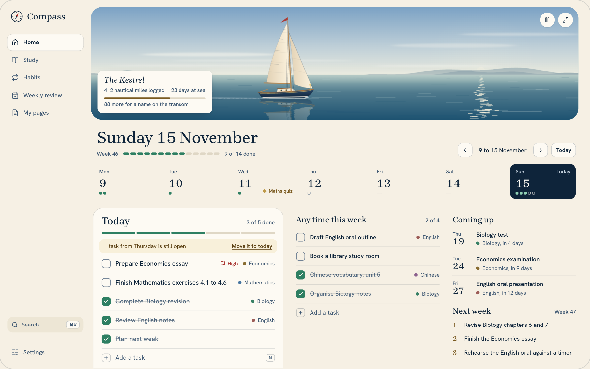
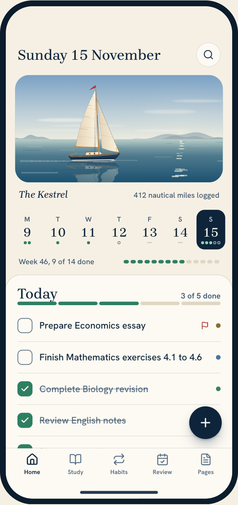

# Home screen specification

| | |
|---|---|
| Status | **Approved by Oliver, 16 November 2026**, together with [compass-art-direction.md](compass-art-direction.md). |
| Date | 15 November 2026 |
| Scope | Phase 1: the Home screen, the sea window, and a first voyage view |
| Assumes | Direction B, Fair weather. If another direction is chosen, sections 3, 11 and 15 are revised. Behaviour in sections 5 to 10 holds for any direction. |



## 1. Purpose

Home has to prove one thing: that the planner and the boat work as one product. The calendar stays the primary tool. The boat is the emotional centre. Neither is allowed to cost the other.

**In scope**

- The app shell: navigation, command menu, toasts.
- Home: sea window, date header, week strip, the day's tasks, tasks for any time this week, upcoming assessments, next week's priorities.
- Tasks: add, edit, complete, reopen, change priority, move, delete with undo.
- Daily and weekly progress.
- The 3D boat and sea, with a still image for loading, reduced motion and no WebGL.
- A first voyage view: the boat at full size, what has been earned, and free colour choices.
- Sample data and local persistence.
- Honest destination pages for Study, Habits, Weekly review and My pages, and a small real Settings page.

**Out of scope**

Accounts, sync, payments, notifications, recurring tasks, habits, reviews, subject pages, drag to reorder, a month view, a dark theme, environments and seasons.

**What would make it a failure even if it works**

- It reads as a dashboard of equal cards.
- The scene slows the planner down or gets in its way.
- Anything makes a user feel worse for missing a day.
- A button that looks real and does nothing.

## 2. Structure

| Route | Page | Phase 1 |
|---|---|---|
| `/` | Home. Selected date in the query string: `/?date=2026-11-15` | Full |
| `/voyage` | The boat experience | First version |
| `/study`, `/habits`, `/review`, `/pages` | Future destinations | A designed page that says what will live there, with the brief's examples as plain text (for Habits: read for 20 minutes, complete daily revision, exercise, plan tomorrow). No fake controls. |
| `/settings` | Settings | Small and real: week start, sea motion, sample data |

The selected date lives in the URL so that back and forward work and a view can be reloaded or shared with oneself.

## 3. Layout

### Desktop, 1440 and up

```
┌─────────┬────────────────────────────────────────────────────────────────────┐
│ ◎ Compass│ ╭────────────────────────────────────────────────────────────────╮ │
│          │ │                    sky                                  ⏸  ⤢  │ │
│ ⌂ Home   │ │                      ⛵                                       │ │ 276
│   Study  │ │ ┌───────────────┐~~~~~~~~~~~~~~~~~~~~~~~~~~~~~~~~~~~~~~~~~~~~~│ │
│   Habits │ │ │ The Kestrel   │                                             │ │
│   Weekly │ │ └───────────────┘                                             │ │
│   review │ ╰────────────────────────────────────────────────────────────────╯ │
│   My     │  Sunday 15 November                    ‹  9 to 15 November  ›  Today│
│   pages  │  Week 46  ▮▮▮▮▮▮▮▮▮▯▯▯▯▯  9 of 14 done                              │
│          │  Mon 9   Tue 10   Wed 11   Thu 12   Fri 13   Sat 14  ┃Sun 15┃      │  86
│          │  ▪▪      ▪        ▪ ◆      ▫        –        –       ┃▪▪▪▫▫ ┃      │
│          │ ╭───────────────────────╮                                          │
│          │ │ Today      3 of 5 done│  Any time this week 2/4   Coming up      │
│          │ │ ▮▮▮▯▯                 │  ☐ Draft English oral…    Thu 19 Biology │
│          │ │ ☐ Prepare Economics…  │  ☐ Book a library…        Tue 24 Econom… │
│  Search  │ │ ☐ Finish Mathematic…  │  ☑ Chinese vocabulary…    Fri 27 English │
│  ⌘K      │ │ ☑ Complete Biology…   │  ☑ Organise Biology…      Next week      │
│  Settings│ │ + Add a task        N │  + Add a task             1  2  3        │
└─────────┴─┴───────────────────────┴──────────────────────────────────────────┘
   216           1.32 fr                    1 fr                     0.86 fr
```

| Measure | Value |
|---|---|
| Rail | 216 px. Compass mark and name, five destinations, then search and settings at the foot |
| Main padding | 16 top, 28 right, 6 left |
| Window | 276 px high, radius 28. 220 px when the viewport is under 820 px tall. Folds to 64 px. |
| Week strip | Seven equal cells, 86 px high, 8 px gaps |
| Columns | 1.32 fr, 1 fr, 0.86 fr with 32 px gaps |
| Maximum width | 1560 px, centred beyond that |

Only the first column is a raised sheet. It runs to the bottom of the viewport like a page. The other two columns sit on the deck.

**Scrolling.** The rail is fixed. Everything to its right scrolls as one page, window included. No list scrolls inside itself, and nothing is sticky on desktop.

**Headings.** The large date is the selected date, not today's. The sheet's title is "Today", "Tomorrow" or "Yesterday" when that applies, and otherwise the weekday and date, such as "Thursday 12".

**Dates.** Phase 1 uses British English and day-before-month dates throughout. Other locales come later.

**Loading.** The planner draws from local data on the first paint, so it has no spinners and no skeletons. The only thing that loads late is the 3D scene, and its still image stands in until then.

### Other widths

| Width | Navigation | Window | Lists |
|---|---|---|---|
| **1280 to 1439** | Rail with labels, 200 px | 240 px | Three columns, same proportions |
| **1024 to 1279** | Rail with labels, 200 px | 240 px | Two columns: the day's sheet, and one column stacking Any time this week, Coming up and Next week |
| **640 to 1023** (tested at 768) | Icon rail, 72 px, with tooltips | 220 px | The day's sheet at full width. Below it, two columns: Any time this week, and Coming up with Next week. |
| **Below 640** (tested at 375 and 390) | Bottom bar, five items | 184 px, 16 px side margins, radius 24 | One column |

### Phone



```
┌──────────────────────────┐
│ Sunday 15 November    🔍 │  date, search
│ ╭──────────────────────╮ │
│ │        ⛵            │ │  window, 184
│ ╰──────────────────────╯ │
│ The Kestrel   412 n mi   │  caption under the window, opens the voyage
│ M  T  W  T  F  S ┃S┃     │  week strip, sticky while scrolling
│ 9 10 11 12 13 14 ┃15┃    │
│ Week 46, 9 of 14  ▮▮▮▯▯  │
│ ╭──────────────────────╮ │
│ │ Today     3 of 5 done│ │  the day's sheet
│ │ ☐ Prepare Economics… │ │
│ │ ☐ Finish Mathemati…  │ │                    (+)  add button, above the bar
│ │ ☑ Complete Biology…  │ │
│ ├──────────────────────┤ │
│ │ ⌂    ▤    ↻    ☑   ▯ │ │  bottom bar: Home, Study, Habits, Review, Pages
└──────────────────────────┘
```

This is a different arrangement, not a smaller desktop:

- The boat's name and miles sit under the window as a text row. Nothing is laid over the scene.
- Search and Settings are two icon buttons at the right of the date, since the bottom bar holds only the five destinations.
- The week strip pins to the top once the window has scrolled away, so the date is always changeable.
- Adding a task is a round button above the bottom bar, within reach of the thumb. It opens a bottom sheet.
- Rows are 54 px high. Every target is at least 44 by 44 px, with at least 8 px between targets.
- The bottom bar, the add button and toasts respect `env(safe-area-inset-bottom)`. The header respects the top inset.
- Other lists follow below the day's sheet in this order: Any time this week, Coming up, Next week.

**Changed at the Phase E review, 16 November.** The wireframe above predates these.

- The phone headline uses the short weekday, "Wed 23 September", because the full weekday wraps beside the two icon buttons. Wider screens keep "Wednesday 23 September".
- The week controls (previous, the week's dates, next, Today) sit under the boat's name and directly above the week strip, so the order is date, sea, boat name, week controls, week strip.
- From 1024 px the day's sheet stretches the height of the lists beside it and runs off the bottom of the page. From 640 to 1023 px, where lists sit under it, it has four rounded corners.

## 4. Component tree

```
AppShell
├─ NavRail  or  BottomBar
├─ CommandMenu
├─ ToastRegion, LiveRegion
└─ HomePage
   ├─ SeaWindow
   │  ├─ BoatPoster        still image, drawn at once
   │  ├─ BoatScene         WebGL, loaded lazily
   │  ├─ VoyagePlate       name, miles, days at sea, next fitting
   │  └─ WindowControls    pause, fold, open voyage
   ├─ DateHeader           date, WeekProgress, WeekNav
   ├─ WeekStrip
   │  └─ DayCell ×7
   ├─ DaySheet
   │  ├─ SheetHeader       title, count, SegmentedProgress
   │  ├─ AssessmentLine    if the day has an assessment
   │  ├─ CarryOverNotice   if earlier tasks are still open
   │  ├─ TaskList → TaskRow
   │  └─ TaskComposer
   ├─ WeekList             "Any time this week"
   ├─ ComingUp → AssessmentRow
   └─ NextWeek → PriorityRow, TaskComposer
TaskEditor                 popover on desktop, bottom sheet on phone
```

## 5. Data

One set of records. Every list on the screen is a view of it. Nothing is copied.

```ts
type ISODate = string;                       // 'YYYY-MM-DD', a local calendar date with no time zone
type Priority = 'high' | 'normal' | 'low';

interface Subject    { id: string; name: string; colour: SubjectColour }
interface Task {
  id: string;
  title: string;                             // 1 to 140 characters after trimming
  notes?: string;
  subjectId?: string;
  priority: Priority;                        // default 'normal'
  scope: 'day' | 'week';
  date: ISODate;                             // the day, or the first day of the week when scope is 'week'
  order: number;                             // position among its siblings
  createdAt: string;                         // ISO timestamp
  completedAt?: string;                      // present means done
  milesAwarded?: true;                       // set the first time it is completed, never cleared
}
interface Assessment { id: string; title: string; subjectId: string; date: ISODate;
                       kind: 'test' | 'exam' | 'presentation' | 'assignment' }
interface LogEntry   { id: string; date: ISODate; source: 'task' | 'day-clear'; sourceId: string; miles: number }
interface Boat       { name: string; hull: HullColour; sail: SailColour; pennant: PennantColour;
                       stage: StageId;       // the boat being sailed, any stage that is unlocked
                       unlocked: string[];   // stage and fitting ids, append-only
                       seen: string[] }      // unlocked ids already shown in the voyage view
interface Settings   { weekStartsOn: 0 | 1; seaPaused: boolean; seaFolded: boolean }
```

### Derived values

Pure functions, unit-tested, with no React in them.

| Function | Returns |
|---|---|
| `tasksForDay(date)` | Day-scoped tasks on that date, sorted |
| `tasksForWeek(weekStart)` | Week-scoped tasks for that week, sorted |
| `allTasksInWeek(weekStart)` | Both of the above for all seven days |
| `progress(tasks)` | `{ done, total }` |
| `dayMarks(weekStart)` | `{ done, total }` for each of the seven days |
| `carryOver(today)` | Open day-scoped tasks dated earlier in the current week |
| `upcomingAssessments(today)` | Assessments in the next 21 days, soonest first, at most four |
| `nextWeekPriorities(today)` | Week-scoped tasks for the week after the current one, sorted |
| `milesLogged(log)`, `daysAtSea(log)` | Totals. Neither can decrease. |
| `stageFor(miles, days)`, `nextFitting(miles, days)` | From the table in the art direction, section 13 |
| `missedDay(date)` | True when that date had day-scoped tasks and none were completed |
| `sceneState(progressOfSelectedDay, { missedYesterday })` | Light, wind, sail, speed and storm values for the window |

**Sorting.** Open tasks come first: high, then normal, then low, and by `order` within each. Completed tasks follow, most recently completed first.

### Storage

- Local storage under the key `compass:v1`, written through Zustand's persist middleware with a schema version and a migration hook.
- If storage is unavailable, the app runs in memory and says so once, in Settings.
- **Sample data** is generated on first run relative to the current week, using the subjects, tasks and assessments named in the brief. It starts the boat at 412 nautical miles and 23 days at sea, so the team sees a sloop mid-voyage. The sample boat has the pennant, lantern, sheer stripe and portlights, which is what 412 miles has earned. Settings can reset the sample or clear everything. Settings also has a clearly labelled prototype tool that sets the sample miles and days at sea, so the team can see fittings and stages arrive without logging weeks of tasks.

## 6. Calendar

| Behaviour | Rule |
|---|---|
| Week | Monday to Sunday by default (ISO 8601). Settings can change the first day to Sunday. |
| Today | From the device clock, local time. Rechecked at midnight and whenever the tab becomes visible. |
| Selected date | From the URL. Defaults to today. |
| Changing week | Keeps the same weekday selected. The strip slides in the direction of travel. |
| Today button | Selects today and returns to the current week. Disabled when already there. |
| Week label | "9 to 15 November". Across months: "30 November to 6 December". Across years the year is added. The ISO week number is shown beside the weekly progress. |

**Day cell.** Weekday, date numeral, then one mark for each day-scoped task: filled when done, outlined when open. Up to six marks, then "+2". A day with no tasks shows a short dash. An assessment adds a brass diamond and a label of at most twelve characters. The label shows from 1280 px, where it fits. From 640 to 1279 px the diamond sits beside the date numeral, and on phones at the top right of the cell.

States: default, hover, focus, selected, today, and today when selected. Each cell is a button. Its accessible name is the whole story: "Sunday 15 November, today, 3 of 5 tasks done, selected".

**Input**

| Input | Result |
|---|---|
| Click or tap a day | Selects it |
| Left and right arrows, with focus in the strip | Previous and next day, counted from the day that has focus. Crossing the end of the week changes week. |
| Home and End | First and last day of the week |
| Page Up and Page Down, or the chevrons | Previous and next week |
| `T` | Today |
| Swipe left or right on the strip (touch) | Next or previous week. The strip follows the finger. |

The strip uses a roving tab index: one tab stop for the group, arrows inside it.

## 7. Tasks

### The row

Checkbox, title, then on the right a priority flag if high and the subject dot and name. On hover or focus the row shows two quiet actions, change priority and edit. On phones the subject name is dropped and the dot stays.

### Add

| Where | How |
|---|---|
| Desktop and tablet | The last row of each list is an input: "Add a task". Type and press Enter. Focus stays for the next one. Escape clears. `N` focuses the composer for the selected day. While it has focus, two small controls appear for subject and priority. |
| Phone | The add button opens a bottom sheet: title, then day (the selected day, or "Any time this week"), subject and priority. The keyboard opens with the sheet. Save adds the task and closes. |

A new task takes the list's scope and date, normal priority and no subject unless set. It appears at the end of the open tasks.

### Edit

Selecting a title opens the editor: a popover anchored to the row on desktop, a bottom sheet on phones.

- Title and notes.
- Subject.
- Priority: high, normal, low.
- When: today, tomorrow, any day of the visible week, any time this week, or next week. This is how a task moves.
- Delete.

Changes save as they are made. Escape or a click outside closes it and returns focus to the row. There is no Save button on desktop. On phones the sheet has Done.

### Complete and reopen

- The checkbox toggles. Space does the same when a row has focus.
- The update is immediate. Nothing waits on storage.
- A completed row stays where it is for 600 ms, so several can be ticked in a row without the list jumping. Then it moves below the open tasks.
- The first completion of a task logs its miles. Reopening it removes nothing. The bonus for finishing a day is logged once for each date.
- The scene follows the day as it stands, so reopening a task moves the light back a step. The miles do not move.

### Priority

Three levels. The flag in the row cycles high, normal, low. `P` does the same for a focused row. The editor sets it directly. A change re-sorts the list.

### Delete

From the editor, or Delete or Backspace on a focused row. The row leaves at once and a toast says "Task deleted. Undo" for six seconds. There is no confirmation dialog.

### Carry-over

When today is selected and earlier days of this week still have open tasks, a notice sits at the top of the sheet:

> 1 task from Thursday is still open. **Move it to today**

With more than one: "3 tasks from earlier this week are still open. Move them to today". Moving shows a toast with Undo. Tasks are never moved automatically, and nothing is marked overdue.

### Rules

- A title is trimmed. An empty title is not saved. The limit is 140 characters.
- Subjects are sample records in Phase 1. A task can be given any existing subject or none. Creating and editing subjects belongs to Study.
- Long titles truncate in the row and show in full in the editor.
- Twenty tasks in a day is fine. The sheet grows and the page scrolls. Lists do not scroll inside themselves.

## 8. Progress

| Measure | Definition | Shown |
|---|---|---|
| **Daily** | Done over total for day-scoped tasks on the selected date | In the sheet header: "3 of 5 done" and a segmented bar |
| **Weekly** | Done over total for every task in the selected week, day-scoped and week-scoped together | Under the date: "Week 46", a segmented bar, "9 of 14 done" |
| **Per day** | Done over total for each day | The marks in each day cell |
| **Any time this week** | Done over total for week-scoped tasks | "2 of 4" beside the list title |

- Bars have one segment per task up to 20, then become one continuous bar.
- A bar is never shown without its words. Colour is not the only signal.
- With no tasks there is no bar. The header reads "Nothing planned".
- Every indicator recomputes from the records on each change. There is no stored progress value.
- A polite live region announces the new daily count after a change: "3 of 5 done".

## 9. Coming up

- Assessments in the 21 days from **today**, soonest first, four at most.
- Each row: weekday and date numeral, title, subject, and how far away it is: "today", "tomorrow", "in 4 days".
- Selecting a row takes the calendar to that date.
- An assessment also shows as a diamond on its day cell, and as a line at the top of that day's sheet: "Biology test today".
- Assessments are sample records in Phase 1 and cannot be edited. Creating them belongs to Study.
- With none: "No assessments in the next three weeks."

## 10. Next week

- Next week's priorities are ordinary week-scoped tasks dated for the week after the **current** one. They are the same records as every other task.
- The list shows the first three, numbered, because their order is the point. "2 more" expands the rest in place.
- Order is the task's `order`. A new priority goes last. The editor has Move up and Move down for these tasks, which is also the keyboard route. Dragging comes later.
- "Add a priority" creates a week-scoped task for next week.
- When that week begins, the same tasks appear under Any time this week with no migration step.
- Coming up and Next week are both anchored to today, not to the selected date, so the right-hand column always describes the real future.

## 11. The sea window

### What it shows

The scene shows the selected day, using the rule in the art direction, section 12.

| Selected day | Scene |
|---|---|
| No tasks planned | In port: moored at a pier, sails furled, people loading supplies |
| Tasks, none done | Dawn, still water, slack sails, the boat idle |
| Some done | Under way from the first task, the day warming toward gold in proportion to the share done |
| All done | Golden hour, full sail |
| The day before was missed | The same day, under a storm that clears in proportion to the share done. A missed day is one that had tasks planned and none completed. A day with nothing planned never shows the storm. |

### Parts

- **Voyage plate**, bottom left on desktop: the boat's name in italic, then upright: "412 nautical miles logged", "23 days at sea", a thin bar, and "88 more for a name on the quarter". When something has been earned since the voyage was last opened, a brass dot and one line such as "New: bow lantern" replace the last line. The whole plate is a button that opens the voyage.
- **Controls**, top right: pause or resume the sea, fold or unfold the window, open the voyage. Each has a text label for assistive technology and a tooltip. The mock above shows only two of the three, and the build has all three.
- On phones the plate becomes a text row under the window, and the controls reduce to pause.
- **As built, 16 November:** the announcement is built as described, with the name in italic. Several fittings at once read "New: bow lantern and 1 more". A new boat reads "The cutter is ready". On phones the line replaces the miles in the text row. The boat wears only the fittings that have been earned.

### Loading and fallback

1. The window's box is reserved in the layout from the first paint. Nothing shifts.
2. `BoatPoster`, an SVG drawn from the same boat measurements and light table, appears at once.
3. The 3D code is a separate chunk, requested after the planner is interactive.
4. When the first frame is ready the canvas fades in over the poster in 400 ms.
5. If WebGL is missing or the context is lost, the poster stays. The planner is unaffected. The poster still changes with progress.

### Performance

| | High tier | Low tier |
|---|---|---|
| Chosen when | Desktop and laptop by default | Touch devices, or after the frame time stays above 22 ms for two seconds |
| Device pixel ratio | Up to 2 | Up to 1.5, falling to 1 |
| Water mesh | 128 by 128 | 64 by 64 |
| Boat reflection | Half-resolution pass of the boat only | A mirrored copy of the boat under the surface, with no extra pass |
| Shadow | One 1024 map | A soft dark patch on the water under the hull |
| Frame rate | Display rate | Capped at 30 |

- Rendering stops when the window is off screen, folded, or the tab is hidden.
- **As built, 16 November:** both tiers exist and the scene sleeps when unseen. The table above differs from the build in three places (the water has no mesh, both tiers mirror the boat, the high tier's shadow map is 2048 px), and the low tier also drops to one device pixel if it still cannot keep up. The budgets below are met: 17 to 32 draw calls and 11,000 to 36,000 triangles a frame. Details and measurements are in [testing-report.md](testing-report.md), section 5.
- Budgets: at most 60,000 triangles and 40 draw calls. The 3D chunk loads after first interaction is possible. Everything else, including React, the router and Motion, stays under 200 kB compressed.
- **Phone pass bar:** the low tier holds 30 frames a second with the processor throttled four times in Chrome, and is then checked by a founder on a real phone. Both results go in the testing report.

### Reduced motion and pause

With `prefers-reduced-motion: reduce`, or when paused, the scene renders one still frame per state and re-renders only when the state changes. Changes cross-fade in 200 ms. Pause is remembered in Settings.

### The completion moment

Ticking a task: the box fills and the tick draws, the title is struck through, one segment fills, and the scene begins easing to its new light and wind over 1.6 s. If it was the day's last task, the sun settles, the pennant streams, and two or three gulls cross. No confetti, no sound, no pop-up.

### Accessibility

The scene is one image to assistive technology. Its label is rewritten when the state changes: "The Kestrel, a sloop, under sail in clear daylight." It is not announced, because the progress count already is.

## 12. The voyage

A first version, enough to show how the boat system works.

- The scene at full height, opening on the same side-on view as the window. Drag turns the boat up to 35 degrees either way and it eases back.
- **Your boat:** name (editable), stage, miles logged, days at sea, and progress to the next fitting and the next stage.
- **Fittings:** earned ones marked, upcoming ones listed with their distances.
- **Colours:** hull, sail and pennant, six swatches each. A change applies at once and is saved.
- **Look ahead:** view the dinghy, sloop, cutter or schooner. A boat not yet earned is labelled as a preview and is not selectable as yours.
- Escape or Back returns to Home with focus on the plate.

On desktop the details sit in a panel beside the scene. On phones they sit in a sheet that can be pulled up over it.

## 13. Required interactions

The thirteen from the brief, and how each is done.

| # | Interaction | Pointer or touch | Keyboard | Feedback |
|---|---|---|---|---|
| 1 | Switch week | Chevrons, or swipe the strip | Page Up, Page Down | Strip slides, label and weekly progress update |
| 2 | Select a date | Click or tap a day | Arrows, Home, End, `T` | Cell fills navy, sheet and scene change |
| 3 | View daily tasks | Always visible for the selected day | | |
| 4 | View weekly tasks | "Any time this week" | | |
| 5 | Add a task | Composer row, or the add button on phones | `N`, then Enter | Row appears, counts update |
| 6 | Edit a task | Click or tap the title | Enter on a focused row | Editor opens, changes save as made |
| 7 | Complete or reopen | Checkbox | Space | Tick, strike-through, segment, scene |
| 8 | Change priority | Flag in the row, or the editor | `P` | Flag appears, list re-sorts |
| 9 | Daily progress | Sheet header | | Recomputed on every change |
| 10 | Weekly progress | Under the date | | Recomputed on every change |
| 11 | Upcoming assessments | "Coming up", day cell diamonds | | Selecting one goes to its date |
| 12 | Next week's priorities | "Next week" | | Numbered list |
| 13 | Open the boat | Voyage plate, or the expand control | `V`, or the command menu | Voyage view |

### Shortcuts

| Key | Action |
|---|---|
| Cmd or Ctrl and `K` | Command menu |
| `N` | New task on the selected day |
| `T` | Today |
| `V` | Open the voyage |
| Arrows, Home, End, Page Up, Page Down | Calendar, as above |
| Space, Enter, `P`, Delete | On a focused task row |
| Escape | Close the editor, sheet or menu |
| `?` | Show this list |

Single-letter shortcuts are off while typing in a field, and hints for them appear where they help, such as `N` on the composer.

## 14. Animation

| What | Duration | Curve | Reduced motion |
|---|---|---|---|
| Checkbox fill and tick | 140 ms | ease-out | Instant |
| Title strike-through | 180 ms | ease-out | Instant |
| Progress segment fill | 200 ms | ease-out | Instant |
| Completed row moves down | 320 ms, after a 600 ms hold | ease-in-out | No movement. The list re-sorts on the next change of day. |
| Row added or removed | 200 ms in, 150 ms out | ease-out | Fade only |
| Week change | 320 ms slide | ease-in-out | Cross-fade, 150 ms |
| Popover and toast | 200 ms in, 150 ms out | ease-out | Fade only |
| Bottom sheet | Spring, no overshoot, follows the finger | | Fade only |
| Window fold | 320 ms | ease-in-out | Instant |
| Scene state change | 1,600 ms | Critically damped | Cross-fade of still frames, 200 ms |
| Canvas over poster | 400 ms | ease-out | 200 ms |

Everything is interruptible. A second action during a transition retargets it.

## 15. Accessibility

- **Structure.** Landmarks for navigation and main. One `h1`, the date. `h2` for each list. Lists are real lists.
- **Controls.** Checkboxes are native inputs with the task title as their label. Day cells, the plate and every icon control are buttons with accessible names.
- **Focus.** Visible on everything, 2 px marine ring. Order follows reading order: navigation, window controls, date and week controls, strip, the day's sheet, the other lists. Opening an editor moves focus into it. Closing returns focus to where it came from.
- **Announcements.** A polite live region for progress changes and toasts.
- **Contrast.** All text at 4.5:1 or better, control borders and graphics at 3:1 or better. The measured table is in the art direction, section 5.
- **Colour.** Never the only signal: done has a tick and a strike-through, priority has a word, subjects have names, assessments have labels.
- **Targets.** At least 44 by 44 px on touch, at least 24 by 24 px with a pointer.
- **Zoom.** Usable at 200% and reflows at 320 px wide with no sideways scrolling.
- **Motion.** `prefers-reduced-motion` is honoured throughout, and the sea has its own pause control.
- **Text.** Sizes are in rem. Nothing below 12.5 px. Inputs are 16 px on touch.

## 16. States

| State | What the user sees |
|---|---|
| First run | Sample data, the sloop at 412 miles. Settings offers to reset or clear it. |
| Day with no tasks | "Nothing planned for Saturday. Add a task, or spend the day in port." The scene is in port. |
| Day complete | "All five done." Golden hour. |
| Week with no tasks | The strip shows dashes. No weekly bar. |
| No upcoming assessments | "No assessments in the next three weeks." |
| No priorities for next week | "Nothing set for next week yet." and the composer |
| A very long title | Truncated in the row, full in the editor |
| WebGL unavailable | The still image, which still follows progress |
| Storage unavailable | Works in memory. A note in Settings. |
| Midnight passes with the app open | Today moves on. The selected date stays where the user left it. |

## 17. Engineering

### Files

```
src/
  app/          shell, routes, providers
  design/       tokens.css, fonts, motion constants, icons
  domain/       types, dates, tasks, progress, voyage, seed     pure, unit-tested
  state/        store, selectors
  ui/           Button, Checkbox, SegmentedProgress, Sheet, Popover, Toast, Kbd, CommandMenu
  features/
    home/       HomePage, DateHeader, WeekStrip, DayCell, DaySheet, TaskRow, TaskComposer,
                TaskEditor, WeekList, ComingUp, NextWeek
    voyage/     SeaWindow, VoyagePlate, VoyagePage, BoatPoster
                scene/   Scene, Boat, parts, Sea, Sky, light, waves      lazy chunk
    places/     Study, Habits, Review, Pages, Settings
tests/e2e/      Playwright
prototypes/     compass-intro.html, compass-boat.html     moved here unchanged
```

The two existing prototypes are kept exactly as they are and moved into `prototypes/`, with the README updated to match.

### Order of work

Riskiest first.

1. Scaffold, tokens, fonts, the shell and its routes.
2. **The 3D sloop and sea on their own, then a look review with the founders.** The rest waits on this.
3. Domain functions and the store, with unit tests.
4. Home layout and components at 1440.
5. The window joined to the planner: poster, lazy scene, states, pause, fold.
6. The voyage view.
7. Responsive pass at 375, 390, 768 and 1024.
8. Accessibility pass.
9. Playwright suite and screenshots at all five widths.
10. Visual refinement against the art direction.

### Tests

- **Unit (Vitest):** week maths across month and year ends, sorting, progress, carry-over, next-week selection, miles and days at sea never decreasing, stage gates, the award-once rule.
- **End to end (Playwright):** each of the thirteen interactions; persistence across reload; undo; keyboard-only completion of a task; no horizontal overflow at the five widths; no console errors; the window without WebGL; reduced motion.

### Acceptance

Home is done when every line of the brief's section 11 has been checked in a browser and recorded in the testing report, not when it runs.
