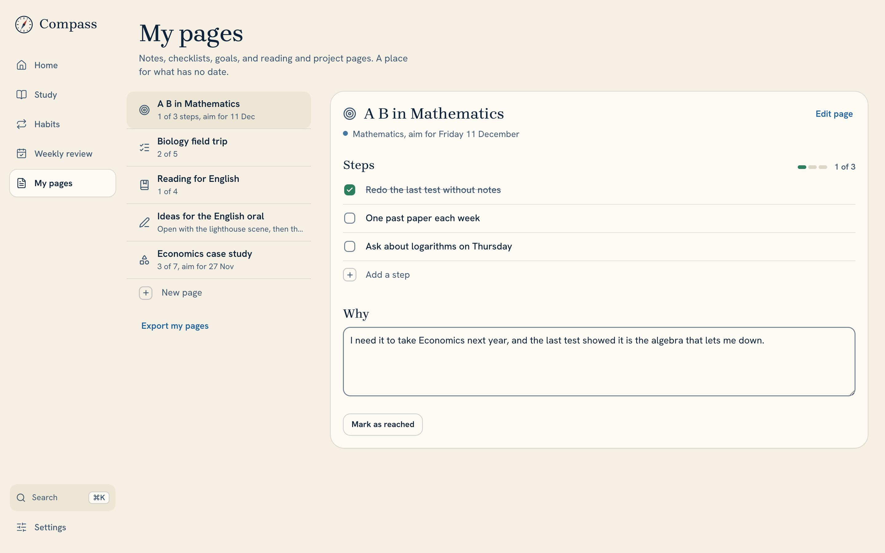
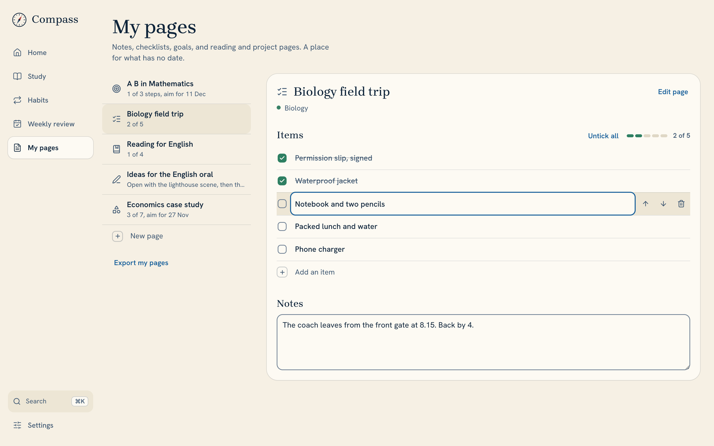
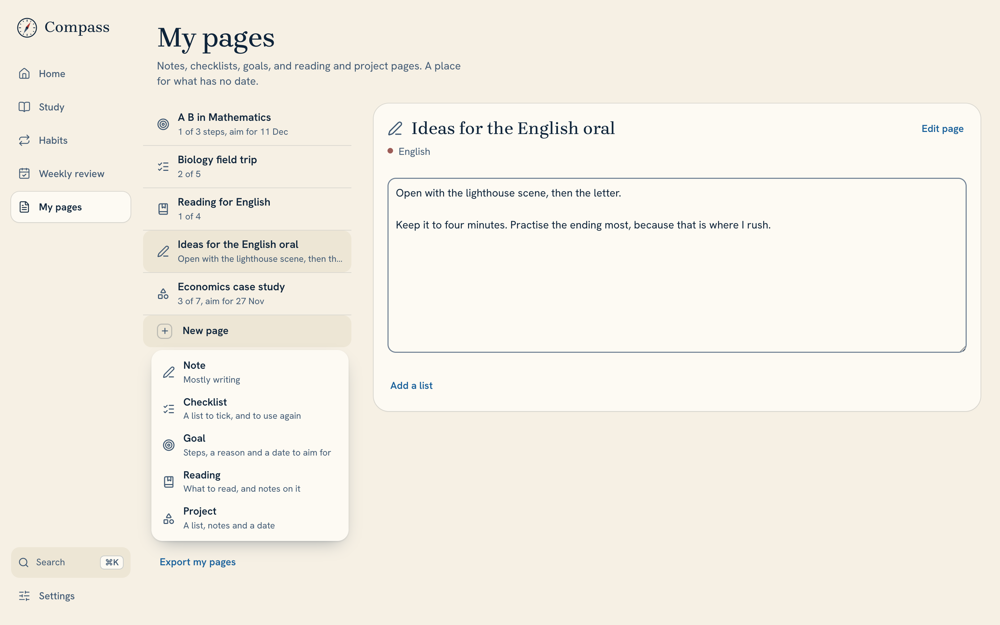

# My pages specification

| | |
|---|---|
| Status | **Built on 17 November 2026, as a first version.** Oliver chose approach B, the layout and the smaller square tick the same day, from this document and its mock. Josh and Aditya have not weighed in. Six decisions in section 10 were built to their recommendations and are still open. Where the build differs from this document is in section 13. |
| Scope | The My pages destination at `/pages`: the brief's personal notes, checklists, goals, and reading and project pages |
| Companions | [compass-master-brief.md](compass-master-brief.md), [home-screen-spec.md](home-screen-spec.md), [study-spec.md](study-spec.md), [next-stages.md](next-stages.md) |
| Mock | [My pages mock](https://claude.ai/artifact/NPCbrcPSUbkeHzv3q9UXu7), a private page: the layout, a goal, a checklist, and three options for a list's tick. It needs sharing from its Share menu before Josh and Aditya can open it. |



The picture is the built page. The mock it was built from is kept beside it in `screenshots/pages/`, as the files named `mock-`.

## 1. What My pages is for

The brief gives it four lines: personal notes, checklists, goals, and reading and project pages. It gives no more than that, so most of this document is a proposal.

Everything else in Compass is tied to a date: a task has a day or a week, a habit has its days, an assessment has its date, a review has its week. **My pages is the place for what has no date:** the packing list, the books for English, the plan for a project, the thing you want to get better at this term. The brief's own description of the problem is that these end up "scattered across different applications". This is where they would live instead.

It is the last of the five destinations, and the only one still showing "Not built yet".

## 2. Goals, and what to stay away from

**It should**

- Let someone start a page in a few seconds and write in it straight away.
- Cover the brief's four lines with real behaviour: a checklist that ticks, a goal that can be reached.
- Feel like the rest of Compass: one raised sheet, plain words, nothing lost by leaving a page.
- Stay small enough to build in one stage, like Habits and Study.

**It should not try to be**

- A document editor. No headings, bold, tables, images or attachments in the first version.
- A filing system. No folders, no pages inside pages, no tags.
- A second task list. Section 6 is about keeping that line clear.

**It would have failed if**

- A checklist item and a task became two copies of the same thing to keep in step.
- A goal turned into pressure: a percentage that sits at 20%, a date that turns red, a count of days behind. The brief rules out that kind of pressure for tasks and habits, and the same holds here.
- Miles could be earned by typing trivial items and ticking them.

## 3. Approaches

Four ways to build it were considered. They differ in what a page is.

### A. Every page is a note

A page is a title and one box of plain text. A checklist is lines of text. A goal is a note with "Goal" in its title.

- **For:** the smallest build, perhaps a third of a stage. Nothing to learn.
- **Against:** it does not deliver two of the brief's four lines. A checklist that cannot be ticked is not a checklist, and a goal is not different from a note.

### B. One page shape, five ways to start (recommended)

Every page has the same parts: a title, a checklist, a box of writing, and an optional date. Starting a page as a note, a checklist, a goal, a reading page or a project page decides which part comes first, what the parts are called, and its icon. A note is mostly writing. A checklist is mostly its list. A goal has steps, a "why" and a date to aim for. Any page can still use every part.

```
 Note                    Checklist               Goal
 ┌───────────────────┐   ┌───────────────────┐   ┌───────────────────┐
 │ Ideas for the     │   │ Field trip        │   │ Chemistry to a B  │
 │ English oral      │   │ 2 of 5            │   │ Aim for 11 Dec    │
 │                   │   │ ☑ Permission slip │   │ Steps  1 of 3     │
 │ Open with the     │   │ ☑ Waterproof      │   │ ☑ Redo the test   │
 │ lighthouse scene… │   │ ☐ Notebook        │   │ ☐ Past paper      │
 │                   │   │ ☐ Lunch           │   │ ☐ Ask about moles │
 │ + Add a list      │   │ + Add an item     │   │ Why               │
 │                   │   │ Notes             │   │ I need it for…    │
 └───────────────────┘   └───────────────────┘   └───────────────────┘
```

- **For:** all four of the brief's lines are real. One set of records, one editor and one layout to design and test. A page can grow: a note gains a list without becoming a different thing.
- **Against:** a page has one list and one box of writing, in a fixed order. A project that wants three separate lists has to use three pages or one long list.

### C. Pages made of blocks

A page is a title and any number of blocks in any order: writing, a checklist, a heading. This is how Notion and similar tools work.

- **For:** the most flexible. Three lists on one page is easy.
- **Against:** it needs controls to add, move and remove blocks, on a phone as well, and it is the kind of editor people already have elsewhere. Roughly twice the build of B, most of it in the editor and not in anything particular to Compass. It also pulls toward the document editor that section 2 says to stay away from.

### D. Five purpose-built kinds of page

Each kind has its own fields and layout: a reading page with authors and pages read, a goal with measurements, a project with milestones.

- **For:** each kind can be exactly right for its job.
- **Against:** five designs, five editors and five sets of tests. It also fixes in advance what a student's reading list or project must look like, which is the least known thing here.

### Decided

**B, chosen by Oliver on 17 November.** It was the recommendation. It is the smallest approach that meets the brief in full. It also keeps the option of C open: a page with one list and one box of writing can later become a page with several, without changing the records already saved. The rest of this document assumes B.

## 4. A page

| Part | Rule |
|---|---|
| Title | 1 to 80 characters. A new page is named "Untitled" until it is given one. |
| Kind | Note, checklist, goal, reading or project. It can be changed afterwards. It sets the icon, the order of the parts and their names, and nothing else. |
| List | Items that can be ticked. 0 to 200 items, each up to 140 characters. |
| Writing | Plain text, up to 20,000 characters. Kept as it is typed, like a subject's notes. |
| Date | Optional, and offered on goals and projects. "Aim for 11 December". It is never shown in red and nothing happens when it passes. |
| Subject | Optional. Shows the subject's dot beside the title. |
| Reached | Goals only. Marking a goal as reached keeps it, moves it below the open pages, and dates it. It can be reopened. |

What each kind starts with:

| Kind | First | Then | The list is called |
|---|---|---|---|
| Note | Writing | List, hidden until asked for | List |
| Checklist | List | Notes | Items |
| Goal | Date and steps | "Why" | Steps |
| Reading | List | Notes | To read |
| Project | Date and list | Notes | To do |

## 5. The list on a page

- **Adding:** type and press Enter, as for a task. The next item can be typed straight away.
- **Ticking:** an item stays where it is when ticked. The order of a packing list or a set of steps is part of its meaning, so ticked items do not sink to the bottom as tasks do.
- **Changing:** select an item to edit its words in place. Move it up or down with the same buttons the task editor uses. Delete it, with Undo.
- **Count:** "2 of 5" beside the list's name, with the same segmented bar as a day's tasks. No percentage.
- **Clearing:** "Untick all" on a checklist, so a packing list can be used again.

## 6. Pages and the rest of Compass

This is the part most worth a founder's attention. The proposal is that **My pages stands apart in the first version.**

- **An item is not a task.** It has no day, does not appear on Home, does not count in a day's progress, and does not move the light or the sea.
- **No miles.** Ticking an item earns nothing, and neither does making a page or reaching a goal. Items cost nothing to invent, so miles for them would be miles for typing.
- **Nothing on Home.** A goal's date does not appear under "Coming up", which stays for assessments.
- **Nothing in the Weekly review.**
- **The command menu finds pages by title,** so any page is two keystrokes away from anywhere.

The reason is the rule the rest of the app follows: one set of records, and no second copy of anything. A step on a goal that was also a task on Tuesday would be one thing in two places.

**The natural second version** is a way to send an item to a day. It would become a real task, and the item would show that task's tick, the way a study session's task is one record seen in two places. That is where pages would start to earn miles, honestly, through tasks. It is left out of the first version because it is a design of its own.

## 7. Layout

The same as Study, so there is one pattern to learn.

- **From 1024 px:** the pages listed on the left, the open page as a raised sheet on the right. With no page chosen, the most recently changed one is open.
- **Below that:** the list first. A page opens on its own at `/pages/:pageId`, with "All pages" to go back.
- **The list:** each row has the kind's icon, the title, and one line beneath: the list's count, the date to aim for, or the first words of the writing. Most recently changed first. Reached goals sit below a "Reached" line.
- **Starting a page:** one "New page" control that offers the five kinds. The new page opens with its title ready to type.
- **Filtering:** a row of the five kinds above the list, shown once there are more than eight pages.
- **Deleting a page:** from the page, with Undo, as everywhere else.

```
 ┌──────────────────────┐  ┌──────────────────────────────────────────────┐
 │ My pages             │  │ ◎ Chemistry to a B              Edit page    │
 │ + New page           │  │ Aim for Friday 11 December                   │
 │                      │  │                                              │
 │ ◎ Chemistry to a B   │  │ Steps                              1 of 3 ▮▯▯│
 │   1 of 3, 11 Dec     │  │ ☑ Redo the last test without notes           │
 │ ☑ Field trip         │  │ ☐ One past paper a week                      │
 │   2 of 5             │  │ ☐ Ask about moles on Thursday                │
 │ ▤ Reading for English│  │ + Add a step                                 │
 │   1 of 4             │  │                                              │
 │ ✎ Ideas for the oral │  │ Why                                          │
 │   Open with the…     │  │ ┌──────────────────────────────────────────┐ │
 │                      │  │ │ I need it for the course next year.      │ │
 │                      │  │ └──────────────────────────────────────────┘ │
 └──────────────────────┘  └──────────────────────────────────────────────┘
```

## 8. Sample data and the empty state

- **The sample** has five pages, one of each kind, so the list is not empty on first opening: a note for the English oral, a checklist for a Biology field trip, a goal for Mathematics, a reading page for English, and a project page for an Economics case study. These are the pages in the mock. Their words are placeholders for the founders to change.
- **With no pages:** one sentence saying what My pages is for, and the five ways to start.
- **"Clear everything" in Settings** removes pages with the rest.

## 9. Limits to know about

- **Storage.** Everything is kept in the browser, which allows about 5 MB for the whole app. The limits in section 4 hold a page to about 50 kB at the very most, and a typical page is well under 2 kB. Hundreds of pages fit. Images would not, which is one reason they are left out.
- **No sync and no backup.** A page exists on one device and in one browser, like everything else in the prototype. For writing someone cares about, that matters more than it does for last week's ticks. An "Export my pages" control that saves them as a text file would be cheap, and is worth deciding on (section 10).
- **Plain text only.** Web addresses in the writing are not links in the first version.

## 10. Decisions for the founders

In order of how much they change what gets built.

| # | Decision | Recommendation | The other way |
|---|---|---|---|
| 1 | What a page is | **Decided by Oliver on 17 November: B,** one shape, five ways to start | A, C or D in section 3 |
| 2 | Do items earn miles or move the sea? | **No.** Pages stand apart in the first version. | A mile for each item, capped, as for habits |
| 3 | Should an item be able to become a task? | **Later,** as the second version | Build it now, which roughly doubles the stage |
| 4 | Does a goal have anything a checklist does not? | **A date to aim for, a "why", and being reached** | Also a number to track, such as a grade or pages read |
| 5 | What does reaching a goal do? | **Marks it and keeps it.** Nothing for the boat yet. | A flag or pennant for the boat, designed with Stage 7 |
| 6 | Does a page with a subject show on that subject's Study page? | **Not yet.** It only carries the subject's dot. | List a subject's pages on its Study page |
| 7 | Is a list's tick square like a task's, or its own shape? | **Decided by Oliver on 17 November: square, and smaller,** with no priority flag | A third shape, after the square for tasks and the round for habits |
| 8 | An "Export my pages" control | **Yes,** as a plain text file | Leave it until accounts and sync |
| 9 | The words: is "Reached" right for a goal, and are the five names right? | **As written** | The founders' own words |

Decision 7 is a visual one, and so is the layout in section 7. Both were shown in the [mock](https://claude.ai/artifact/NPCbrcPSUbkeHzv3q9UXu7), which drew the tick three ways. **Oliver chose the layout as mocked and the smaller square on 17 November.** Decisions 2 to 6, 8 and 9 were built to their recommendations and are still open.

## 11. Not in the first version

- Headings, bold, links, images and attachments.
- Folders, tags, pinning and archiving.
- More than one list on a page.
- Items that become tasks.
- Drag to reorder.
- Sharing a page.
- Any effect on miles, the sea, Home or the Weekly review.

## 12. Left to the build

These follow the rest of the code and do not need a decision.

- Pages are one more list in the saved data, with rules as pure functions in `src/domain/pages.ts` and unit tests written first.
- The page reuses the Study page's layout and the shared editor frame, and the list's rows reuse the task row's ticking where they can.
- Browser tests cover each kind, ticking, editing and moving items, deleting with Undo, the phone flow, and a reload.

## 13. As built

The build follows this document. These are the places where it differs or adds detail.

| This document or the mock | The build |
|---|---|
| The five kinds float above the "New page" row | They open below it, in the flow of the list, so they never cover the pages or leave the screen on a phone |
| "Untick all" on a checklist | It appears only while something is ticked, and offers Undo |
| An item is edited "in place" | Selecting its words turns them into a box in the same row, with buttons to move it up, move it down and delete it. Enter or leaving the row saves; Escape does not. |
| Export is not placed | "Export my pages" is at the foot of the list of pages. It saves one text file, `compass-pages-` and the date. |
| The date is "offered on goals and projects" | The date box is in the page's editor for those two kinds only. A page changed to another kind keeps its date out of sight, and shows it again if it is changed back. |
| Nothing on what a change does to the list | Any change to a page moves it to the front of the list, including a tick |
| A page with a subject | If the subject is deleted, the page is kept without one, and Undo gives it back |
| On a keyboard | On an item, Space ticks it and Delete removes it, as for a task |




