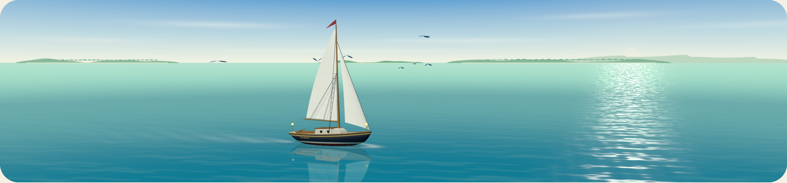
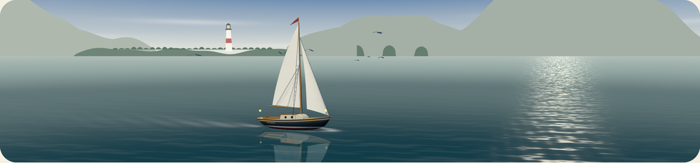
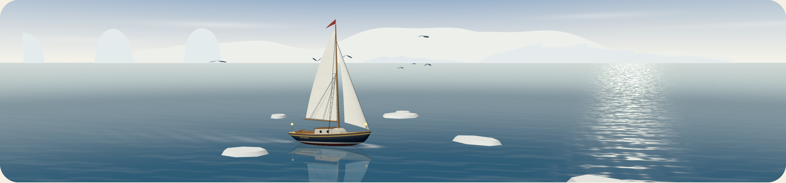
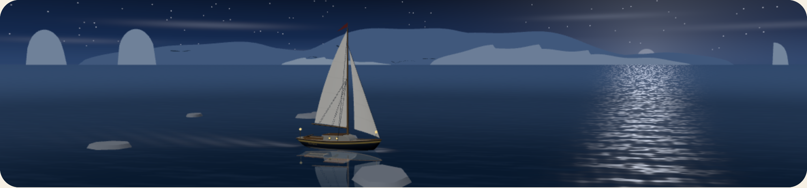
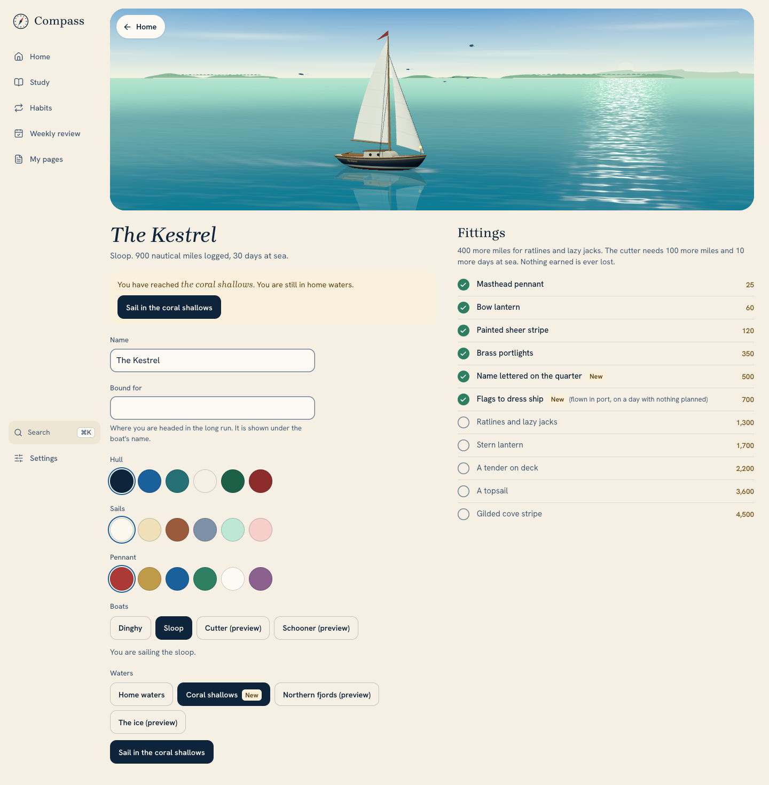

# New waters: specification, as built

| | |
|---|---|
| Status | **Built on 18 November 2026 on the branch `new-waters`, on top of night and the dark theme. Committed on 20 November and brought up to date with `main`; not yet merged.** Oliver decided what it rests on from the options page on 17 November (section 2). On 18 November he asked for the rest of the app to be built without a further round of approval, so this document was written with the build and records it. No founder has reviewed how the waters look. |
| Scope | The second of the three parts left in Stage 7: three new waters, reached by distance and chosen in the voyage view |
| Companions | [next-stages.md](next-stages.md), [night-and-dark-theme-spec.md](night-and-dark-theme-spec.md), [compass-art-direction.md](compass-art-direction.md), [testing-report.md](testing-report.md) |
| Mock | [Stage 7 options](https://claude.ai/artifact/Ax2cKW9qUbCgBXG6bTEvja), a private page |

| | |
|---|---|
|  |  |
|  |  |

## 1. What this is for

A voyage should go somewhere. Until now every mile was logged in the same water. A new water is the largest thing the voyage can give, and it comes long before the last boat, so that there is somewhere new to look forward to in the first weeks.

## 2. What was already decided

By Oliver, on 17 November, from the options page. Josh and Aditya have not weighed in.

- **Three waters:** coral shallows first, then northern fjords, then ice.
- **Reached along the way,** from about 800 miles, then about 2,000 and 3,300.
- **A water that has been reached can be chosen** in the voyage view, as an earned boat can.

## 3. Goals, and what to stay away from

- A water changes the place and nothing about the day. The boat, the day's progress, the storm after a missed day and the day in port all work exactly as before.
- Reaching a water is told once, quietly, in the same line that tells of a new fitting.
- Nothing is taken away. A water that has been reached stays reached, and home waters can always be chosen again.
- **Stay away from:** moving the boat to a new water without being asked; a water that costs more to draw than home waters; any change to home waters themselves.

## 4. The waters

| Water | Reached at | The place | In port |
|---|---|---|---|
| Home waters | The start | The sea as it has always been | Palms, a sand beach |
| Coral shallows | 800 miles | Low sand islands with palms, and bright green water over the reef | Palms, pale sand |
| Northern fjords | 2,000 miles | Steep green mountains close on both sides, dark deep water, a lighthouse on a wooded point | Pines, a shingle beach |
| The ice | 3,300 miles | Pale shelves and bergs under a cold haze, and drift ice on the water around the boat | Snow, a few pale rocks, no trees |

No water is reached at the same miles as a fitting, so each is news of its own. A water needs miles only, never days at sea.

Each water has its own dawn, clear day and golden hour. At night each keeps the same dusk, stars and moonrise as home waters, with something of the place left in it: the shallows keep their green water, the fjords go darker, and the ice stays pale against the dark. A full storm is the same storm everywhere.

## 5. Reaching and choosing

- **On Home,** the plate over the sea says "New waters: the coral shallows" until the voyage view is opened. A new boat is told before a new water, and a new water before a new fitting.
- **In the voyage view,** the new water is the one on show, with a note: "You have reached the coral shallows. You are still in home waters." and a button to sail there. The boat does not move until that button is pressed.
- **Under the boats,** a row of the four waters. One that has been reached can be chosen; one that has not is marked "(preview)" and can be looked at, with the miles at which it is reached.
- **The chosen water is kept** on the device with the boat. If the voyage is made shorter with the prototype tool, the boat comes back within the waters it has reached.
- **For a screen reader,** the sea's description ends with where the boat is: "under sail in clear daylight, in the coral shallows". Home waters go unsaid.

## 6. How it is put together

- `src/features/voyage/waters.ts` holds each water: its name, its skies, its islands, its shore and the still image's ridges. A new water is one more entry there.
- `src/domain/voyage.ts` holds the miles and the news of a new water. `src/features/voyage/light.ts` reads each water's day and night.
- The 3D scene builds the horizon's islands from the water and builds them again when it changes. The port's shore takes its sand, ground, rocks and trees from the water.
- The drift ice is eleven floes drawn as instances of one mesh, so the whole field is one draw call. In port only the open side has any.
- Home waters are saved as nothing at all, so a voyage saved before there were waters reads the same.

## 7. Done when

| Asked | Stands |
|---|---|
| Home waters look exactly as before | Met. A test holds that their light is unchanged, by day and at night |
| Each water is reached at its miles and told once | Met, by tests |
| A water is sailed only when chosen, and the choice is kept through a reload | Met, by tests |
| A water not yet reached can be looked at and not sailed | Met, by tests |
| Each water draws live by day and at night, at sea and in port, with nothing in the console | Met, by a test |
| Each water stays within the budget of 40 draw calls, at sea and in port | Met, by a test on real graphics hardware |
| The still image is a different picture in each water | Met, by a test of all sixteen: four waters, day and night, at sea and in port |
| No sideways scroll in the voyage view at 375, 390, 768, 1024 and 1440 px | Met, by tests |
| Every existing test passes, in the light theme and with the device set to dark | Met: see the testing report, section 15 |
| A look review by a founder | **Not done** |

## 8. Calls made here, open to change

| Call | Why | The other way |
|---|---|---|
| The miles are 800, 2,000 and 3,300 | The numbers on the options page, and none falls on a fitting | Any others |
| Reaching a water does not move the boat there | A new boat is offered and not swapped in; a water is the same | Sail there at once |
| The names are "Coral shallows", "Northern fjords" and "The ice" | Plain, and each reads in a sentence | Named places |
| The fjords have a lighthouse and the shallows and the ice do not | A lit lighthouse at night is worth keeping somewhere beyond home | One in each, or none |
| Drift ice is in the ice only | It is what makes that water move | Something of its own in each water |
| A water not yet reached can be previewed | Boats can be | Hide what is not reached |
| No water after the ice | Three were decided. The art direction's "every 1,000 after the last fitting" needs waters that are not designed | More waters |
| The still image's mountains are rounded | It draws every ridge with one shape | A sharper shape for the fjords |

## 9. Limits to know about

- **No founder has reviewed the look.** The pictures are in [screenshots/waters/](screenshots/waters/).
- **The still image is plainer than the 3D scene:** its fjords are rounded hills, and its port does not show each water's trees.
- **Drift ice passes over the boat's reflection** in the 3D scene when a floe drifts between the boat and the viewer.
- **Not checked:** a real phone, Safari or Firefox, a screen reader by ear, and frame rate in each water. The draw calls are within the same budget as home waters.

## 10. Not in this piece

- Decorations: the sail mark, the pennant's shape and the seasonal keepsakes. They are the last part of Stage 7.
- A water that changes with the season.
- More waters after the ice.
