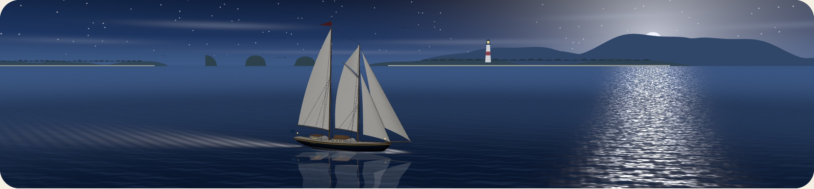

# Compass: recommended next stages

| | |
|---|---|
| Date | 16 November 2026, updated 18 November |
| Status | A recommendation. Since 18 November the founders go with Oliver's decisions unless he says otherwise, so what Oliver approves counts as agreed. |
| Based on | The brief, the approved [art direction](compass-art-direction.md) and [Home spec](home-screen-spec.md), and the [testing report](testing-report.md) |

**Update, 18 November.** All thirteen pull requests were merged into `main`, in order. The last one added a motion system and a new type, Libre Caslon Text with Source Sans 3. The sections below keep the wording from when each stage was written; where a line still speaks of the founders reviewing something, read it as Oliver's review.

The order below puts first what protects the work already done, then what the brief still expects of Phase 1, then new product.

## Stage 1. Close Phase 1

Small, and mostly decisions and checks that need a founder.

| Step | Why | Size |
|---|---|---|
| ~~Founders review Home and approve the Phase E changes~~ | **Oliver approved them for the founders, and everything is merged.** | Done |
| A founder opens Home on a real phone | The only way to settle speed, heat and battery. The spec's pass bar ends with this. | Ten minutes |
| Open Home in Safari and Firefox | Only Chrome has been tested | An hour |
| ~~Look at the first CI run~~ | **Passed on 17 November, both jobs.** A workflow now builds and tests every pull request. The stack was merged on 18 November, so CI now covers `main` too. | Done |
| One pass with VoiceOver | Names and structure were checked by script, never by ear | An hour |
| Boat look review, round three | Parked by Oliver. The storm crests and the folded strip are the known weak points. | Depends on the review |

## Stage 2. Make the sea cheap to run

The brief asks for battery efficiency on mobile, and this is where the build is furthest from the spec.

1. ~~Stop drawing when the window is scrolled out of view or the tab is hidden.~~ **Built on 16 November.**
2. ~~Build the low tier: no shadow map, fewer pixels, 30 frames a second, chosen for touch devices and whenever frames run slow.~~ **Built on 16 November.**
3. ~~Bring draw calls down to the budget of 40.~~ **Done on 16 November:** 17 to 32 a frame, from 50 to 457.
4. Measure on two real phones, one recent and one about four years old, and record the numbers in the testing report.

**Done when** the low tier holds 30 frames a second on the older phone and the scene uses no processor time when it cannot be seen. The second half is met. The first half waits on step 4, which needs a founder and a phone.

## Stage 3. Finish the reward loop on Home

The boat only motivates if earning something is noticed. These are all in the approved spec and not yet built.

1. ~~The plate announces what was just earned: a brass dot and one line, such as "New: bow lantern".~~ **Built on 16 November.**
2. ~~"The cutter is ready" when a new boat is earned, with the choice made in the voyage view.~~ **Built on 16 November.**
3. ~~Fittings appear on the boat when they are earned.~~ **Built on 16 November.** Before this, every boat wore a fixed set whatever had been earned.
4. ~~Draw the remaining Phase 1 fitting, the boat's name.~~ **Built on 16 November, on the quarter.** Oliver chose the quarter over the transom, which faces away from the usual view.
5. ~~The motion the spec describes: the week strip sliding, a completed row moving down, the sheet following the finger.~~ **Built on 16 November,** with Motion installed.
6. ~~The `?` list of shortcuts, and the editor as a popover on desktop.~~ **Built on 16 November.**

**Stage 3 is complete.**

## Stage 4. Habits

Recommended as the first new destination, ahead of Study, for three reasons. It is the smallest. It gives people a reason to open Compass on a day with no tasks. And the mileage rule for it already exists (one mile a tick).

**Built on 16 November.** The rules are in [habits-spec.md](habits-spec.md).

- ~~Habits the user defines, for every day or chosen weekdays.~~ Built.
- ~~Today's habits shown on Home, without becoming a second task list.~~ Built, as decided.
- ~~History and a weekly consistency summary.~~ Built one week at a time: a count for each habit in each week, and earlier weeks as the record. A view across many weeks is not built.
- ~~No streak counter, in line with the art direction.~~ There is none.

Not built: reordering habits, pausing one without deleting it, and a view of consistency across many weeks.

**Where today's habits sit on Home: decided by Oliver on 16 November.** A line of its own between the week and the lists from 1280 px wide; at the foot of the day's sheet below that, tablets and phones included. Josh and Aditya have not weighed in. The mock is at https://claude.ai/artifact/MqFDefCBQVsYLmYd8JPm3b.

**Built to the recommendation, and still open to change:** the ticks belong to the selected day, habits log miles and do not change the sea, and up to six show on Home.

## Stage 5. Study

**Built on 16 November.** The rules are in [study-spec.md](study-spec.md).

- ~~Subject pages that can be created and edited.~~ Built, with notes.
- ~~Assessments that can be added, edited and removed.~~ Built. Preparation tasks attached to one assessment are not: a task belongs to a subject, not yet to an assessment.
- ~~Recurring study sessions.~~ **Built.** Oliver decided from the [mock](https://claude.ai/artifact/K8BkfUFMt7HfLrAgaY66g4) that a session becomes an ordinary task that repeats. Three smaller rules were built to the mock's recommendations and are still open: sessions count toward the port and the storm like any task, a week's tasks are made when the week arrives, and changing a session leaves tasks already made.

## Stage 6. Weekly review, then My pages

- ~~**Weekly review:** a saved reflection, a summary of tasks and habits, and next week's priorities, which Home already shows. Saving one earns ten miles under the existing rule.~~ **Built on 17 November** as a first version, to [review-spec.md](review-spec.md). No founder has reviewed it, and it was not mocked first. Its open calls are in section 7 of that document; the largest is that an old review's figures are live and not a snapshot.
- ~~**My pages:** notes, checklists, goals, reading and project pages.~~ **Built on 17 November** as a first version, to [my-pages-spec.md](my-pages-spec.md). Oliver chose its approach the same day: one page shape with five ways to start. It also recommends that pages stand apart from tasks and miles at first. Its layout and three options for a list's tick are drawn in a [mock](https://claude.ai/artifact/NPCbrcPSUbkeHzv3q9UXu7) (private; share it from its Share menu). Oliver chose the layout and the smaller square tick from that mock. Six smaller decisions were built to their recommendations and are still open, the largest being that pages earn no miles and that an item cannot yet become a task. Josh and Aditya have not weighed in.

All five destinations in the brief now exist. What is left in this stage is Oliver's review of the pages that were built before any founder had seen them.

## Stage 7. The boat grows up

- ~~The cutter and schooner fittings that are listed but not drawn.~~ **Drawn on 17 November:** flags to dress ship, ratlines and lazy jacks, the stern lantern, the tender, the topsail and the gilded cove stripe. All eleven fittings are now on the boat, in 3D and in the still image. Screenshots are in `docs/screenshots/fittings/`. Oliver has seen them; Josh and Aditya have not.
  - **Decided by Oliver on 17 November: the dress flags fly in port only,** on a day with nothing planned, as a real boat dresses at rest with her sails furled. Under sail they are stowed. The voyage view says so beside the fitting.
- Flags, banners and decorations.
- New waters earned by distance, and seasonal items that arrive with the calendar.
- Dusk, night and the dark theme, designed together.

**Oliver approved every recommendation for these three on 17 November.** Josh and Aditya have not weighed in, and nothing is built. The options are on a private page, [Stage 7 options](https://claude.ai/artifact/Ax2cKW9qUbCgBXG6bTEvja), which needs sharing from its Share menu before Josh and Aditya can open it. A few of its pictures are kept in `docs/screenshots/stage-7-options/`. Each picture of the sea was drawn by the app's own scene with its light and islands changed for the picture; no file was changed to make them.

What was decided:

| Part | Decided by Oliver | The other ways |
|---|---|---|
| Night | It comes with a dark theme. The dark theme's day runs dusk, then stars, then moonrise when everything is done. | By the clock; or only after a finished day |
| New waters | Coral shallows, northern fjords and ice, earned along the way from about 800 miles, and able to be chosen once earned | From 5,500 miles, as the art direction's table says |
| Decorations | A mark on the mainsail and the pennant's shape, chosen freely; one keepsake a season, such as a string of lights in winter | The sea changing with the season; or no seasons |
| Order | Night and the dark theme, then waters, then decorations | |

The eleven decisions in full:

1. **Night comes with the dark theme.** The light theme keeps dawn, clear day and golden hour.
2. **The dark theme opens on dusk,** then stars, then moonrise when everything is done.
3. **The dark planner** is ivory ink on deep navy, with the same greens and subject dots and a marine blue for what is selected. The exact colours are to be measured for contrast before they are fixed.
4. **The theme follows the device,** with light, dark and automatic in Settings.
5. **Three waters:** coral shallows first, then northern fjords, then ice.
6. **Waters are earned along the way,** from about 800 miles, then about 2,000 and 3,300, and every 1,000 after the last fitting. This changes the progression table in the art direction, which had the first at 5,500. The exact miles are to be fixed when waters are built.
7. **An earned water can be chosen** in the voyage view, as an earned boat can.
8. **Chosen freely:** a mark on the mainsail and the shape of the pennant.
9. **One keepsake a season:** a string of lights in winter, blossom at the bow in spring, a striped awning in port in summer, a harvest lantern in autumn.
10. **The season is asked once in Settings** (northern, southern, or no seasons), the first time a season would bring something.
11. **Order:** night and the dark theme, then waters, then decorations.

Each of the three is about the size of one earlier stage, and each gets a short spec of its own before it is built. The first is written and approved by Oliver: [night-and-dark-theme-spec.md](night-and-dark-theme-spec.md), with a dark palette measured for contrast. It was built on 17 and 18 November on the branch `night-dark-theme`, on top of the Home and Weekly review additions, and committed on 18 November. Oliver saw the pictures that day, kept the blue selection over an ivory block, and approved the look as built. Josh and Aditya have seen nothing. Waters and decorations are not built.

## Stage 8. Aditya's plan

Aditya wrote a plan for a complete personal planner. The plan itself is kept by the founders and is not in this repository, because the repository is public and the plan is personal. On 17 November Oliver decided how it comes into Compass: Compass keeps its main idea (the boat, the navy and ivory look, a planner any student could use), and Aditya's extras come in around it. Josh and Aditya have not weighed in. The review page is https://claude.ai/artifact/TzbYHALrhnx46UbYp1KJot (private; share it from its Share menu).

It is five pieces, each designed and reviewed on its own before it is built:

| Piece | What it holds | State |
|---|---|---|
| 1. Home and the Weekly review | A greeting, a long-term goal and links on Home; ratings and subject levels in the review, which then decide what Home puts first | **Built on 17 November** on `home-review-additions`, to [home-and-review-additions-spec.md](home-and-review-additions-spec.md). Committed, with a pull request against `boat-fittings`. Josh and Aditya have not reviewed it. |
| 2. Study detail | Current topic, teacher feedback, a revision checklist, past papers, links on tasks and assessments, preparation tasks | Not designed |
| 3. Fitness | The training week, a workout log and measurements, in a place that is switched on | Not designed |
| 4. Interests | Investing and Law Journey as folders in My pages with ready-made forms, and saved headlines on Home | Not designed |
| 5. Search and backup | Search across everything, and a full export and import | Not designed |

**Decided by Oliver on 17 November:**

- Fitness is a place of its own, off until it is switched on. Investing and Law Journey are interests in My pages, not places.
- The green and cream palette and the emoji icons do not come in.
- In piece 1: the goal sits on the boat's plate as "Bound for"; a greeting shows once a name is set; links sit in the rail on wide screens and at the foot of Home on narrow ones; a High subject is named on Home and comes first in each list and in Study; each person names their own rating areas; and the review keeps its three questions.

**Still open:**

- The nine smaller calls in the specification's section 12. The largest: the sample shows nothing new on Home, Study can change this week's level, and levels are kept week by week.
- Headlines that refresh by themselves. That would be the first time Compass talks to an outside service, so it gets its own decision, with piece 4 or after it.

The mock shows where training (piece 3) and headlines (piece 4) will sit on Home, so Home's layout does not have to be reopened for them.

## Later, and deliberately not now

Accounts and sync, notifications, school licensing and any payment. The brief rules these out of the prototype, and each one changes the privacy promise, so each deserves its own decision.

## Decisions still open

Oliver decides these for the founders.

| Decision | Needed before |
|---|---|
| Approve or change the Phase E fixes | Committing them |
| Is the boat's look settled, or is there a round three? | Stage 7, and any public screenshot |
| Habits before Study, as recommended here? | Stage 4 |
| ~~Keep the centred editor on desktop, or build the popover in the spec?~~ Built as the spec has it: a popover. | Done |
| ~~The boat's name: on the transom or on the quarter?~~ Decided: the quarter. | Done |
| Is a plain boat with nothing earned right for a new user's first day? | Any public release |
| Are the mileage numbers and stage gates right after a week of real use? | Stage 3, since the plate will start announcing them |
