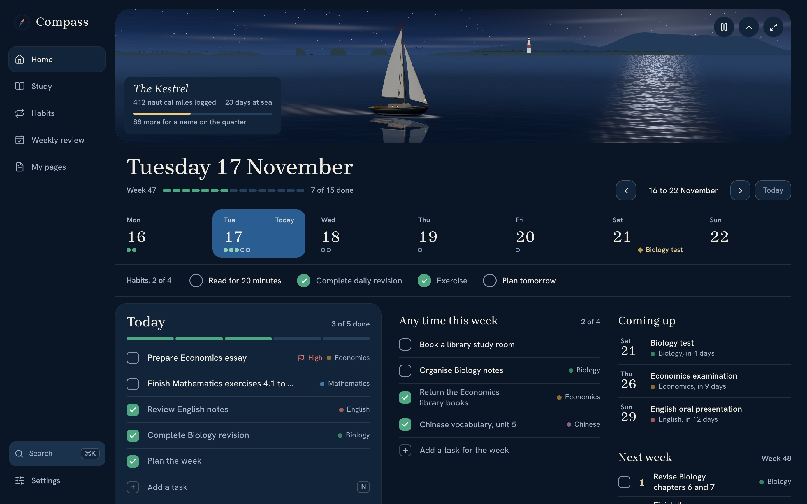
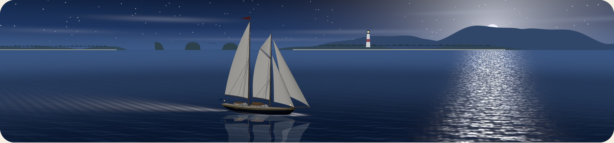
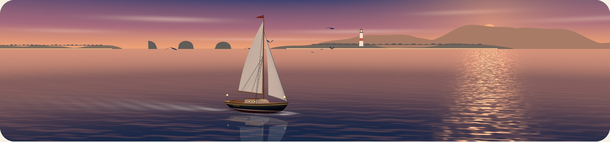
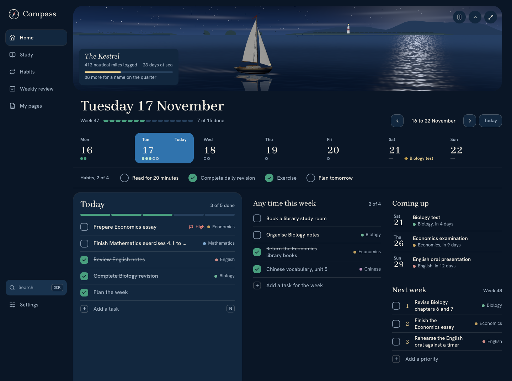
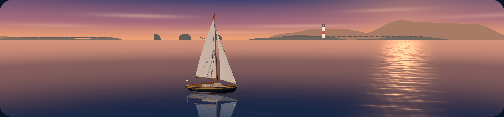
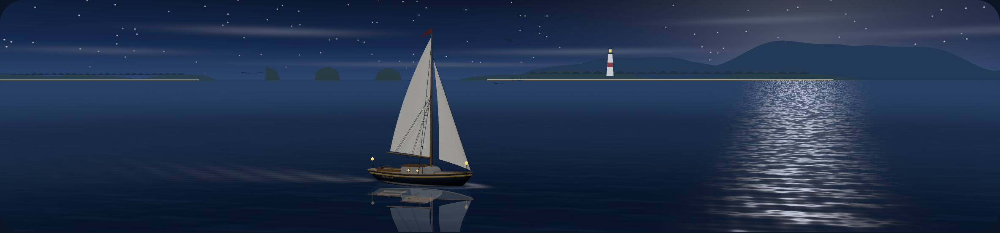
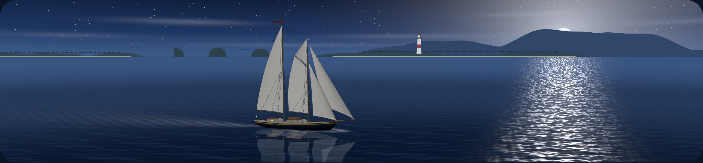
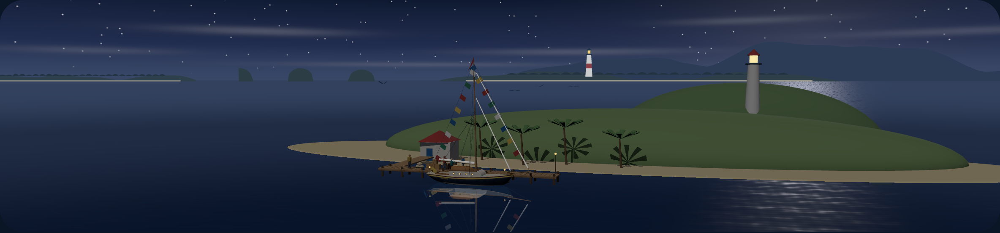
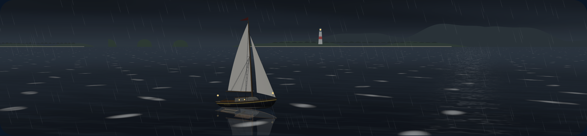
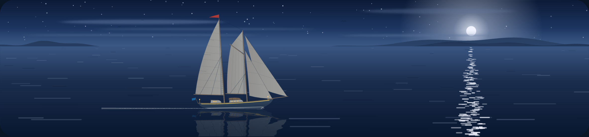

# Night and the dark theme: specification

| | |
|---|---|
| Status | **Written on 17 November 2026 and approved by Oliver the same day. Built on 17 and 18 November on the branch `night-dark-theme`, and committed there on 18 November. Oliver saw the pictures that day, kept the blue selection over the ivory block, and approved the look as built.** Josh and Aditya have not seen it. What was built, and where it differs from this document, is in section 16. Oliver decided the four things it rests on from the options page (section 2), then approved this document. Josh and Aditya have not weighed in. The calls in section 12 were made here and are still open to change; the first of them, the selection blue, is to be seen both ways at the look review. |
| Scope | The first of the three parts left in Stage 7: a dark theme for the whole app, and a night for the sea that comes with it |
| Companions | [compass-art-direction.md](compass-art-direction.md), [home-screen-spec.md](home-screen-spec.md), [next-stages.md](next-stages.md), [testing-report.md](testing-report.md) |
| Mock | [Stage 7 options](https://claude.ai/artifact/Ax2cKW9qUbCgBXG6bTEvja), a private page. It needs sharing from its Share menu before Josh and Aditya can open it. |

The picture is the mock this document was written from: the running app with its colours and the sea's light changed for the picture. The built screens are in [screenshots/night/](screenshots/night/) and section 16.

## 1. What this is for

Compass has one look, ivory paper, and a sea that runs from dawn to golden hour. The brief asks for a dark theme, and the art direction says dusk and night are to be designed with it. After this piece the planner can be read comfortably in a dark room, and the sea has a night of its own to go with it.

## 2. What is already decided

Oliver approved these on 17 November, from the options page.

| | Decision |
|---|---|
| 1 | **Night comes with the dark theme.** The light theme keeps dawn, clear day and golden hour. It is not by the clock, and it is not a reward after a finished day. |
| 2 | **The dark theme opens on dusk,** then stars, then moonrise when everything is done. |
| 3 | **The dark planner** is ivory ink on deep navy, with the same greens and subject dots, and a marine blue for what is selected. The exact colours were to be measured before they were fixed, which section 5 does. |
| 4 | **The theme follows the device,** with light, dark and automatic in Settings. |

The rule the scene is built on does not change: **the sea shows the selected day as it stands.** Only which sky it stands under changes.

## 3. Goals, and what to stay away from

**Goals**

- Every screen reads well in the dark theme, to the same contrast standard as the light one.
- The planner and the sea always match: a dark planner never sits under a daylit sea.
- Finishing the day still earns the best light. In the dark theme that is moonrise.
- Someone who never changes a setting gets the theme their device asks for.

**Not goals**

- A night that follows the clock, sunset times, or the device's location.
- A third theme (high contrast, or pure black for some phone screens).
- New waters, or the string of lights. They are the other parts of Stage 7.

**What would make this a failure**

- A flash of the wrong theme when the app opens.
- Any text below the contrast in section 5, or a state shown by colour alone.
- The night sea is so dark that the boat cannot be made out in the small window on a phone.
- Stars that twinkle, or anything else that moves that did not move before.
- The light theme changes at all.

## 4. The theme

- **Setting:** `settings.theme` is `auto`, `light` or `dark`. A new user and an earlier save both get `auto`.
- **Automatic** follows the device's light or dark setting, and changes with it while the app is open.
- **Where it is chosen:** a new "Appearance" part in Settings, after "Calendar", with three choices: Automatic, Light, Dark. Under it: "Automatic follows your device. The sea is at night in the dark theme."
- **How it is applied:** `data-theme="dark"` on the page's root element, with `color-scheme: dark` so that the browser's own controls and scrollbars follow. The light theme sets nothing, so the page as built today is the light theme.
- **No flash:** a few lines in `index.html`, before the app loads, read the saved setting and set the theme. The app then keeps it in step.
- **The browser's bar** (`theme-color`) takes the dark page colour in the dark theme.
- **The command menu** gains "Use the dark theme", "Use the light theme" and "Follow the device".

## 5. The dark palette

Ivory ink on the boat's own deep navy. Every pair below was measured with the WCAG 2.2 formula.

### Surfaces and ink

| Token | Light | Dark | Role |
|---|---|---|---|
| `surface-deck` | `#F6F0E4` | `#0A1626` | The page |
| `surface-sheet` | `#FDFAF3` | `#12273E` | The raised sheet, the plate, editors |
| `surface-well` | `#EDE6D5` | `#19334E` | Hover, and a row being edited |
| `text` | `#0E243A` | `#F6F0E4` | Ink |
| `text-muted` | `#405973` | `#A7B6C6` | Secondary text |
| `text-subtle` | `#566D84` | `#93A4B7` | Disabled and faint text |
| `text-link`, `focus` | `#1A619B` | `#88B7DE` | Links and the focus ring |
| `surface-inverse` | `#0E243A` | `#3073AD` | The selected day, the main button, the toast |
| `text-inverse` | `#FDFAF3` | `#FDFAF3` | Text on those |
| `positive` | `#2E7F62` | `#499F7E` | Done |
| `attention` | `#AB3935` | `#E8847A` | High priority, delete |
| `highlight-text` (new) | `#7A5A20` | `#E5CB8D` | The brass numbers and miles |
| `control` | `#718295` | `#8A9BAF` | The outline of a box or a field |
| `line`, `line-strong` | Navy at 12% and 22% | Ivory at 12% and 24% | Rules between rows. Decoration. |
| `track` | `#DFD7C5` | `#263F5B` | The empty part of a progress bar. Decoration. |

### Measured contrast

| Pair | Ratio | Needs |
|---|---|---|
| Ink on the page, the sheet, the well | 16.0, 13.4, 11.4 | 4.5 |
| Muted on the page, the sheet, the well | 8.8, 7.3, 6.3 | 4.5 |
| Subtle on the sheet, the well | 5.9, 5.1 | 4.5 |
| Link on the page, the sheet, the well | 8.5, 7.1, 6.1 | 4.5 |
| Text on the selection blue | 4.8 | 4.5 |
| The selection blue against the page, the sheet | 3.6, 3.0 | 3.0 |
| Done (green) against the page, the sheet | 5.7, 4.7 | 3.0 |
| Attention on the sheet, the well | 5.8, 4.9 | 4.5 |
| Brass numbers on the page, the sheet | 11.5, 9.6 | 4.5 |
| A box's outline against the page, the sheet | 6.4, 5.3 | 3.0 |

Three colours changed from the mock because they fell short when measured:

- **The selection blue** was `#2A5D92`. Against the sheet it was 2.2, under the 3.0 a filled control needs. It is now `#3073AD`, with its text the brighter of the two ivories. That is the only blue that passes both ways: any lighter and the text on it fails, any darker and it fades into the sheet.
- **Attention** was `#E3776D`, which was 4.4 on a hovered row. It is now `#E8847A`.
- **Subtle text** was `#8A9BAF`, which was 4.55 on a hovered row, with no margin. It is now `#93A4B7`.

### What is not a token today

A survey of the components found 63 places that use a colour step by name (`port-600`, `brass-700`, `paper-0` and so on) and seven literal colours, where a dark theme needs a role. Each gets a role of its own, so that after this piece **components name roles only**:

| Used today | Becomes | Dark |
|---|---|---|
| `port-600`, `port-700` as text | `attention` | `#E8847A` |
| `port-100` behind a delete button on hover | `attention-tint` | `#3A2428` |
| `paper-0` for the tick inside a box | `on-positive` | `#0A1626`, a dark tick on the lighter green (5.7) |
| `brass-700`, `brass-500` as text | `highlight-text` | `#E5CB8D` |
| `brass-100` and `brass-800`, the "Prototype tool" note | `note` and `on-note` | `#2B3A44` and `#EFE0B8` |
| `deep-700`, the main button on hover | `surface-inverse-hover` | `#2B68A0`, darker, so its text stays readable (5.6) |
| `paper-200`, `paper-300`, labels on the selected day | `text-inverse-muted` | `#FDFAF3`, the same as the main text there: see the limit below |
| The strike through a done task, navy at 35% | `strike` | Ivory at 40% |
| The loading colour behind the sea, `#9CC4CC` | `sea-loading` | `#12264A` |

**A limit of the selection blue.** On the selected day, "Tue" and "Today" are quieter than the date in the light theme. On `#3073AD` nothing quieter than the brightest ivory reaches 4.5, so in the dark theme those labels are the same ivory as the date and are told apart by size and weight alone. An ivory block with navy text would not have this limit. It is the first call in section 12.

A unit test reads the component files and fails if a colour step is named in one, so the two themes cannot drift apart again.

### Subject colours

The eight subject dots measure 3.0 to 3.3 against the dark sheet, which is at the limit, and rose is just under. Each subject colour gets a dark set: a lighter dot (5.7 to 6.5), a dark tint and a light text for the session mark. The dots keep their hue, so Biology is still green.

### Shadows

The sheet's shadow and the float shadow become black and stronger, since a navy shadow does not show on navy. The sheet is told from the page mostly by its tone and its hairline, as in the light theme.

## 6. The sea at night

### The light

The dark theme has a light table of its own, read by the same share of the day done.

| Share done | Light theme | Dark theme |
|---|---|---|
| Nothing | Dawn: pale, a little mist, still water | **Dusk:** violet above, rose, then orange at the horizon. The sun is just down. |
| Half | A clear day | **Stars:** a clear, deep blue night |
| Everything | Golden hour, with the sun's path on the water | **Moonrise:** the moon comes up where the sun sets, and lays the same path |

Starting values, from the mock, to be tuned by eye at a look review:

| | Sky top | Sky middle | Horizon | Water at the horizon | Deep water | Sun or moon | Land |
|---|---|---|---|---|---|---|---|
| Dusk | `#34406E` | `#A56A7C` | `#F0A271` | `#C98A76` | `#172746` | `#FFB27A` | `#2A3350` |
| Stars | `#081428` | `#12264A` | `#27406A` | `#223A5C` | `#061226` | `#DFE7F8` | `#0B182C` |
| Moonrise | `#0C1A36` | `#1C3560` | `#3F5C8A` | `#3A5682` | `#08162E` | `#F1F4FF` | `#0D1B32` |

- **The light gets darker before it gets brighter.** Dusk is brighter than the stars that follow it. This was weighed on the options page: a dark, still night as the first picture of each day was the bleakest Compass would have.
- **How lit the boat is** becomes part of the light: full by day, about three quarters at dusk, and under half at night. She is never a silhouette: the hull's stripe, the sails and the name must still read.
- **Stars** are drawn by the sky itself, about a hundred of them, fixed in place. They fade into cloud and haze and are absent at dusk. They do not twinkle.
- **Lamps.** At dusk and at night the portlights glow, and the bow and stern lanterns are brighter. The lighthouse is already lit. By day the portlights are dark glass, as now.
- **The moon's path** uses the sparkle the sun's path already uses.
- **Changing theme** eases the sea from one sky to the other over about half a second, as it already eases between a day's lights. Under reduced motion it changes at once.

### The storm, the port and other days

- **The storm** the day after a missed day has a night of its own: near-black cloud, no stars, the lamps lit. It clears toward the night's table as tasks are done, as it clears toward the day's now.
- **A day with nothing planned** is an evening in port: between dusk and the stars, lamps lit along the pier and aboard.
- **Any selected day** is shown under the theme's sky, past or future. The theme decides the sky and the day decides the rest.

### The still image

The still image stands in while the scene loads, and is all there is without WebGL. It takes its colours from the same table, so it follows the theme. It also needs, for the night: stars as small dots, the moon in place of the sun, lit portlights and lanterns, and sails shaded for moonlight where it warms them for the sun today.

### What is read aloud

| Share done | Dark theme |
|---|---|
| Nothing | "The Kestrel, a sloop, on still water at dusk." |
| Between | "The Kestrel, a sloop, under sail beneath the stars." |
| Everything | "The Kestrel, a sloop, under full sail by moonlight." |
| In port | "The Kestrel, a sloop, moored in port for the evening." |
| Storm | As by day. |

## 7. Every screen

The whole app changes, so the whole app is checked. In order of risk:

| Screen | What to look at |
|---|---|
| Home | The selected day, the week strip's marks, the plate over the sea, the habit ticks, the phone's bottom bar |
| Editors | The popover's shadow on a dark page, the chips, the date field, the delete button on hover |
| Weekly review | The day-by-day well, the progress segments, the writing boxes |
| Study and My pages | The current row in the list, subject dots, the smaller tick |
| Habits | The round ticks, a day still to come, a day that is not a day for the habit |
| Voyage | The colour swatches, the fittings list, the boats |
| Settings | The "Prototype tool" note, "Clear everything" |
| Toasts, the command menu, the shortcut list | The toast is the selection blue on dark. It must still stand out. |
| The look-review page | Gains "Night" beside its other controls |

The compass mark in the rail needs a dark version: its ring and face are navy today and would vanish.

## 8. Records

- `settings.theme`: `auto`, `light` or `dark`. Kept with the other settings on the device.
- Nothing else is saved. Which sky is showing is worked out from the theme each time.
- "Reset the sample data" and "Clear everything" leave the theme alone. It is about the device, not the data.

## 9. Accessibility

- The contrast in section 5 is the standard. The build measures it again in the running app, as the testing report did for the light theme, at 390 and 1440 px.
- Nothing is told by colour alone that was not already: done has a tick, high priority has a word, today has a label.
- The focus ring is the lighter marine blue, 7.1 against the sheet.
- The theme choice is three buttons that say which is pressed, in a group named "Theme".
- Nothing new moves. Stars are still, and the change of sky follows the reduced-motion setting.
- Forced colours (Windows high contrast) are left to the browser, as now.

## 10. Performance

- No new draw calls are expected. Stars are drawn in the sky's own pass, and lit windows use the glow the lanterns already use. The unit test that holds the scene to 40 draw calls must pass unchanged.
- This has not been measured. The mock ran without trouble on a laptop, which says little about a phone.

## 11. Done when

- With the device set to dark and nothing changed in Compass, the app opens dark, with no flash of ivory.
- Choosing Light, Dark or Automatic in Settings changes the app at once and is kept after a reload.
- In the dark theme the sea shows dusk with nothing done, stars part-way, and moonrise with everything done. In the light theme it is exactly as it is today.
- The portlights are lit at night and dark by day.
- The still image follows the theme, with stars and a moon at night.
- Every pair in section 5 is measured in the running app and meets its number, at 390 and 1440 px.
- No component names a colour step, and a test holds that.
- There is no sideways scroll at 375, 390, 768, 1024 and 1440 px in either theme.
- Every existing unit and browser test passes unchanged in the light theme, and the browser suite also passes with the dark theme forced on.
- A look review of screenshots of every screen in section 7, in the dark theme, before the look is treated as settled.

## 12. Calls made here, open to change

| Call | Why | The other way |
|---|---|---|
| The selected day is marine blue with ivory text | Decided as the direction. `#3073AD` is the one value that passes both contrast rules, and it leaves no room for quieter labels on it. | An ivory block with navy text, as a true inverse of the light theme (13.9). It allows quieter labels, and is stronger and louder. **Oliver saw both on 18 November and kept the blue.** |
| The tick inside a done box is dark in the dark theme | An ivory tick on the lighter green is 3.1; a dark one is 5.7 | Keep the ivory tick |
| Subject dots get a lighter dark set | The light set sits at the limit against navy | Keep one set |
| Stars do not twinkle | Nothing new should move, and the scene holds still under reduced motion | A slow twinkle when motion is allowed |
| Changing theme eases the sky over half a second | It is the one moment the two skies are seen together | Change at once |
| The theme is left alone by "Clear everything" | It belongs to the device | Reset it with the rest |
| "Appearance" sits after "Calendar" in Settings | Before the sea, which it changes | With "The sea" |
| A storm at night has no stars | It should read as a storm at a glance | Stars through breaks in the cloud |

## 13. Limits to know about

- **Someone who never uses a dark theme never sees the night,** and someone whose device is always dark never sees golden hour unless they choose Light. This was weighed and accepted in decision 1.
- **Automatic can change the sea in the middle of a session,** when a device switches itself at sunset. That is the device's doing and is eased.
- **Another piece of work touches the same screens.** The Home and Weekly review additions are being built on a branch of their own. This piece changes how every component names its colours, so it should be built on top of that work once it lands, not beside it.

## 14. Not in this piece

- New waters, and how each looks at night. Each water will need its own night when it is built.
- The string of lights and the other seasonal keepsakes.
- A night that follows the clock.
- A high-contrast theme, or a pure black one.
- A dark version of the pages in `docs/`.

## 15. Left to the build

- The names of the new tokens and functions.
- Whether subject colours become CSS variables or a second table.
- The exact light values, within what a look review accepts.
- How the few lines in `index.html` read the saved setting, as long as there is no flash and nothing breaks when storage is blocked.

## 16. As built

Built on 17 and 18 November 2026 on the branch `night-dark-theme`, on top of the Home and Weekly review additions, and committed on 18 November with Oliver's approval. The record of what was tested is in the [testing report](testing-report.md), section 14.

| | |
|---|---|
|  |  |
|  |  |
|  |  |

Every screen in section 7 is pictured in the same folder at 1440 and 390 px.

### How it is put together

- **Components name roles, never colour steps.** New role tokens were added, each with a light value equal to the step it replaced, so the light theme is unchanged. A test (`src/design/roles.test.ts`) fails if a component names a step or writes a colour into a class. The 3D scene, the still image and the look-review page are left out of that rule: they paint with the colours a person chooses for their boat.
- **The dark theme is one block** at the end of `src/design/tokens.css`, under `:root[data-theme='dark']`. It redefines roles and nothing else. The same test measures the pairs in section 5 from that block.
- **Subject colours became CSS variables,** with the two sets of values kept in one table in the code and checked against the token file.
- **The theme is set before the app loads,** by a short script in `index.html` that reads the saved setting, so there is no flash of ivory.
- **The night is a second light table** in `src/features/voyage/light.ts`, mixed with the day's by how far the sky has eased. The scene and the still image both read it.

### Where the build differs from this document

- **A storm at night dims its breaking crests and its rain.** Section 6 did not say. At full brightness they glowed against the dark water.
- **Two tick boxes in Settings are restyled in the dark theme only.** The browser draws its own tick box in neutral grey on a dark page. Empty, they now take the planner's outline; ticked, they are as before.
- **A fault in the command menu was found and fixed.** The search box kept its last query for an instant after opening, and a key pressed in that instant was added to it. It was found by a new test failing one run in three, and is older than this work.
- **A fault in the frame every editor shares was found and fixed.** An editor opened in the instant after another closed could be shut by the browser's late word that the first had closed. It is older than this work and was shown up by a slow machine; the testing report, section 14, has the numbers.
- **The selection is built in blue,** as section 12 says. The ivory block was photographed in its place for the look review: `selection-*-blue.png` and `selection-*-ivory.png` in the screenshots folder. Oliver saw both on 18 November and kept the blue, so the ivory block is not built.

### What section 11 asks for, and where each stands

| Asked | Stands |
|---|---|
| Opens dark on a dark device, with no flash of ivory | Met, by a test that holds the app back and reads the page before it loads |
| Light, Dark and Automatic change the app at once and are kept | Met, by tests |
| Dusk, stars and moonrise in the dark theme; the light theme exactly as before | Met. The light theme was compared picture by picture with pictures taken before the work: the only change is the new Appearance section in Settings |
| Portlights lit at night and dark by day | Met |
| The still image follows the theme | Met, by a test that counts its stars |
| Every pair in section 5 measured in the running app, at 390 and 1440 px | Met, by a test that reads each element's own colours |
| No component names a colour step, held by a test | Met |
| No sideways scroll at five widths in either theme | Met, by tests |
| Every existing test passes in the light theme, and the browser suite passes with the dark theme forced on | Met: 127 pass in the light theme, 127 with the device set to dark, and 121 with 6 skipped as CI runs them |
| A look review of every screen in the dark theme | **Done by Oliver** on 18 November: he kept the blue selection and approved the look as built. Josh and Aditya have seen nothing |

### Not checked

- A real phone, Safari or Firefox, and a screen reader by ear.
- Frame rate with the night scene. It draws nothing more than the day's: the stars are part of the sky's own shader.
- A device that changes theme by itself at sunset. The change was tested by choosing it in Settings and in the command menu.
