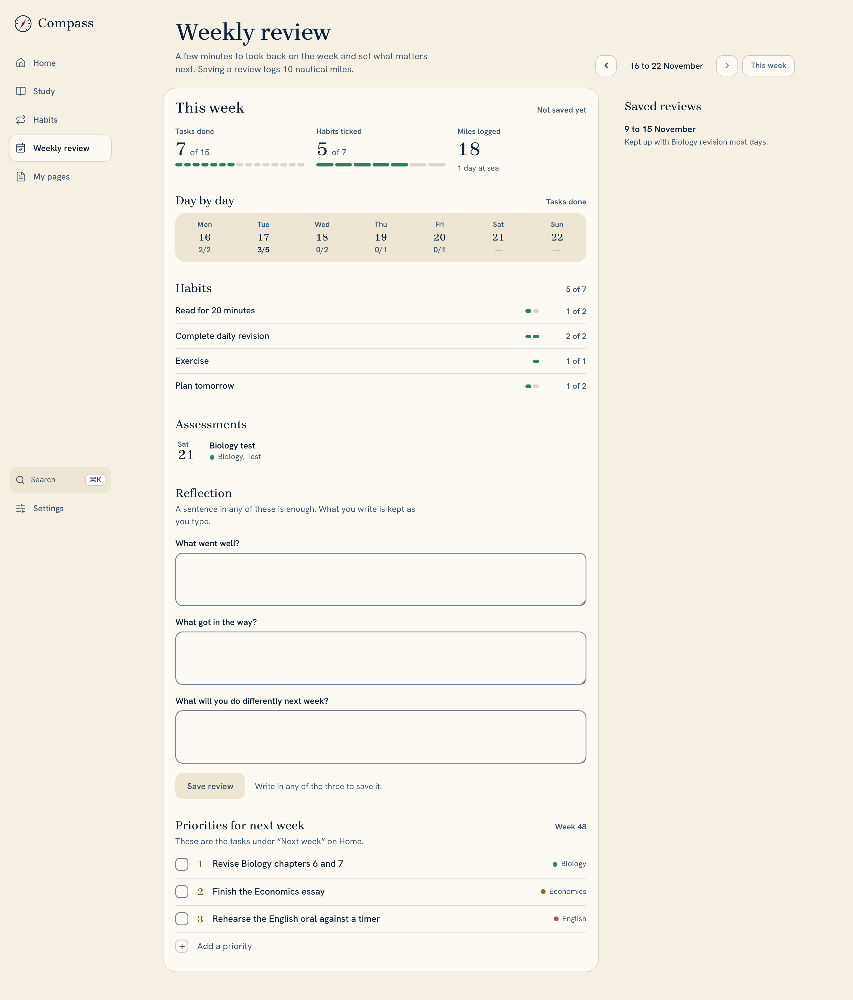

# Weekly review specification

| | |
|---|---|
| Status | **Built on 17 November 2026 as a first version. No founder has reviewed the page,** and its design was not mocked first. The calls made in the build are in section 7. |
| Scope | The Weekly review page: a week's summary, a written reflection, the priorities for the week after, and the saved reviews |
| Companions | [home-screen-spec.md](home-screen-spec.md), [habits-spec.md](habits-spec.md), [study-spec.md](study-spec.md), [testing-report.md](testing-report.md) |

## 1. What the review is

A few minutes to look back on a week, write a line or two, and set what matters next. The brief asks for three things: saved weekly reflections, task and habit summaries, and next-week priorities.

Nothing in the summary is stored. It is worked out from the same tasks, habits and log as every other page, so a task ticked on Home changes the review. Only the words of the reflection are new records.

## 2. Layout

- **From 1024 px:** one raised sheet for the chosen week, with the saved reviews listed to its right. The page is 1100 px at most, which keeps the writing boxes to a comfortable line length.
- **Below that:** the sheet, then the saved reviews under it.
- **Choosing a week:** previous and next buttons and "This week", as on Habits. A week still to come cannot be opened, because it has nothing to look back on.

## 3. The week's summary

- **Three figures:** tasks done of those planned, habits ticked of those due so far, and nautical miles logged with the number of days they were logged on.
- **Day by day:** each of the seven days with its tasks done of planned. A day with none shows a short dash, as on the week strip.
- **Habits:** each habit that had a day in the week so far, with its count. A habit made later in the week is counted from the day it was made.
- **Assessments:** the ones that fell in the week. The heading is left out when there are none.

Tasks for "any time this week" are in the total and not in the day-by-day row, since they belong to no day.

## 4. The reflection

Three questions, each optional:

1. What went well?
2. What got in the way?
3. What will you do differently next week?

- **Kept as typed.** Nothing is lost by leaving the page without saving.
- **Saving** needs something written in at least one box. It marks the review as saved, lists it among the saved reviews, and logs the miles in section 6.
- **A saved review can still be changed.** It keeps its first saved date.
- **One review for each week.** There is no way to delete one yet, other than clearing its words.

## 5. Priorities for the week after

The review of this week ends with "Priorities for next week". The review of last week ends with "Priorities for this week".

- These are not a new kind of record. They are the any-time tasks of that week: the same ones Home lists under "Next week" and "Any time this week". Adding, ticking, editing and deleting them here does the same there.
- They are numbered, as on Home, because their order is the point.
- The section is left off older weeks, where the week after has already gone. It is a plan and not a record.

## 6. Miles

- **Saving a review logs 10 nautical miles,** the figure in the art direction's table.
- **Once for each week.** Saving again, or changing a saved review, logs nothing more.
- **Only this week or the one just ended.** An older week can be written and saved, and earns nothing, so the past cannot be mined for miles.
- As with everything else, miles are never taken away.

There is no reminder to review, no count of weeks reviewed in a row, and nothing is marked as missed.

## 7. Calls made in the build, open to change

| Call | Why | The other way |
|---|---|---|
| Three fixed questions | Short enough to answer in a minute, and they end on next week | One open box, or questions the user can change |
| The page opens on this week, whatever the day | Simple and predictable | Open on last week early in the week, when last week has no saved review |
| A review can be saved at any point in the week | No rule about when a week is "over" | Only from Friday, or only once the week has ended |
| Only this week and last week earn miles | Stops miles being earned from old weeks | Any week, once |
| Older weeks can still be written | A late reflection is better than none | Lock weeks after a time |
| Priorities are the week's any-time tasks | One set of records, as everywhere else | A separate list of priorities kept with the review |
| The figures are live, not a snapshot | Nothing to keep in step | Freeze the figures when the review is saved |

The last one matters most. A saved review of an old week shows that week's figures as the records stand now, so ticking a late task or deleting an old one changes what an old review shows.

## 8. Not in this version

- Deleting a saved review.
- A view across many weeks, such as tasks done week by week.
- A link from Home to the review at the end of the week.
- Any effect on the sea beyond the miles.
