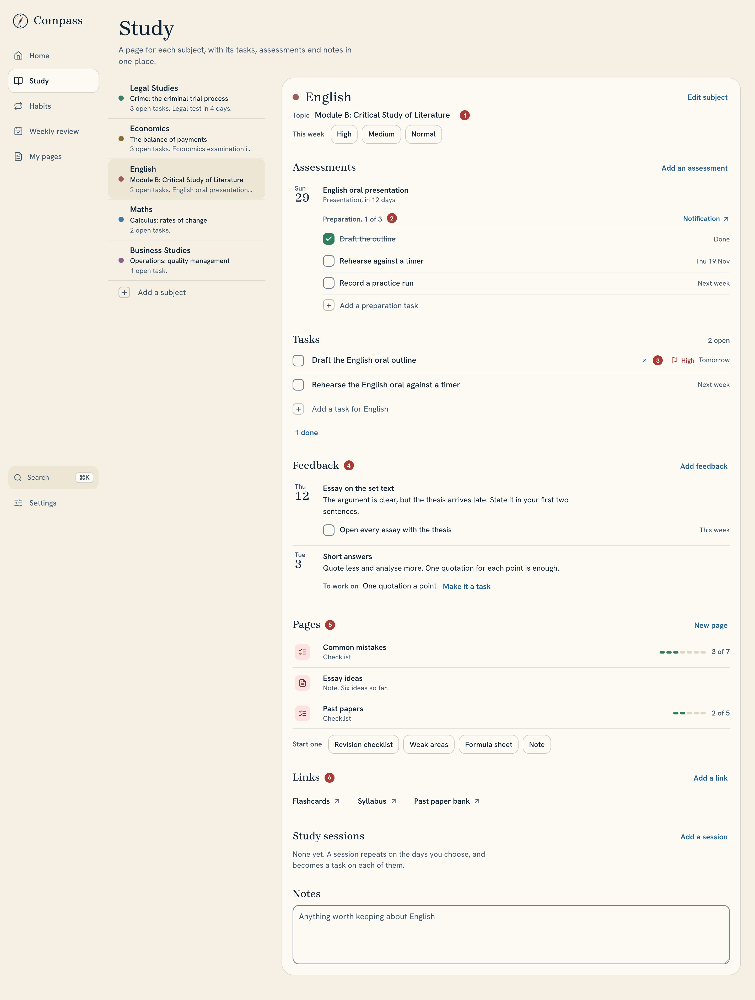
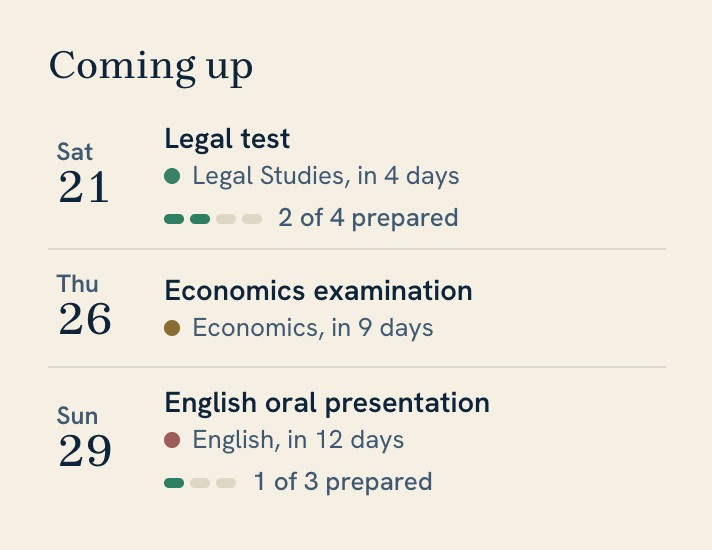
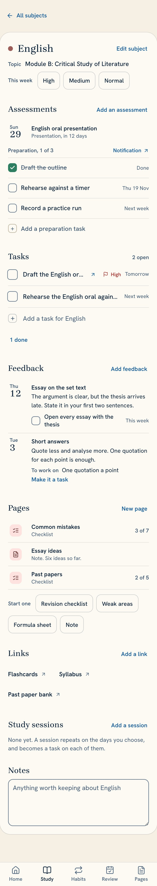
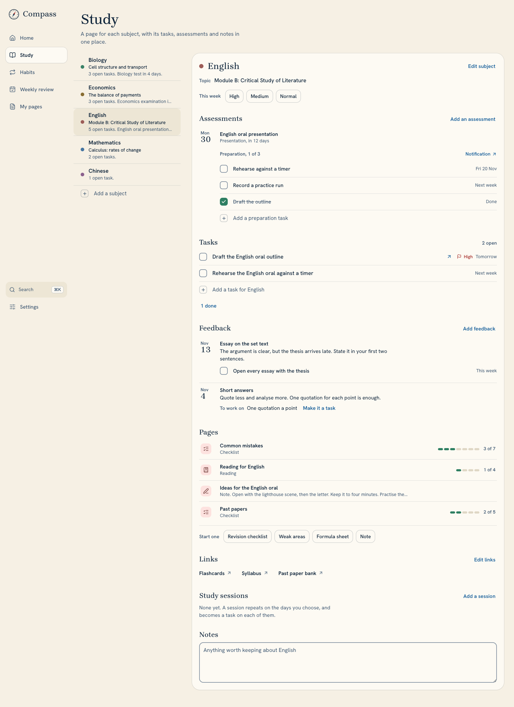
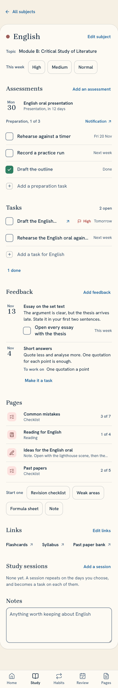
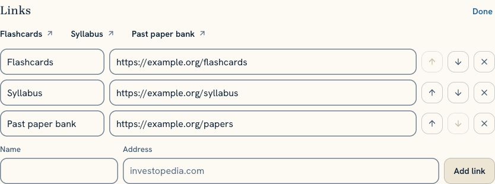

# Study detail: specification

| | |
|---|---|
| Status | **Designed on 17 November 2026 and approved by Oliver the same day. Built on 18 November, on the branch `study-detail`.** Oliver chose the approach and all seven decisions in section 4 from the mock, then approved this document. Josh and Aditya have not weighed in. The calls in section 13 were made here and are still open to change. Section 16 says where the build differs. |
| Scope | The second piece of Aditya's plan: what a subject's page gains. A current topic, preparation tasks and a link on an assessment, a link on a task, teacher feedback, the subject's own pages, and its links. |
| Companions | [study-spec.md](study-spec.md), [my-pages-spec.md](my-pages-spec.md), [home-and-review-additions-spec.md](home-and-review-additions-spec.md), [home-screen-spec.md](home-screen-spec.md), [compass-art-direction.md](compass-art-direction.md) |
| Mock | [Study Detail in Compass](https://claude.ai/artifact/K3yezjZJ4BZDaCC9FQk4Bs), a private page. It needs sharing from its Share menu before Josh and Aditya can open it. |

The picture is a mock, drawn onto the running app. The red numbers are for the mock only. The feedback, pages and links in it are invented samples.

## 1. Where this comes from

This is piece 2 of the five in [next-stages.md](next-stages.md), Stage 8. The plan asks for each subject's page to show the current topic, homework, teacher feedback, revision and reference material, with different extras for each subject: essay ideas for English, a formula sheet for Maths, cases for Legal Studies.

Piece 1, Home and the Weekly review, is built and is pull request 11.

## 2. What this piece is for

A subject's page is where a student goes to answer "where am I with this subject?". Today it answers with tasks and assessments. After this piece it also says what the subject is on now, what the teacher last said, what is left to prepare for the next assessment, and where the subject's own material is kept.

## 3. Goals, and what to stay away from

**Goals**

- The current topic, in the syllabus's own words, is the first thing on a subject's page.
- An assessment shows what is left to prepare for it, here and on Home.
- Feedback is kept where it can be acted on, and what to work on can become a task.
- Each subject holds the material that suits it, without a section built for every kind of material.
- A new subject's page gains three short lines, not three empty boxes.

**Not goals**

- A third state for a task, "in progress". A task is open or done.
- Sorting tasks by date, subject or status. A subject's tasks are already in date order.
- Tags for topic and year on past-paper questions. A past-papers page is a list, and a line can say its year.
- Uploaded files. A link is kept and the file is not: Compass keeps everything on the device and has nowhere to put a file.
- Keeping a task's original date when it is moved.
- A revision status in the list of subjects.

**What would make this a failure**

- A second copy of anything. A preparation task that is also a different record on Home, or a checklist kept in Study and again in My pages.
- A subject's page that reads as a form to fill in. Nothing new is required, and nothing is marked as missing.
- Anything that is not a web address reaching a link. Every link, wherever it is kept, follows the rules piece 1 set.
- A saved week that changes: adding these parts must not alter a task's miles, a day's progress or the sample's counts.

## 4. Approaches

### How a subject holds its open-ended material

| | Approach | Trade-off |
|---|---|---|
| A | The same fixed sections on every subject: weak areas, revision checklist, past papers, reference | Simplest. The plan itself wants different sections for each subject, so some would sit empty and others would be missing. |
| **B** | **A subject lists its own pages.** A page in My pages can already carry a subject; the subject's page lists the ones that are its own. | Every subject gets the sections it needs from what is already built. The material is one click away, not laid out on the subject's page. |
| C | Sections laid out on the subject's page itself, each subject with its own | Closest to the plan's drawing. A second copy of lists and notes inside Study, and a long page on a phone. |

**Oliver chose B.**

### The seven decisions in this piece

Oliver chose the recommended side of each, from the mock.

| | Decision | Chosen | The other way |
|---|---|---|---|
| 1 | Where the topic shows | Under the subject's name, and as a line in the list of subjects | On the subject's page only |
| 2 | What a preparation task is | An ordinary task that belongs to an assessment: on Home on its day, and counted under "Coming up" | A checklist on the assessment that is not a task |
| 3 | Feedback's "To work on" | Can be made into a task, which shows its tick beside the feedback | Words only |
| 4 | Starting a page from a subject | Four starters: Revision checklist, Weak areas, Formula sheet, Note | "New page" alone, with My pages' five kinds |
| 5 | Where links can go | One on a task, one on an assessment, and a short list on the subject | The subject's list only |
| 6 | The order of the page | Assessments, tasks, feedback, then pages, links, sessions and notes | Today's order, with the new parts at the end |
| 7 | A revision status in the list of subjects | None. Each checklist shows its count on the subject's page. | One count across the subject's checklists |

## 5. Records

New parts of the saved data. Everything stays on the device.

| Record | Fields | Limits |
|---|---|---|
| `subject.topic` | What the subject is on now | Up to 200 characters. Kept exactly as typed, apart from spaces at either end and line breaks, which become spaces. Empty means not set. |
| `subject.links` | A list of `{ id, name, url }`, in the order shown | Up to 6 for each subject. Name 1 to 24 characters. |
| `task.link` | One web address | Optional |
| `task.assessmentId` | The assessment a task is preparation for | Optional |
| `assessment.link` | One web address: its notification | Optional |
| `feedback` | A list of `{ id, subjectId, date, about, words, work, taskId }` | `words`, what the teacher said, 1 to 2,000 characters. `about`, what it was on, up to 80 and optional. `work`, what to work on, up to 140 and optional. `taskId` is set when `work` is made into a task. |

**Every web address** follows piece 1's rule, in `cleanUrl`: `https://` is put in front when no scheme was typed, only http and https addresses are kept, and anything else is refused with "That does not look like a web address."

**A save is not trusted.** When a save is opened, every address in it is checked again: a subject's links through `storedLinks`, and a task's or an assessment's link through `cleanUrl`. One that fails is dropped. Feedback is kept only where it has an id, a subject and words.

**The topic is never rewritten.** No capital letters are changed, no punctuation is added, and no words are cut except at the limit.

## 6. A subject's page

The parts in order. What is worked on comes first, and what is kept comes after.

| Part | State |
|---|---|
| Name, topic, "This week" | Topic is new |
| Assessments | Each gains its preparation tasks and its link |
| Tasks | A task can carry a link |
| Feedback | New |
| Pages | New |
| Links | New |
| Study sessions | Moved down |
| Notes | As now |

### The topic

- One line under the subject's name: the word "Topic", then the topic. It wraps if it is long.
- With no topic it reads "Set the topic", as a quiet link.
- Pressing either opens the subject's editor with the topic box ready to type in. The editor gains a "Topic" box under the name.
- In the list of subjects, the topic is a line of its own between the subject's name and its summary, cut with an ellipsis if it is long. With no topic the row is as it is today.

### Assessments, with preparation

- **A preparation task is an ordinary task** with an assessment to belong to. It has a day or a week, shows in that day's list on Home, counts in the day's and the week's progress, moves the light and the sea, and earns a task's miles.
- **Under its assessment,** on the subject's page: a line "Preparation, 1 of 3", then each task with its tick, its title and when it is for. Open ones come first, by date. Done ones follow and read "Done".
- **"Add a preparation task"** is the last row under each assessment that is still ahead. The task is for any time this week, carries the subject, and belongs to the assessment. Its editor can move it to a day.
- **Listed once.** A preparation task is under its assessment and not again under "Tasks". The count beside "Tasks" does not include it. The subject's summary line in the list counts every open task, as now.
- **An assessment with no preparation tasks** shows no count, here or on Home, and only the row to add one.
- **On Home, "Coming up"** gains a line under an assessment that has preparation tasks: a small bar and "1 of 3 prepared". Nothing else on Home changes: a preparation task is not marked in the day's list.
- **In the task's editor,** a preparation task says "Preparation for English oral presentation" and offers "Not preparation", which keeps the task and frees it from the assessment.
- **Deleting an assessment** keeps its preparation tasks, as ordinary tasks. Undo puts them back under it.
- **The date passing** does nothing to the tasks. A past assessment, behind "2 past", still shows its preparation when it is opened.
- **The link.** The assessment's editor gains "Notification link". On the page it shows as "Notification" with a small arrow, at the right of the preparation line, and opens in a new tab.

### Tasks, with a link

- The task's editor gains "Link", checked when the box is left or Enter is pressed, as a link's address is in Settings.
- A task with a link shows a small arrow on its row, wherever the row is: a subject's page, Home, the Weekly review. It is a link of its own that opens in a new tab, and is read aloud as "Link for Draft the English oral outline, opens in a new tab".

### Feedback

- **An entry** is a date, what it was about (optional), what the teacher said, and what to work on (optional). Entries are listed newest first.
- **"Add feedback"** opens an editor: the date (today, to start with), "About", "What was said" and "To work on". It is added when "What was said" has something in it. An existing entry is changed in the same editor, and deleted there with Undo.
- **"To work on"** shows under the entry with "Make it a task". That makes a task with those words as its title, for any time this week, carrying the subject. The entry then shows that task in place of the words: its tick, its title and when it is for.
- **The task is the one record.** Ticking it beside the feedback is ticking it on Home. If the task is deleted, the entry shows its words and "Make it a task" again. Changing the words afterwards does not rename a task already made.
- **Deleting an entry** keeps the task it made.
- **No entries:** one line, "None yet. Feedback is kept here, with anything to work on."

### Pages

- **Every page that carries this subject** is listed, in the order My pages uses: most recently changed first, reached goals last.
- **A row** has the page's kind as an icon in the subject's tint, its title, and one line: its kind, then what My pages says about it ("3 of 7", "aim for 11 Dec", or its first words). A page with a list also shows the count at the right, with the bar from 640 px.
- **Selecting a row** opens the page in My pages.
- **"Start one"** is a row of starters under the list. Each makes a page that already carries the subject and opens it:

| Starter | Kind | Title |
|---|---|---|
| Revision checklist | Checklist | Revision checklist |
| Weak areas | Checklist | Weak areas |
| Formula sheet | Note | Formula sheet |
| Note | Note | Untitled, with its title ready to type |

- A starter is left out once the subject has a page with that title. "Note" always stays.
- **No pages:** the starters alone, under the line "Nothing kept for English yet."

### Links

- The subject's links in a row, each with a small arrow, opening in a new tab.
- **"Edit links"** opens an editor with each link's name and address, move up and down, remove with Undo, and a row to add one, as in Settings. With no links the action reads "Add a link".
- Up to six for each subject.

### On a phone

The same parts in one column. Preparation tasks are not indented. A page's count shows without its bar.

## 7. Deleting, and Undo

| Deleted | What goes | What stays | Undo |
|---|---|---|---|
| A subject | Its assessments, sessions, feedback and links | Its tasks and pages, without a subject | Puts everything back |
| An assessment | Its link | Its preparation tasks, as ordinary tasks | Puts them back under it |
| A feedback entry | The entry | A task it made | Puts it back |
| A task made from feedback | The task | The entry, with its words | Puts the task back beside it |

## 8. Miles, and the sea

- Preparation tasks and tasks made from feedback are tasks, so they earn a task's miles and move the light like any other.
- Feedback, pages, links and the topic earn nothing and change nothing on the sea.

## 9. Sample data and earlier saves

- **The sample** gains a topic on Biology and one feedback entry there. No sample task is added, changed or made into preparation, so every count on Home, in Study and in the Weekly review is as it was.
- **A save from before this piece** opens with no topics, links or feedback, and nothing lost.
- **"Clear everything"** also clears them.

## 10. Accessibility

- A preparation task's tick is a real checkbox named by its title.
- Every link says that it opens in a new tab.
- The topic line is a button that says what it does: "Change the topic" or "Set the topic".
- Each new part has a heading, in the page's order.
- On phones every new control is at least 44 px tall.
- Long words in a topic, a feedback entry or a link's name wrap, and never push a phone's page sideways.

## 11. Done when

- A topic set in the subject's editor shows under its name and in the list of subjects, exactly as typed.
- A preparation task added under an assessment shows on Home in its week, counts under "Coming up", and earns its miles once when ticked in either place.
- Deleting that assessment keeps the task, and Undo puts it back under the assessment.
- "Make it a task" on a feedback entry makes one task, which can be ticked beside the feedback and on Home.
- A page started from a subject carries that subject and is listed on its page at once.
- A link on a task, on an assessment and on a subject each open in a new tab, and something that is not a web address is refused in all three.
- A save edited by hand to hold something that is not a web address in any of the three opens with it dropped.
- A save from before this piece opens with nothing lost.
- There is no sideways scroll at 375, 390, 768, 1024 and 1440 px with every new part at its longest.
- The existing unit and browser tests pass unchanged, and the new rules have tests of their own.

## 12. Limits to know about

- **A day with only a preparation task is not a day in port,** and doing nothing on it brings the storm, as for any task.
- **Preparation tasks for the same assessment can sit in different weeks,** so "1 of 3 prepared" counts across weeks while a week's progress counts only its own.
- **A feedback entry's task and its words can drift apart,** since the task can be renamed on its own.

## 13. Calls made here, open to change

| Call | Why | The other way |
|---|---|---|
| A preparation task is listed under its assessment and not again under "Tasks" | One thing in one place | Listed in both |
| A new preparation task is for any time this week | The same as a task added from a subject today | For the day before the assessment |
| A preparation task is not marked on Home | Home stays as it is | A small diamond on its row |
| The topic is edited in the subject's editor | One place for a subject's details, and the same on a phone | Typed in place on the page |
| The four starters replace "New page" | "Note" is a new page, so a second button would do the same thing | Keep both, as in the mock |
| A starter is left out once it has been used | Two "Revision checklist" pages for one subject is a mistake more often than a wish | Always show all four |
| Links are edited in one editor, as in Settings | The same thing done the same way | Each link edited where it stands |
| Up to six links for each subject | The same limit as piece 1 | More |
| The sample gains a topic and one feedback entry on Biology | The parts can be seen, and no count changes | The sample shows nothing new |
| Feedback's task is for any time this week | It is something to keep doing, not something for one day | For today |

## 14. Not in this piece

- "In progress", sorting, tags, uploaded files and a task's original date, as in section 3.
- A link from a page back to its subject's page.
- Feedback tied to an existing task. "About" says what it was on.
- Finding feedback, topics or links by search. That is piece 5.

## 15. Left to the build

- Exact spacing, within the tokens and the pictures.
- The names of the new functions and files.
- Whether the links editor is the Settings one made general, or one of its own that looks the same.
- How the subject's editor puts the cursor in the topic box.

## 16. As built

Built on 18 November 2026. Every line of section 11 is met, each by a test. The pictures of the built pages are the numbered files in `screenshots/study-detail/`, beside the mocks. What was tested is in [testing-report.md](testing-report.md), section 14.

### Where the build differs from this document or its mock

| This document, or the mock | The build | Why |
|---|---|---|
| "Edit links" opens an editor | The rows open in place, under the links. The action reads "Done" while they are open. | Every other editor is a dialog that shuts out the rest of the page, so "Undo" could not be pressed after "Link removed." Settings changes its links in place too. |
| A page's line is its kind, then what My pages says about it, and its count shows at the right | When the count shows at the right, the line leaves it out: "Checklist", not "Checklist. 3 of 7" | The count is said once, as the mock draws it |
| Each starter makes a page and opens it | "Note" opens with the page's editor and its title ready to type. The three that come with a title open ready to fill in. | A page that already has its name is opened to be written in |
| The mock draws a done preparation task first | Open ones come first, by date, and done ones follow | Section 6 says so, and it is the order of every other list |
| This document does not say where else a task made from feedback is listed | Beside its entry, and not again under "Tasks", as the mock draws it. It is on Home like any task. | One thing in one place, the rule preparation follows |
| The notice in the subject's editor says deleting removes assessments and ends sessions | It also names feedback, links and pages: "Deleting a subject removes its assessments, feedback and links, and ends its study sessions. Its tasks and pages are kept, without a subject." | Feedback cannot be made again, so the notice says it goes |
| The mock draws an entry's date as a weekday over the day | The month is over the day | Feedback is looked back on weeks later, when a weekday says little |

### Calls made in the build, open to change

- The topic line is read aloud as "Change the topic. It is: ...", so a screen reader hears the topic and what pressing it does.
- "Add a link", pressed when a subject has none, puts the cursor in the name box. "Edit links" leaves it where it is.
- "Start one" always offers "Note", however many notes the subject has.
- What "Tasks" leaves out goes by the page. A preparation task moved to another subject stays under its assessment, and is also under the other subject's "Tasks", where that subject's count says it is.
- A link typed in an editor is checked and kept when the editor closes, however it closes. One that is not a web address is dropped then, without a message, since the editor has gone.

### One change that reaches beyond this piece

The frame every editor shares closed an editor that was opened in the moment after another had closed. The browser reports a close slightly late, and the frame took the late report to be about the editor now open. It is fixed in the frame (`src/ui/EditorFrame.tsx`), so for every editor. The frame can also be told which box takes the cursor, which is how the subject's editor opens at the topic.

### The review of the whole change

A fresh reviewer read the whole change against this document before it was committed. What it found, what was fixed and what was left is in the testing report, section 14.
