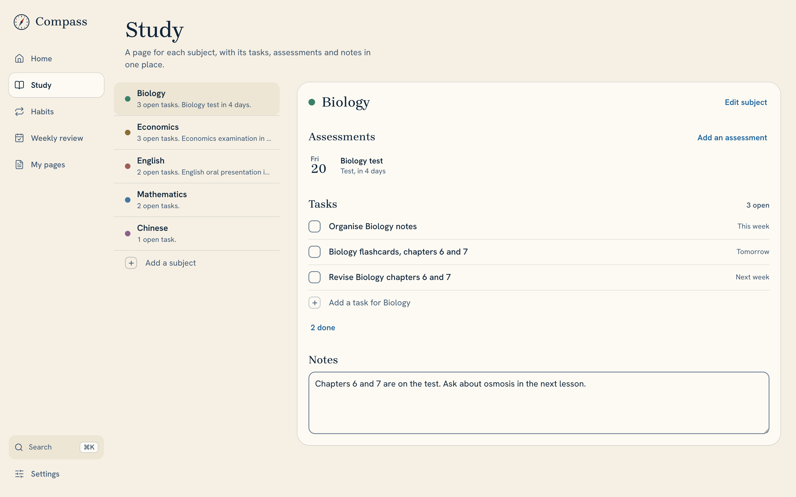
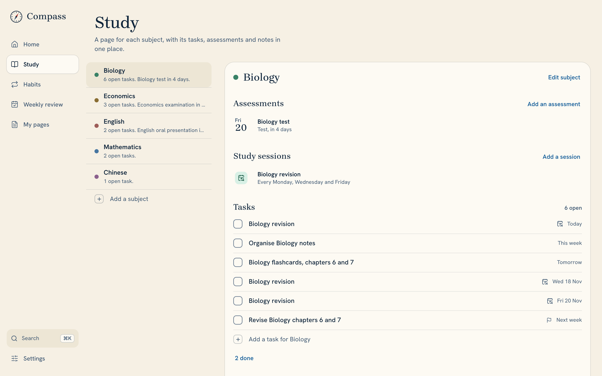

# Study specification

| | |
|---|---|
| Status | **Built on 16 November 2026. No founder has reviewed the page.** Oliver decided the same day that a study session becomes an ordinary task that repeats. |
| Scope | The Study page: subjects, their assessments, their study sessions, their tasks and their notes |
| Companions | [home-screen-spec.md](home-screen-spec.md), [habits-spec.md](habits-spec.md), [testing-report.md](testing-report.md) |

## 1. What Study is

A page for each subject. It does not hold a second copy of anything: a subject's tasks are the same tasks Home shows, and its assessments are the ones under "Coming up".

## 2. Layout

| Width | Layout |
|---|---|
| 1024 px and up | The subjects are listed on the left. The open subject is the one raised sheet on the right. With none chosen, the first is open. |
| Below 1024 px | The list comes first. A subject opens on its own, with a link back to all subjects. |

Each subject in the list has one line under its name: how many tasks are open and what is next, such as "3 open tasks. Biology test in 4 days."

## 3. A subject's sheet

| Part | Behaviour |
|---|---|
| **Study sessions** | The subject's sessions, each with its days in words, such as "Every Monday, Wednesday and Friday". Selecting one opens its editor. |
| **Assessments** | Those still ahead, soonest first. Today counts as ahead. Past ones are behind a count, such as "2 past". Selecting one opens its editor. |
| **Tasks** | Every open task for the subject, wherever it is planned: by date, a day's tasks before the week's. Each row says when it is for ("Today", "Thu 19 Nov", "This week") in place of the subject. Done ones are behind a count. |
| **Add a task** | The last row. The task is for any time this week and carries the subject. It appears on Home at once. |
| **Notes** | Free text, saved as it is typed. |

## 4. Subjects

| | Rule |
|---|---|
| Name | 1 to 40 characters. An empty name is not saved. |
| Colour | One of the eight subject colours. A new subject takes the first colour not yet used. |
| Delete | Removes the subject and its assessments. Its tasks are kept, without a subject. A toast offers Undo, which puts everything back. |

## 5. Assessments

| | Rule |
|---|---|
| Title | 1 to 80 characters |
| Kind | Test, exam, presentation or assignment |
| Date | Any date |
| Delete | With Undo |

A new assessment is confirmed with "Add assessment". Changes to an existing one save as they are made. On Home, assessments still appear under "Coming up" and as a diamond on their day, as before; they can now be changed.

## 6. Study sessions

A session repeats on chosen weekdays. Oliver decided on 16 November, from the [mock](https://claude.ai/artifact/K8BkfUFMt7HfLrAgaY66g4), that on each of its days it becomes **an ordinary task**. The other rules below follow the mock's recommendations and are still open to change.

| | Rule |
|---|---|
| Set up | On the subject's page: a name, which is the title of the tasks it makes, and at least one weekday. A new session is offered the name "Biology revision" for Biology. |
| What it makes | On each of its days, a task for that day with the session's name and subject. It is an ordinary task: it can be ticked, moved, edited and deleted, it counts in the day's and the week's progress, and it earns a task's miles. |
| When | A week's tasks are made when the week arrives, so the week strip shows them from its first day. Weeks further ahead show nothing until they come. |
| Never for the past | Only days from today on are made. Opening the app after a few days away does not fill the days that have gone with tasks nobody saw. |
| Once | A day is made once. Deleting its task is how a day off is taken, and the task is not made again. |
| Changing a session | Applies from then on. Tasks already made are left as they are. A day added mid-week gets its task for what is left of the week. |
| Ending a session | Its tasks stay, as ordinary tasks, and stop being marked as repeating. A toast offers Undo. |
| Deleting the subject | Ends its sessions. Undo restores them. |
| The mark | A task made from a session carries a small calendar mark, on Home and on the subject's page. Opening it says that it came from a session and that changes are for that day only. |

### What it does to the sea

A session's task is counted like any other, which was the recommendation. That has two effects worth knowing:

- A day with a session always has something planned, so the boat is not in port that day.
- Do nothing on such a day and the next one opens in a storm.

The sample data has no sessions, so the sample week is the one the brief describes.

## 7. Not in this version

- **Preparation tasks attached to an assessment.** A task belongs to a subject, not yet to a particular assessment.
- **Reordering subjects.**
