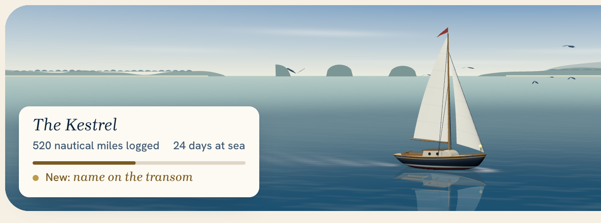
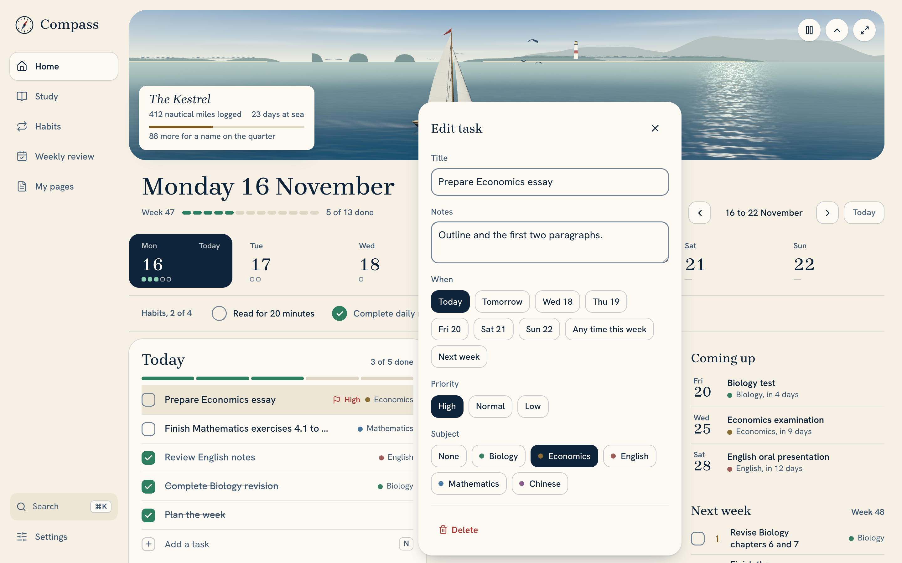

# Compass testing report, Phase 1

| | |
|---|---|
| Date | 16 November 2026 |
| Build | Branch `habits`: Phase 1 with the Phase E changes in section 2, the performance work in section 5, the reward loop in section 6, the motion and editor work in section 7, and Habits in section 8 |
| Covers | The brief's completion criteria (section 11) and the Phase E visual review (section 9) |
| Companions | [compass-art-direction.md](compass-art-direction.md), [home-screen-spec.md](home-screen-spec.md), [next-stages.md](next-stages.md) |

## 1. Summary

Home meets every functional line of the brief's section 11 that can be checked on a laptop. The build passes, 130 unit tests pass and 39 browser tests pass.

Two things are **not** verified, and should not be read as passing:

1. **Performance on a real phone.** Only an indicative figure from a laptop exists (section 5).
2. **A manual screen-reader pass.** Structure, names and contrast were checked by script and by reading the code, not by listening.

## 2. Phase E: what the visual review found and fixed

Home was captured at 375, 390, 768, 1024, 1280 and 1440 px, plus a day in port, a finished day, the editor, the new-task sheet, the command menu, a toast and the folded window. Each was compared with the art direction.

| Found | Where | Fix |
|---|---|---|
| The day's sheet stopped in mid-page with a square bottom edge while the lists beside it carried on. It read as a clipped card, not "a page that runs to the bottom". | 1024 and up | The sheet now stretches the full height of the lists and runs off the bottom of the page. |
| The same sheet had square bottom corners with lists directly under it. | 640 to 1023 | It is a whole sheet with four rounded corners there. |
| Four different left edges: the date, the week strip's text, the sheet's text and the caption each started a few pixels apart. The week controls also stopped 8 px short of the right edge. | All widths | One text edge per width (20 px in from the window at 1024 and up, 14 px on tablet, 20 px from the screen on phones). The week controls end flush with the window. |
| The assessment label on a day was cut to "Biolog…" and ran into the date. | 1024 to 1279 | The label shows only from 1280, where it fits. Below that a brass diamond sits beside the date. |
| On tablet the diamond floated between two days and belonged to neither. | 768 | Same fix: it sits beside its date. |
| On phones the week controls sat between the date and the sea, so four bordered buttons came before the picture. | Below 640 | The order is now date, sea, boat name, week controls, week strip. The controls sit on the strip they move. |
| The phone date wrapped to two lines for long dates such as "Wednesday 23 September". | Below 640 | Phones show "Wed 23 September" at the specified 25 px. Wider screens keep the full weekday. |
| The plate read "88 more for name lettered on the transom". | 1024 and up | Each fitting has a phrase for sentences: "88 more for a name on the transom". The voyage view uses it too. |
| The week line and the week controls sat 7 px out of line with each other. | 640 and up | Both rows are the same height and share a centre line. |
| "All 5 done" where the approved voice says "All five done". | All widths | Counts from two to ten are spelled out. |
| Two-line titles left one word alone on the second line ("…chapters 6 / and 7"). | Side lists | Titles in the side lists break evenly. The empty-day sentence no longer leaves "port." alone. |
| One hex colour in a component, against the tokens rule. | Week strip | Replaced with a token. |
| Arrow keys in the week strip moved from the selected day even when focus was on another day. | Week strip | They move from the day that has focus. |
| A console warning on every load about a removed shadow type. | Scene | The scene asks for the shadow type it was already getting. No visual change. |

Reviewed and left alone: the type scale, the colour use (one accent per region holds), the rail, the one-sheet rule, the task rows, the composer, the editor and the bottom bar.

Updated screenshots are in [screenshots/home/](screenshots/home/).

## 3. How it was tested

| Check | Tool | Result |
|---|---|---|
| Type-check and production build | `npm run build` | Passes. Main bundle 159 kB compressed. Loaded afterwards: the animation engine, 34 kB, and the 3D scene, 259 kB. |
| Unit tests | `npm test` (Vitest) | 130 of 130 pass |
| Browser tests | `PW_CHANNEL=chrome npm run test:e2e` (Playwright, headless Chrome 157) | 39 of 39 pass, three runs in a row |
| Screenshots and state capture | Playwright scripts, six widths and nine states | No console errors in any capture |
| Contrast, text size, touch targets | A script run inside the live page at 390 and 1440 | Section 4 |
| Frame rate | The same, at phone size with the processor slowed four times | Section 5 |

The browser tests had never been run before this pass. Two failed on the first run:

- **A real fault:** the arrow-key behaviour in the table above. Fixed in the app.
- **A fault in the test:** it pressed `N` a few milliseconds after the page loaded, before the shortcuts were listening. A person cannot do this. The test now waits for the page, and the app is unchanged.

`PW_CHANNEL=chrome` is new. It runs the suite in an installed Chrome, so the 100 MB test browser does not need downloading.

## 4. The brief's completion criteria

### Home

| Criterion | Result | How it was checked |
|---|---|---|
| Home loads without runtime errors | Pass | Browser test; no console errors at any width |
| Calendar displays correctly | Pass | Screenshots at six widths |
| Week navigation works | Pass | Browser test: the two week buttons, and an arrow key across a week end |
| Date selection works | Pass | Browser test: click, arrows, `T`; the date is kept in the URL |
| Daily tasks display correctly | Pass | Browser test and screenshots |
| Weekly tasks display correctly | Pass | Browser test: four sample tasks under "Any time this week" |
| Tasks can be added | Pass | Browser test: `N`, type, Enter. An empty title is refused. |
| Tasks can be edited | Pass | Browser test: title and subject change and survive a reload |
| Tasks can be completed and reopened | Pass | Browser test |
| Progress indicators update correctly | Pass | Browser test: the daily count follows each change. Unit tests cover the sums. |
| Sample assessments display correctly | Pass | Browser test: three under "Coming up", and selecting one goes to its date |
| Next-week priorities display correctly | Pass | Browser test: three, numbered |

Also checked: delete with Undo, priority changes, the command menu, and miles being earned once and never falling.

### Boat

| Criterion | Result | How it was checked |
|---|---|---|
| The 3D boat renders | Pass | Browser test waits for the live scene; screenshots |
| Recognisable sailboat geometry | Pass, by eye | Screenshots. The founders' look review is still open (parked by Oliver). |
| Water animation works | Pass | Two captures of the canvas one second apart differ |
| Lighting and materials are coherent | Pass, by eye | Dawn, day, golden hour, port and storm captured |
| The scene does not obstruct the planner | Pass | It sits in its own window, folds to a strip, and the planner draws before the 3D code loads |
| Mobile performance is acceptable | **Not verified on a phone.** The low tier is built and behaves as specified on a laptop. | Section 5 |
| Reduced motion is respected | Pass | Browser test: the scene holds still |
| A fallback exists without WebGL | Pass | Browser test: the still image stays and nothing breaks |

### Responsive design

| Criterion | Result | How it was checked |
|---|---|---|
| Desktop, tablet and mobile layouts work | Pass | Screenshots at 375, 390, 768, 1024, 1280, 1440 |
| No horizontal overflow | Pass | Browser tests at the five widths; also on every destination page |
| Touch targets are usable | Pass | Script at 390 px: every link, button and field is at least 44 by 44 px. At 1440 the smallest is 36 px, above the 24 px the spec asks for with a pointer. |
| Text remains readable | Pass | Script: nothing below 12.5 px at either width |
| Navigation works on smaller screens | Pass | Each bottom-bar item was followed and its page loaded |

### Quality

| Criterion | Result | How it was checked |
|---|---|---|
| No obvious console errors | Pass | None at any width. One harmless warning remains: "THREE.Clock deprecated", from React Three Fiber. |
| No broken navigation | Pass | Every route was reached through the real navigation at 390 and 1440 |
| No placeholder buttons pretending to work | Pass | The four future pages state what will live there and have no controls |
| No unnecessary loading delays | Pass | The planner draws from local data on the first paint. Only the scene loads late, behind its still image. |
| No major visual inconsistencies | Pass after section 2 | |
| No severe performance issues | Pass on a laptop. Phone not verified. | Section 5 |

### Contrast

A script walked every visible piece of text on Home at 390 and 1440 px, worked out the colour actually behind it, and computed the ratio. **Nothing was below 4.5 to 1.** This is the first check of contrast inside the running app. It covers text only. Graphics such as the progress marks rest on the measured token table in the art direction.

## 5. Performance

### What was built on 16 November

The sea now has the two tiers the spec asks for, and it stops drawing when nobody can see it.

| | High tier | Low tier |
|---|---|---|
| Chosen when | A device with a mouse or trackpad | A touch device, or any device whose frames average over 22 ms for two seconds |
| Pixel density | Up to 2 | Up to 1.5, falling to 1 if frames average over 45 ms for two seconds |
| Shadow | A shadow map | None. The soft dark patch the water already draws under the hull does the job. |
| Frame rate | The display's own | Capped at 30 |
| Graphics chip | Asks for the fast one | Lets the device choose, to save battery |

- **Asleep.** The scene draws nothing while its window is scrolled out of view or the tab is hidden, and starts again when it returns.
- **One-way.** A device that steps down stays down for the visit, so the picture does not flicker between tiers.
- **Review tool.** `/lookdev` has a Performance control (Automatic, High, Low) to compare the tiers side by side.

### Measured

Apple M5 laptop, headless Chrome 157, real GPU. Frames were counted from outside the app by watching WebGL draw calls.

| Case | Result |
|---|---|
| Phone size (390 by 844, three times density, touch) | Low tier chosen. 30 frames a second. Canvas drawn at 537 by 276 for a 358 by 184 window. |
| The same, scrolled until the window is out of view | 0 frames in two seconds |
| Laptop size (1440 by 900, twice density) | High tier chosen. 60 frames a second. |
| Every frame made to take 30 ms, as on a slow device | Steps down to the low tier within a few seconds |
| Processor slowed four times, before this work | 60 frames a second, median frame 16.7 ms |

The two tiers look almost the same at window size. The low tier is slightly softer.

### Draw calls and triangles

The spec's budgets are 40 draw calls and 60,000 triangles a frame. The first measurement found the scene far over the first: every plank, palm frond and limb was its own draw call. Parts that never move are now baked into one mesh for each material, the sails share one mesh, each figure is one mesh, the gulls are one mesh, and each island is one mesh.

Draw calls in a frame, before and after:

| Scene | High tier before | High tier now | Low tier before | Low tier now |
|---|---|---|---|---|
| Dinghy under sail | 59 | 20 | 50 | 17 |
| Sloop under sail | 117 | 22 | 89 | 17 |
| Sloop in a storm | 104 | 23 | 74 | 18 |
| Cutter under sail | 144 | 25 | 105 | 19 |
| Schooner under sail | 169 | 28 | 121 | 21 |
| Sloop in port | 328 | 29 | 225 | 20 |
| Schooner in port | 457 | 32 | 294 | 22 |

- **Both budgets are met in every case.** Triangles run from 11,000 to 36,000 a frame and did not change.
- **The picture was checked against the old one,** frame against frame with the scene paused, in nine cases. The boat, its reflection, the port and the figures match.
- **One thing looks different, and it is a fix.** Each island's beach, and the band and lamp of the distant lighthouse, used to show in some scenes and vanish in others, because their layers sat at the same depth. They now show every time. In the picture below, each pair of rows is before, then after: golden hour, in port, a storm, and the dinghy.

### What this does not show

- **How a real phone copes.** A laptop's graphics chip is far stronger than a phone's, and none of this measures heat or battery. The spec's pass bar ends with a founder checking on a real phone. That has not happened.

## 6. The reward loop

Built on 16 November, from the art direction (section 13) and the Home spec (section 11).

### What was missing

Earning a fitting changed nothing you could see. The boat's pennant, lantern, stripe and portlights were fixed by the type of boat: every sloop had all four from its first mile, and a dinghy never had any. The plate did not say when something was earned.

### What was built

| | Behaviour |
|---|---|
| **Fittings on the boat** | The boat wears the fittings that have been earned and no others, in the 3D scene and the still image alike. A pennant earned on the dinghy flies from the dinghy, and carries to every later boat. |
| **The plate** | When something has been earned since the voyage was last opened, a brass dot and one line replace the plate's last line: "New: *bow lantern*". Several at once read "New: *bow lantern* and 1 more". The name is in the voyage's italic, as the chart rule asks. |
| **A new boat** | The plate says "*The cutter* is ready". The boat on Home does not change. |
| **The voyage view** | It opens on the new boat, with one notice: "The cutter is ready. You are still sailing the sloop." and a button to sail it. New fittings carry a "New" tag in the list. Opening the view is what marks them as seen. |
| **Phones** | The same line takes the place of the miles under the window. |
| **The name on the quarter** | At 500 miles the boat's name is lettered on her quarter, on both sides, in the voyage's italic: gold leaf on a dark hull, navy on a light one. Renaming the boat repaints it at once. It is painted by the hull itself, so it adds no draw call. |
| **Assistive technology** | The plate's name includes the line, and a polite live region states it once. Nothing pops up. |

The name on the quarter, enlarged three times. In the Home window it is under twenty pixels long, which is how a name reads on a boat at that distance:

A dinghy and a sloop, each with nothing earned and then with the first four fittings:

### Checked

- Browser tests: a new fitting is announced, survives a reload, is tagged in the voyage view, and the plate returns to normal afterwards; a new boat is offered and not swapped in, and sailing it works; on a phone the line fits without sideways scroll.
- Unit tests: what counts as new, the wording of the line, and each fitting adding to the 3D boat and to the still image.
- The sample boat at 412 miles looks exactly as before, because it has earned all four drawn fittings.

### Calls made here that the founders can overrule

- **A boat with nothing earned is plainer than before.** A new sloop has no pennant, lantern, stripe or portlights until its miles earn them. This is what the art direction describes, but it has not been seen until now.
- **The dinghy's lantern is 60% of full size,** so it does not overpower a 3.8 m boat.
- **The voyage view opens on a newly earned boat** and not on the one being sailed.
- **On phones the announcement replaces the miles** under the window until the voyage is opened.
- **The lettering is to scale,** about 0.2 m tall on the sloop. It is small in the Home window and readable in the voyage view.

## 7. Motion, the editor and the shortcut list

Built on 16 November, from the Home spec (sections 7, 13 and 14). This finishes Stage 3.

| | Behaviour |
|---|---|
| **Task rows** | A finished task holds its place for 600 ms, then slides below the open ones in 320 ms. A row fades in when added and out when deleted, and the rows around it slide to close the gap. Choosing another day swaps the list at once. |
| **Week strip** | The new week arrives from the side the calendar moved toward. The strip follows a finger or a mouse drag: past 56 px, or a quick flick, it changes the week, and otherwise it settles back. |
| **Editor on wider screens** | A popover beside the task's row, which is tinted while it is being edited. Beside the row if there is room, otherwise below or above, and always wholly on screen. No Done button: changes save as they are made. Escape or a click outside closes it and focus returns to the row. |
| **Editor on phones** | A bottom sheet that rises on a spring with no overshoot. Dragging its header down follows the finger; past 110 px, or a quick flick, it closes. |
| **Shortcut list** | `?` shows every shortcut, grouped by where it works. It is also in the command menu. |
| **Reduced motion** | Nothing slides or scales. Changes cross-fade. |

### How it was built

- Motion 14.14, which the brief's stack lists, is now installed. Its animation engine is loaded after the first paint, which keeps the main bundle at 156 kB compressed against the spec's ceiling of 200.
- Single-key shortcuts now do nothing while any dialog is open.
- Key hints are set in the interface typeface. They were in the browser's monospace, which the type system does not include.

### Checked

- Browser tests: the shortcut list opens and closes; the popover sits beside its row, on screen, with no Done button, saves as you type, and returns focus; a click outside closes it; the phone sheet settles back after a short drag and closes after a long one; the week strip does the same; a finished task moves below the open ones; and everything works with reduced motion.
- Unit tests: where the popover sits in six cases, including a window too small for it.
- No console errors or warnings.

## 8. Habits

Built on 16 November. The rules are in [habits-spec.md](habits-spec.md). Where habits sit on Home was decided by Oliver from the mock, and Oliver accepted the Habits page as a first version on 16 November. Josh and Aditya have not reviewed either.

### What was built

| | Behaviour |
|---|---|
| **Habits** | Named by the user, for every day or chosen weekdays. A habit can be ticked for the day or any day after, never for a day still to come. |
| **On Home** | A line of its own between the week and the lists from 1280 px wide. Below that, a grid at the foot of the day's sheet. It follows the selected day, shows up to six, and shows nothing on a day with no habits. |
| **The Habits page** | The week as a grid of round ticks, a count for each habit and for the week, and earlier weeks as the record. Add, rename, choose days, delete with Undo. |
| **Miles** | One for each tick, once for each habit and day, up to 8 a day. Unticking takes nothing back. |
| **Never** | No streaks, no red, no reminders, and no effect on the sea. |

### Checked

- Browser tests: the line sits between the week and the sheet on a wide screen and on the first screen; a tick counts, logs one mile once, and survives a reload; a day ahead cannot be ticked; the grid is at the foot of the sheet at 1024 px and on a phone, with no sideways scroll; the Habits page counts each habit and keeps earlier weeks; habits can be added, renamed, given days and deleted with Undo; a day with no habits shows nothing.
- Unit tests: which habits fall on a day, a habit's week, counting only the days that have come, choosing days, the mile for a tick, the daily limit, and the store's actions.
- The task editor was moved onto a frame it now shares with the habit editor. Its own browser tests still pass unchanged.

### Calls made here that the founders can overrule

- **The limit of 8 miles a day from habits.** The art direction gives one mile a tick and no limit.
- **A new habit starts today.** Days before it was made are not counted, so its record starts clean, and they cannot be ticked.
- **Earlier weeks can still be ticked,** so a forgotten tick can be put right.
- **The page shows one week at a time.** There is no view across many weeks yet.

## 9. Built differently from the approved spec

None of these breaks a criterion in the brief. Each is a gap between the build and the approved documents that the founders should know about.

| Spec says | Build does |
|---|---|
| The water is a mesh, 128 by 128 on the high tier and 64 by 64 on the low | The water is one flat sheet shaded per pixel, so there is no mesh to coarsen. The low tier saves by drawing fewer pixels. |
| The high tier reflects the boat with a half-resolution pass | Both tiers use a mirrored copy of the boat, which the spec gives as the low tier's method |
| The high tier's shadow map is 1024 px | It is 2048 px, kept from the look review |
| The week strip slides when the week changes | It moves 28 px in the direction of travel while it fades, and does not sweep the full width. The outgoing week leaves the other way. |
| The folded window shows a strip of horizon | It shows a strip of the same view, which cuts through the sail |
| Corners use `corner-shape: squircle` where supported | Plain rounded corners |
| The name is lettered on the transom | It is lettered on the quarter, by Oliver's decision on 16 November, because the transom faces away from the usual view. The still image does not letter it. |

## 10. Known limitations

- No manual screen-reader pass.
- No real-phone test of speed, heat or battery.
- The storm's breaking crests look like patches.
- The still image is side-on, so the picture shifts when the 3D scene takes over. Its port has no figures.
- Dark theme, the night scene, Study, Weekly review, My pages, drag to reorder, recurring tasks, editing assessments, accounts and sync are not built, by plan.
- Tested in Chrome only. Safari and Firefox have not been opened.
