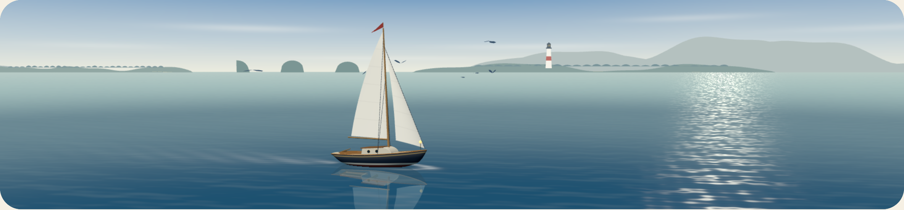

# Compass testing report, Phase 1

| | |
|---|---|
| Date | 16 November 2026 |
| Build | Branch `sea-performance`: Phase 1 with the Phase E changes in section 2, and the performance work in section 5 |
| Covers | The brief's completion criteria (section 11) and the Phase E visual review (section 9) |
| Companions | [compass-art-direction.md](compass-art-direction.md), [home-screen-spec.md](home-screen-spec.md), [next-stages.md](next-stages.md) |

## 1. Summary

Home meets every functional line of the brief's section 11 that can be checked on a laptop. The build passes, 67 unit tests pass and 20 browser tests pass.

Three things are **not** verified or not met, and should not be read as passing:

1. **Performance on a real phone.** Only an indicative figure from a laptop exists (section 5).
2. **A manual screen-reader pass.** Structure, names and contrast were checked by script and by reading the code, not by listening.
3. **The draw-call budget is exceeded.** The spec allows 40 draw calls a frame. The scene makes about 88 on the low tier and 117 on the high tier (section 5).

## 2. Phase E: what the visual review found and fixed

Home was captured at 375, 390, 768, 1024, 1280 and 1440 px, plus a day in port, a finished day, the editor, the new-task sheet, the command menu, a toast and the folded window. Each was compared with the art direction.

| Found | Where | Fix |
|---|---|---|
| The day's sheet stopped in mid-page with a square bottom edge while the lists beside it carried on. It read as a clipped card, not "a page that runs to the bottom". | 1024 and up | The sheet now stretches the full height of the lists and runs off the bottom of the page. |
| The same sheet had square bottom corners with lists directly under it. | 640 to 1023 | It is a whole sheet with four rounded corners there. |
| Four different left edges: the date, the week strip's text, the sheet's text and the caption each started a few pixels apart. The week controls also stopped 8 px short of the right edge. | All widths | One text edge per width (20 px in from the window at 1024 and up, 14 px on tablet, 20 px from the screen on phones). The week controls end flush with the window. |
| The assessment label on a day was cut to "Biolog…" and ran into the date. | 1024 to 1279 | The label shows only from 1280, where it fits. Below that a brass diamond sits beside the date. |
| On tablet the diamond floated between two days and belonged to neither. | 768 | Same fix: it sits beside its date. |
| On phones the week controls sat between the date and the sea, so four bordered buttons came before the picture. | Below 640 | The order is now date, sea, boat name, week controls, week strip. The controls sit on the strip they move. |
| The phone date wrapped to two lines for long dates such as "Wednesday 23 September". | Below 640 | Phones show "Wed 23 September" at the specified 25 px. Wider screens keep the full weekday. |
| The plate read "88 more for name lettered on the transom". | 1024 and up | Each fitting has a phrase for sentences: "88 more for a name on the transom". The voyage view uses it too. |
| The week line and the week controls sat 7 px out of line with each other. | 640 and up | Both rows are the same height and share a centre line. |
| "All 5 done" where the approved voice says "All five done". | All widths | Counts from two to ten are spelled out. |
| Two-line titles left one word alone on the second line ("…chapters 6 / and 7"). | Side lists | Titles in the side lists break evenly. The empty-day sentence no longer leaves "port." alone. |
| One hex colour in a component, against the tokens rule. | Week strip | Replaced with a token. |
| Arrow keys in the week strip moved from the selected day even when focus was on another day. | Week strip | They move from the day that has focus. |
| A console warning on every load about a removed shadow type. | Scene | The scene asks for the shadow type it was already getting. No visual change. |

Reviewed and left alone: the type scale, the colour use (one accent per region holds), the rail, the one-sheet rule, the task rows, the composer, the editor and the bottom bar.

Updated screenshots are in [screenshots/home/](screenshots/home/).

## 3. How it was tested

| Check | Tool | Result |
|---|---|---|
| Type-check and production build | `npm run build` | Passes. Main bundle 136 kB compressed, 3D chunk 256 kB compressed and loaded lazily. |
| Unit tests | `npm test` (Vitest) | 67 of 67 pass |
| Browser tests | `PW_CHANNEL=chrome npm run test:e2e` (Playwright, headless Chrome 157) | 20 of 20 pass, three runs in a row |
| Screenshots and state capture | Playwright scripts, six widths and nine states | No console errors in any capture |
| Contrast, text size, touch targets | A script run inside the live page at 390 and 1440 | Section 4 |
| Frame rate | The same, at phone size with the processor slowed four times | Section 5 |

The browser tests had never been run before this pass. Two failed on the first run:

- **A real fault:** the arrow-key behaviour in the table above. Fixed in the app.
- **A fault in the test:** it pressed `N` a few milliseconds after the page loaded, before the shortcuts were listening. A person cannot do this. The test now waits for the page, and the app is unchanged.

`PW_CHANNEL=chrome` is new. It runs the suite in an installed Chrome, so the 100 MB test browser does not need downloading.

## 4. The brief's completion criteria

### Home

| Criterion | Result | How it was checked |
|---|---|---|
| Home loads without runtime errors | Pass | Browser test; no console errors at any width |
| Calendar displays correctly | Pass | Screenshots at six widths |
| Week navigation works | Pass | Browser test: the two week buttons, and an arrow key across a week end |
| Date selection works | Pass | Browser test: click, arrows, `T`; the date is kept in the URL |
| Daily tasks display correctly | Pass | Browser test and screenshots |
| Weekly tasks display correctly | Pass | Browser test: four sample tasks under "Any time this week" |
| Tasks can be added | Pass | Browser test: `N`, type, Enter. An empty title is refused. |
| Tasks can be edited | Pass | Browser test: title and subject change and survive a reload |
| Tasks can be completed and reopened | Pass | Browser test |
| Progress indicators update correctly | Pass | Browser test: the daily count follows each change. Unit tests cover the sums. |
| Sample assessments display correctly | Pass | Browser test: three under "Coming up", and selecting one goes to its date |
| Next-week priorities display correctly | Pass | Browser test: three, numbered |

Also checked: delete with Undo, priority changes, the command menu, and miles being earned once and never falling.

### Boat

| Criterion | Result | How it was checked |
|---|---|---|
| The 3D boat renders | Pass | Browser test waits for the live scene; screenshots |
| Recognisable sailboat geometry | Pass, by eye | Screenshots. The founders' look review is still open (parked by Oliver). |
| Water animation works | Pass | Two captures of the canvas one second apart differ |
| Lighting and materials are coherent | Pass, by eye | Dawn, day, golden hour, port and storm captured |
| The scene does not obstruct the planner | Pass | It sits in its own window, folds to a strip, and the planner draws before the 3D code loads |
| Mobile performance is acceptable | **Not verified on a phone.** The low tier is built and behaves as specified on a laptop. | Section 5 |
| Reduced motion is respected | Pass | Browser test: the scene holds still |
| A fallback exists without WebGL | Pass | Browser test: the still image stays and nothing breaks |

### Responsive design

| Criterion | Result | How it was checked |
|---|---|---|
| Desktop, tablet and mobile layouts work | Pass | Screenshots at 375, 390, 768, 1024, 1280, 1440 |
| No horizontal overflow | Pass | Browser tests at the five widths; also on every destination page |
| Touch targets are usable | Pass | Script at 390 px: every link, button and field is at least 44 by 44 px. At 1440 the smallest is 36 px, above the 24 px the spec asks for with a pointer. |
| Text remains readable | Pass | Script: nothing below 12.5 px at either width |
| Navigation works on smaller screens | Pass | Each bottom-bar item was followed and its page loaded |

### Quality

| Criterion | Result | How it was checked |
|---|---|---|
| No obvious console errors | Pass | None at any width. One harmless warning remains: "THREE.Clock deprecated", from React Three Fiber. |
| No broken navigation | Pass | Every route was reached through the real navigation at 390 and 1440 |
| No placeholder buttons pretending to work | Pass | The four future pages state what will live there and have no controls |
| No unnecessary loading delays | Pass | The planner draws from local data on the first paint. Only the scene loads late, behind its still image. |
| No major visual inconsistencies | Pass after section 2 | |
| No severe performance issues | Pass on a laptop. Phone not verified. | Section 5 |

### Contrast

A script walked every visible piece of text on Home at 390 and 1440 px, worked out the colour actually behind it, and computed the ratio. **Nothing was below 4.5 to 1.** This is the first check of contrast inside the running app. It covers text only. Graphics such as the progress marks rest on the measured token table in the art direction.

## 5. Performance

### What was built on 16 November

The sea now has the two tiers the spec asks for, and it stops drawing when nobody can see it.

| | High tier | Low tier |
|---|---|---|
| Chosen when | A device with a mouse or trackpad | A touch device, or any device whose frames average over 22 ms for two seconds |
| Pixel density | Up to 2 | Up to 1.5, falling to 1 if frames average over 45 ms for two seconds |
| Shadow | A shadow map | None. The soft dark patch the water already draws under the hull does the job. |
| Frame rate | The display's own | Capped at 30 |
| Graphics chip | Asks for the fast one | Lets the device choose, to save battery |

- **Asleep.** The scene draws nothing while its window is scrolled out of view or the tab is hidden, and starts again when it returns.
- **One-way.** A device that steps down stays down for the visit, so the picture does not flicker between tiers.
- **Review tool.** `/lookdev` has a Performance control (Automatic, High, Low) to compare the tiers side by side.

### Measured

Apple M5 laptop, headless Chrome 157, real GPU. Frames were counted from outside the app by watching WebGL draw calls.

| Case | Result |
|---|---|
| Phone size (390 by 844, three times density, touch) | Low tier chosen. 30 frames a second. Canvas drawn at 537 by 276 for a 358 by 184 window. 88 draw calls a frame. |
| The same, scrolled until the window is out of view | 0 frames in two seconds |
| Laptop size (1440 by 900, twice density) | High tier chosen. 60 frames a second. 117 draw calls a frame. |
| Every frame made to take 30 ms, as on a slow device | Steps down to the low tier within a few seconds |
| Processor slowed four times, before this work | 60 frames a second, median frame 16.7 ms |

The two tiers look almost the same at window size. The low tier is slightly softer.

### What this does not show

- **How a real phone copes.** A laptop's graphics chip is far stronger than a phone's, and none of this measures heat or battery. The spec's pass bar ends with a founder checking on a real phone. That has not happened.
- **The draw-call budget is not met.** The spec allows 40 a frame. The scene makes 88 to 117, because the boat, the port and the figures are many small meshes. Merging them by material is the next saving, and it matters most on phones.
- **Triangle count** has not been measured against the 60,000 budget.

## 6. Built differently from the approved spec

None of these breaks a criterion in the brief. Each is a gap between the build and the approved documents that the founders should know about.

| Spec says | Build does |
|---|---|
| At most 40 draw calls a frame | 88 on the low tier, 117 on the high tier |
| The water is a mesh, 128 by 128 on the high tier and 64 by 64 on the low | The water is one flat sheet shaded per pixel, so there is no mesh to coarsen. The low tier saves by drawing fewer pixels. |
| The high tier reflects the boat with a half-resolution pass | Both tiers use a mirrored copy of the boat, which the spec gives as the low tier's method |
| The high tier's shadow map is 1024 px | It is 2048 px, kept from the look review |
| When something is earned, the plate shows a brass dot and "New: bow lantern" | The plate does not announce it. The voyage view lists it. |
| The week strip slides when the week changes, and follows the finger on a swipe | The week changes at once. A swipe past 56 px changes the week. |
| A completed row slides down after 600 ms | It waits 600 ms and then moves at once |
| The editor is a popover anchored to the row on desktop | It is a centred dialog |
| `?` shows the list of shortcuts | Not built |
| The folded window shows a strip of horizon | It shows a strip of the same view, which cuts through the sail |
| Corners use `corner-shape: squircle` where supported | Plain rounded corners |
| Motion is in the stack | Not installed. All animation is CSS or the scene. |
| Five fittings are drawn: pennant, lantern, sheer stripe, transom name, portlights | Four are drawn. The transom name is listed as earned but not drawn. |

## 7. Known limitations

- No manual screen-reader pass.
- No real-phone test of speed, heat or battery.
- The storm's breaking crests look like patches.
- The still image is side-on, so the picture shifts when the 3D scene takes over. Its port has no figures.
- Dark theme, the night scene, Habits, Study, Weekly review, My pages, drag to reorder, recurring tasks, editing assessments, accounts and sync are not built, by plan.
- Tested in Chrome only. Safari and Firefox have not been opened.
