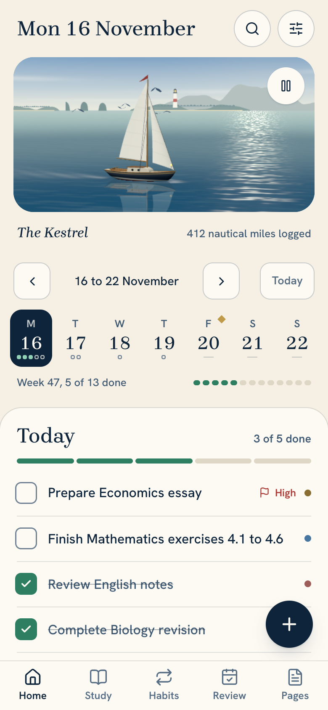
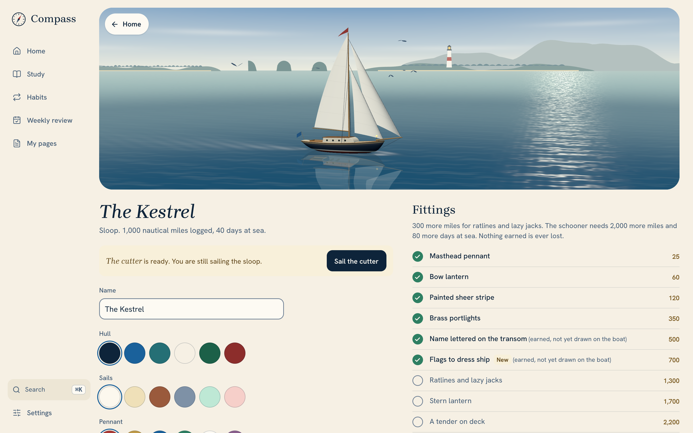
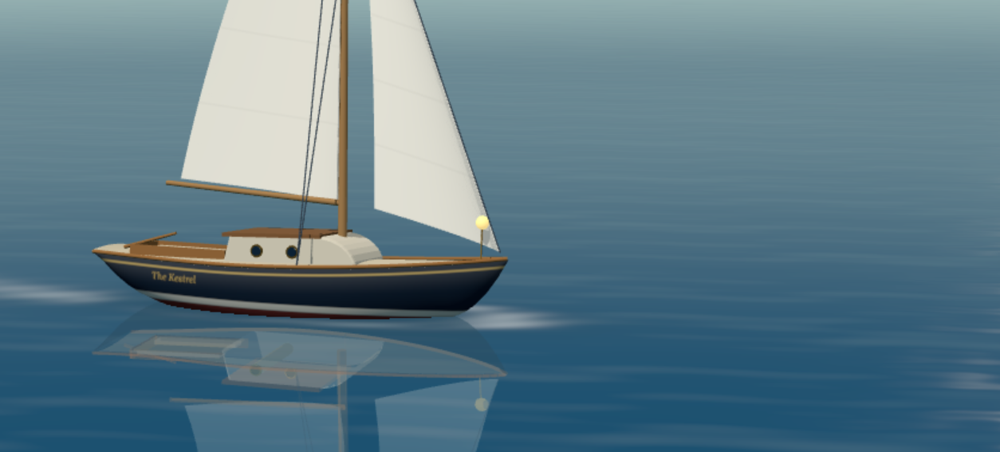
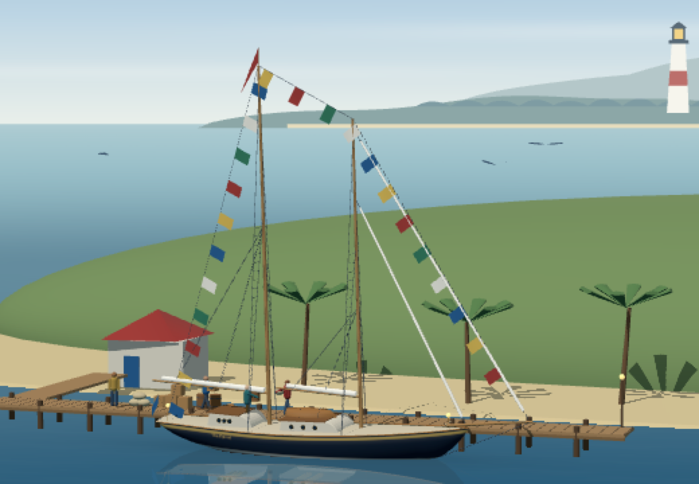
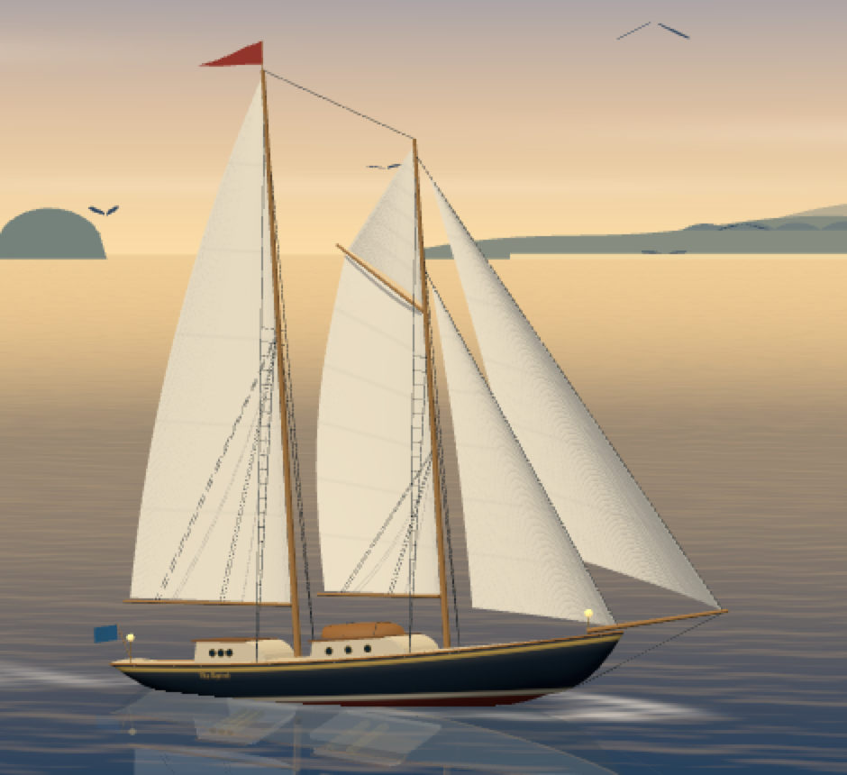
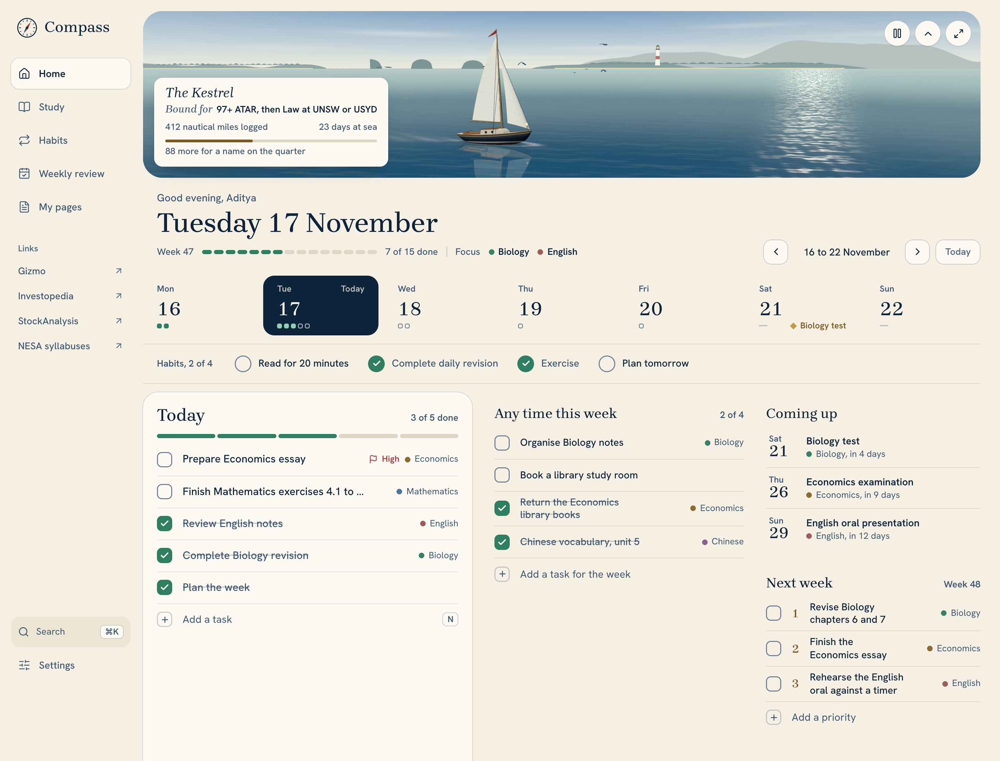

# Compass testing report, Phase 1

| | |
|---|---|
| Date | 16 November 2026, with sections 10 to 13 added on 17 November |
| Build | Branch `boat-fittings`: Phase 1 with the Phase E changes in section 2, the performance work in section 5, the reward loop in section 6, motion and the editor in section 7, Habits in section 8, Study in section 9, the Weekly review in section 10, My pages in section 11, and the later fittings in section 12. Section 13, the Home and Weekly review additions, is on the branch `home-review-additions`, cut from it |
| Covers | The brief's completion criteria (section 11) and the Phase E visual review (section 9) |
| Companions | [compass-art-direction.md](compass-art-direction.md), [home-screen-spec.md](home-screen-spec.md), [next-stages.md](next-stages.md) |

## 1. Summary

Home meets every functional line of the brief's section 11 that can be checked on a laptop. The build passes, 256 unit tests pass and 115 browser tests pass. Those counts include the additions in section 13; before them it was 225 and 72, and all of those still pass unchanged.

Two things are **not** verified, and should not be read as passing:

1. **Performance on a real phone.** Only an indicative figure from a laptop exists (section 5).
2. **A manual screen-reader pass.** Structure, names and contrast were checked by script and by reading the code, not by listening.

## 2. Phase E: what the visual review found and fixed

Home was captured at 375, 390, 768, 1024, 1280 and 1440 px, plus a day in port, a finished day, the editor, the new-task sheet, the command menu, a toast and the folded window. Each was compared with the art direction.

| Found | Where | Fix |
|---|---|---|
| The day's sheet stopped in mid-page with a square bottom edge while the lists beside it carried on. It read as a clipped card, not "a page that runs to the bottom". | 1024 and up | The sheet now stretches the full height of the lists and runs off the bottom of the page. |
| The same sheet had square bottom corners with lists directly under it. | 640 to 1023 | It is a whole sheet with four rounded corners there. |
| Four different left edges: the date, the week strip's text, the sheet's text and the caption each started a few pixels apart. The week controls also stopped 8 px short of the right edge. | All widths | One text edge per width (20 px in from the window at 1024 and up, 14 px on tablet, 20 px from the screen on phones). The week controls end flush with the window. |
| The assessment label on a day was cut to "Biolog…" and ran into the date. | 1024 to 1279 | The label shows only from 1280, where it fits. Below that a brass diamond sits beside the date. |
| On tablet the diamond floated between two days and belonged to neither. | 768 | Same fix: it sits beside its date. |
| On phones the week controls sat between the date and the sea, so four bordered buttons came before the picture. | Below 640 | The order is now date, sea, boat name, week controls, week strip. The controls sit on the strip they move. |
| The phone date wrapped to two lines for long dates such as "Wednesday 23 September". | Below 640 | Phones show "Wed 23 September" at the specified 25 px. Wider screens keep the full weekday. |
| The plate read "88 more for name lettered on the transom". | 1024 and up | Each fitting has a phrase for sentences: "88 more for a name on the transom". The voyage view uses it too. |
| The week line and the week controls sat 7 px out of line with each other. | 640 and up | Both rows are the same height and share a centre line. |
| "All 5 done" where the approved voice says "All five done". | All widths | Counts from two to ten are spelled out. |
| Two-line titles left one word alone on the second line ("…chapters 6 / and 7"). | Side lists | Titles in the side lists break evenly. The empty-day sentence no longer leaves "port." alone. |
| One hex colour in a component, against the tokens rule. | Week strip | Replaced with a token. |
| Arrow keys in the week strip moved from the selected day even when focus was on another day. | Week strip | They move from the day that has focus. |
| A console warning on every load about a removed shadow type. | Scene | The scene asks for the shadow type it was already getting. No visual change. |

Reviewed and left alone: the type scale, the colour use (one accent per region holds), the rail, the one-sheet rule, the task rows, the composer, the editor and the bottom bar.

Updated screenshots are in [screenshots/home/](screenshots/home/).

## 3. How it was tested

| Check | Tool | Result |
|---|---|---|
| Type-check and production build | `npm run build` | Passes. Main bundle 175 kB compressed. Loaded afterwards: the animation engine, 34 kB, and the 3D scene, 260 kB. |
| Unit tests | `npm test` (Vitest) | 225 of 225 pass |
| Browser tests | `PW_CHANNEL=chrome npm run test:e2e` (Playwright, headless Chrome 157) | 72 of 72 pass, four runs in a row |
| Screenshots and state capture | Playwright scripts, six widths and nine states | No console errors in any capture |
| Contrast, text size, touch targets | A script run inside the live page at 390 and 1440 | Section 4 |
| Frame rate | The same, at phone size with the processor slowed four times | Section 5 |

The browser tests had never been run before this pass. Two failed on the first run:

- **A real fault:** the arrow-key behaviour in the table above. Fixed in the app.
- **A fault in the test:** it pressed `N` a few milliseconds after the page loaded, before the shortcuts were listening. A person cannot do this. The test now waits for the page, and the app is unchanged.

`PW_CHANNEL=chrome` is new. It runs the suite in an installed Chrome, so the 100 MB test browser does not need downloading.

### On GitHub

Added on 17 November: `.github/workflows/ci.yml` builds and tests every pull request, in two jobs. One runs the build and the unit tests. The other runs the browser tests in Playwright's own Chromium.

- **The six sea tests are skipped there.** They measure frame rate, the performance tier and draw calls, which depend on a graphics card. A CI runner has none and draws in software, so the scene would step down and the numbers would mean nothing. They still run on a real machine, and the figures in section 5 come from one.
- **Its first run on GitHub passed, both jobs,** on 17 November. That includes the two look-review tests that need the 3D scene to start, which on a runner means drawing WebGL in software. Run as CI runs it on this machine, the suite reports 66 passed and 6 skipped.
- **Only the top of the stack is checked.** GitHub runs a workflow for a pull request only if the branch holds the workflow file, so the earlier pull requests get no checks until they are merged.

## 4. The brief's completion criteria

### Home

| Criterion | Result | How it was checked |
|---|---|---|
| Home loads without runtime errors | Pass | Browser test; no console errors at any width |
| Calendar displays correctly | Pass | Screenshots at six widths |
| Week navigation works | Pass | Browser test: the two week buttons, and an arrow key across a week end |
| Date selection works | Pass | Browser test: click, arrows, `T`; the date is kept in the URL |
| Daily tasks display correctly | Pass | Browser test and screenshots |
| Weekly tasks display correctly | Pass | Browser test: four sample tasks under "Any time this week" |
| Tasks can be added | Pass | Browser test: `N`, type, Enter. An empty title is refused. |
| Tasks can be edited | Pass | Browser test: title and subject change and survive a reload |
| Tasks can be completed and reopened | Pass | Browser test |
| Progress indicators update correctly | Pass | Browser test: the daily count follows each change. Unit tests cover the sums. |
| Sample assessments display correctly | Pass | Browser test: three under "Coming up", and selecting one goes to its date |
| Next-week priorities display correctly | Pass | Browser test: three, numbered |

Also checked: delete with Undo, priority changes, the command menu, and miles being earned once and never falling.

### Boat

| Criterion | Result | How it was checked |
|---|---|---|
| The 3D boat renders | Pass | Browser test waits for the live scene; screenshots |
| Recognisable sailboat geometry | Pass, by eye | Screenshots. The founders' look review is still open (parked by Oliver). |
| Water animation works | Pass | Two captures of the canvas one second apart differ |
| Lighting and materials are coherent | Pass, by eye | Dawn, day, golden hour, port and storm captured |
| The scene does not obstruct the planner | Pass | It sits in its own window, folds to a strip, and the planner draws before the 3D code loads |
| Mobile performance is acceptable | **Not verified on a phone.** The low tier is built and behaves as specified on a laptop. | Section 5 |
| Reduced motion is respected | Pass | Browser test: the scene holds still |
| A fallback exists without WebGL | Pass | Browser test: the still image stays and nothing breaks |

### Responsive design

| Criterion | Result | How it was checked |
|---|---|---|
| Desktop, tablet and mobile layouts work | Pass | Screenshots at 375, 390, 768, 1024, 1280, 1440 |
| No horizontal overflow | Pass | Browser tests at the five widths; also on every destination page |
| Touch targets are usable | Pass | Script at 390 px: every link, button and field is at least 44 by 44 px. At 1440 the smallest is 36 px, above the 24 px the spec asks for with a pointer. |
| Text remains readable | Pass | Script: nothing below 12.5 px at either width |
| Navigation works on smaller screens | Pass | Each bottom-bar item was followed and its page loaded |

### Quality

| Criterion | Result | How it was checked |
|---|---|---|
| No obvious console errors | Pass | None at any width. One harmless warning remains: "THREE.Clock deprecated", from React Three Fiber. |
| No broken navigation | Pass | Every route was reached through the real navigation at 390 and 1440 |
| No placeholder buttons pretending to work | Pass | The four future pages state what will live there and have no controls |
| No unnecessary loading delays | Pass | The planner draws from local data on the first paint. Only the scene loads late, behind its still image. |
| No major visual inconsistencies | Pass after section 2 | |
| No severe performance issues | Pass on a laptop. Phone not verified. | Section 5 |

### Contrast

A script walked every visible piece of text on Home at 390 and 1440 px, worked out the colour actually behind it, and computed the ratio. **Nothing was below 4.5 to 1.** This is the first check of contrast inside the running app. It covers text only. Graphics such as the progress marks rest on the measured token table in the art direction.

## 5. Performance

### What was built on 16 November

The sea now has the two tiers the spec asks for, and it stops drawing when nobody can see it.

| | High tier | Low tier |
|---|---|---|
| Chosen when | A device with a mouse or trackpad | A touch device, or any device whose frames average over 22 ms for two seconds |
| Pixel density | Up to 2 | Up to 1.5, falling to 1 if frames average over 45 ms for two seconds |
| Shadow | A shadow map | None. The soft dark patch the water already draws under the hull does the job. |
| Frame rate | The display's own | Capped at 30 |
| Graphics chip | Asks for the fast one | Lets the device choose, to save battery |

- **Asleep.** The scene draws nothing while its window is scrolled out of view or the tab is hidden, and starts again when it returns.
- **One-way.** A device that steps down stays down for the visit, so the picture does not flicker between tiers.
- **Review tool.** `/lookdev` has a Performance control (Automatic, High, Low) to compare the tiers side by side.

### Measured

Apple M5 laptop, headless Chrome 157, real GPU. Frames were counted from outside the app by watching WebGL draw calls.

| Case | Result |
|---|---|
| Phone size (390 by 844, three times density, touch) | Low tier chosen. 30 frames a second. Canvas drawn at 537 by 276 for a 358 by 184 window. |
| The same, scrolled until the window is out of view | 0 frames in two seconds |
| Laptop size (1440 by 900, twice density) | High tier chosen. 60 frames a second. |
| Every frame made to take 30 ms, as on a slow device | Steps down to the low tier within a few seconds |
| Processor slowed four times, before this work | 60 frames a second, median frame 16.7 ms |

The two tiers look almost the same at window size. The low tier is slightly softer.

### Draw calls and triangles

The spec's budgets are 40 draw calls and 60,000 triangles a frame. The first measurement found the scene far over the first: every plank, palm frond and limb was its own draw call. Parts that never move are now baked into one mesh for each material, the sails share one mesh, each figure is one mesh, the gulls are one mesh, and each island is one mesh.

Draw calls in a frame, before and after:

| Scene | High tier before | High tier now | Low tier before | Low tier now |
|---|---|---|---|---|
| Dinghy under sail | 59 | 20 | 50 | 17 |
| Sloop under sail | 117 | 22 | 89 | 17 |
| Sloop in a storm | 104 | 23 | 74 | 18 |
| Cutter under sail | 144 | 25 | 105 | 19 |
| Schooner under sail | 169 | 28 | 121 | 21 |
| Sloop in port | 328 | 29 | 225 | 20 |
| Schooner in port | 457 | 32 | 294 | 22 |

- **Both budgets are met in every case.** Triangles run from 11,000 to 36,000 a frame and did not change.
- **The picture was checked against the old one,** frame against frame with the scene paused, in nine cases. The boat, its reflection, the port and the figures match.
- **One thing looks different, and it is a fix.** Each island's beach, and the band and lamp of the distant lighthouse, used to show in some scenes and vanish in others, because their layers sat at the same depth. They now show every time. In the picture below, each pair of rows is before, then after: golden hour, in port, a storm, and the dinghy.

### What this does not show

- **How a real phone copes.** A laptop's graphics chip is far stronger than a phone's, and none of this measures heat or battery. The spec's pass bar ends with a founder checking on a real phone. That has not happened.

## 6. The reward loop

Built on 16 November, from the art direction (section 13) and the Home spec (section 11).

### What was missing

Earning a fitting changed nothing you could see. The boat's pennant, lantern, stripe and portlights were fixed by the type of boat: every sloop had all four from its first mile, and a dinghy never had any. The plate did not say when something was earned.

### What was built

| | Behaviour |
|---|---|
| **Fittings on the boat** | The boat wears the fittings that have been earned and no others, in the 3D scene and the still image alike. A pennant earned on the dinghy flies from the dinghy, and carries to every later boat. |
| **The plate** | When something has been earned since the voyage was last opened, a brass dot and one line replace the plate's last line: "New: *bow lantern*". Several at once read "New: *bow lantern* and 1 more". The name is in the voyage's italic, as the chart rule asks. |
| **A new boat** | The plate says "*The cutter* is ready". The boat on Home does not change. |
| **The voyage view** | It opens on the new boat, with one notice: "The cutter is ready. You are still sailing the sloop." and a button to sail it. New fittings carry a "New" tag in the list. Opening the view is what marks them as seen. |
| **Phones** | The same line takes the place of the miles under the window. |
| **The name on the quarter** | At 500 miles the boat's name is lettered on her quarter, on both sides, in the voyage's italic: gold leaf on a dark hull, navy on a light one. Renaming the boat repaints it at once. It is painted by the hull itself, so it adds no draw call. |
| **Assistive technology** | The plate's name includes the line, and a polite live region states it once. Nothing pops up. |

The name on the quarter, enlarged three times. In the Home window it is under twenty pixels long, which is how a name reads on a boat at that distance:

A dinghy and a sloop, each with nothing earned and then with the first four fittings:

### Checked

- Browser tests: a new fitting is announced, survives a reload, is tagged in the voyage view, and the plate returns to normal afterwards; a new boat is offered and not swapped in, and sailing it works; on a phone the line fits without sideways scroll.
- Unit tests: what counts as new, the wording of the line, and each fitting adding to the 3D boat and to the still image.
- The sample boat at 412 miles looks exactly as before, because it has earned all four drawn fittings.

### Calls made here that the founders can overrule

- **A boat with nothing earned is plainer than before.** A new sloop has no pennant, lantern, stripe or portlights until its miles earn them. This is what the art direction describes, but it has not been seen until now.
- **The dinghy's lantern is 60% of full size,** so it does not overpower a 3.8 m boat.
- **The voyage view opens on a newly earned boat** and not on the one being sailed.
- **On phones the announcement replaces the miles** under the window until the voyage is opened.
- **The lettering is to scale,** about 0.2 m tall on the sloop. It is small in the Home window and readable in the voyage view.

## 7. Motion, the editor and the shortcut list

Built on 16 November, from the Home spec (sections 7, 13 and 14). This finishes Stage 3.

| | Behaviour |
|---|---|
| **Task rows** | A finished task holds its place for 600 ms, then slides below the open ones in 320 ms. A row fades in when added and out when deleted, and the rows around it slide to close the gap. Choosing another day swaps the list at once. |
| **Week strip** | The new week arrives from the side the calendar moved toward. The strip follows a finger or a mouse drag: past 56 px, or a quick flick, it changes the week, and otherwise it settles back. |
| **Editor on wider screens** | A popover beside the task's row, which is tinted while it is being edited. Beside the row if there is room, otherwise below or above, and always wholly on screen. No Done button: changes save as they are made. Escape or a click outside closes it and focus returns to the row. |
| **Editor on phones** | A bottom sheet that rises on a spring with no overshoot. Dragging its header down follows the finger; past 110 px, or a quick flick, it closes. |
| **Shortcut list** | `?` shows every shortcut, grouped by where it works. It is also in the command menu. |
| **Reduced motion** | Nothing slides or scales. Changes cross-fade. |

### How it was built

- Motion 14.14, which the brief's stack lists, is now installed. Its animation engine is loaded after the first paint, which keeps the main bundle at 156 kB compressed against the spec's ceiling of 200.
- Single-key shortcuts now do nothing while any dialog is open.
- Key hints are set in the interface typeface. They were in the browser's monospace, which the type system does not include.

### Checked

- Browser tests: the shortcut list opens and closes; the popover sits beside its row, on screen, with no Done button, saves as you type, and returns focus; a click outside closes it; the phone sheet settles back after a short drag and closes after a long one; the week strip does the same; a finished task moves below the open ones; and everything works with reduced motion.
- Unit tests: where the popover sits in six cases, including a window too small for it.
- No console errors or warnings.

## 8. Habits

Built on 16 November. The rules are in [habits-spec.md](habits-spec.md). Where habits sit on Home was decided by Oliver from the mock, and Oliver accepted the Habits page as a first version on 16 November. Josh and Aditya have not reviewed either.

### What was built

| | Behaviour |
|---|---|
| **Habits** | Named by the user, for every day or chosen weekdays. A habit can be ticked for the day or any day after, never for a day still to come. |
| **On Home** | A line of its own between the week and the lists from 1280 px wide. Below that, a grid at the foot of the day's sheet. It follows the selected day, shows up to six, and shows nothing on a day with no habits. |
| **The Habits page** | The week as a grid of round ticks, a count for each habit and for the week, and earlier weeks as the record. Add, rename, choose days, delete with Undo. |
| **Miles** | One for each tick, once for each habit and day, up to 8 a day. Unticking takes nothing back. |
| **Never** | No streaks, no red, no reminders, and no effect on the sea. |

### Checked

- Browser tests: the line sits between the week and the sheet on a wide screen and on the first screen; a tick counts, logs one mile once, and survives a reload; a day ahead cannot be ticked; the grid is at the foot of the sheet at 1024 px and on a phone, with no sideways scroll; the Habits page counts each habit and keeps earlier weeks; habits can be added, renamed, given days and deleted with Undo; a day with no habits shows nothing.
- Unit tests: which habits fall on a day, a habit's week, counting only the days that have come, choosing days, the mile for a tick, the daily limit, and the store's actions.
- The task editor was moved onto a frame it now shares with the habit editor. Its own browser tests still pass unchanged.

### Calls made here that the founders can overrule

- **The limit of 8 miles a day from habits.** The art direction gives one mile a tick and no limit.
- **A new habit starts today.** Days before it was made are not counted, so its record starts clean, and they cannot be ticked.
- **Earlier weeks can still be ticked,** so a forgotten tick can be put right.
- **The page shows one week at a time.** There is no view across many weeks yet.

## 9. Study

Built on 16 November. The rules are in [study-spec.md](study-spec.md). No founder has reviewed the page. Oliver decided that a study session becomes an ordinary task that repeats.

### What was built

| | Behaviour |
|---|---|
| **The Study page** | Subjects listed beside the one that is open on wider screens. On phones the list comes first and a subject opens on its own. |
| **A subject's sheet** | Its assessments still ahead, every open task for it wherever it is planned, a row to add a task, and notes. |
| **Subjects** | Add, rename, recolour, delete with Undo. Deleting one removes its assessments and keeps its tasks. |
| **Assessments** | Add, change and delete with Undo. Until now they were fixed sample records. |
| **Study sessions** | A session repeats on chosen weekdays and becomes an ordinary task on each of them, made when its week arrives. Tasks from a session carry a small mark. Deleting one is a day off: it is not made again. Changing or ending a session leaves the tasks already made. |
| **One set of records** | A task added on a subject's page is the same task on Home, and an assessment added here appears under "Coming up". |

### Not built

- **Preparation tasks attached to one assessment.** A task belongs to a subject, not yet to a particular assessment.

### Worth knowing about sessions

- **They count like any task,** so a day with a session is never a day in port, and doing nothing on it brings the storm the next day. This was the recommendation in the mock, and is still open to change.
- **Nothing is made for a day that has gone.** A week's tasks are made on the first day the app is opened that week, from that day on.
- **The sample has no sessions,** so the sample week and every earlier screenshot are unchanged. To see one, add it on a subject's page.

### Checked

- Browser tests: the list and the first subject's sheet; a task added on a subject's page showing on Home with its subject, and a tick on Home counting here; an assessment added, shown on Home, changed, and deleted with Undo; a subject added, renamed, recoloured, and deleted with Undo; notes kept after a reload; the phone flow, with no sideways scroll.
- Browser tests for sessions: one is set up and needs a day; its task for today appears on the subject's page and on Home with the mark, counts in the day, and is ticked like any other; deleting it is not undone by a reload; renaming a session leaves its task alone; ending it keeps the task and removes the mark, and Undo restores both; a task from a session says where it came from.
- Unit tests: a subject's tasks and their order, when a task is for, assessments ahead and past, the one-line summary, a new subject's colour, which session tasks are made and when, a session's days in words, and the store's actions.
- Two of the new browser tests failed on their first run because of their own selectors, and one led to a fix in the page: the Notes label now names its text box properly.

## 10. Weekly review

Built on 17 November as a first version, to [review-spec.md](review-spec.md). No founder has reviewed the page, and it was not mocked before it was built.

### What was built

- **The page at `/review`,** in place of the "Not built yet" page. It opens on this week, with earlier weeks one step back. A week still to come cannot be opened.
- **The week's summary:** tasks done of planned, habits ticked of due, miles logged and the days they were logged on, each day's tasks, each habit's count, and the week's assessments. All of it is worked out from the existing records. Nothing is stored.
- **A reflection** of three questions. It is kept as it is typed. Saving it needs something written, and lists it among the saved reviews.
- **Priorities for the week after,** which are that week's any-time tasks: the same ones Home shows under "Next week".
- **Miles:** 10 for saving a review, once for each week, and only for this week or the one just ended.
- **The sample** has last week's review, already saved.

### Checked

- Browser tests, eight new: the page and its figures; a task ticked on Home changing the figures; saving needing words, logging ten miles once and listing the review; words kept before saving; opening a saved review from the list; a priority added here showing on Home; an older week saving with no miles and no plan; and the phone layout with no sideways scroll.
- Unit tests, fifteen new: the summary's counts, which weeks can be reviewed, the award and its limits, a blank reflection, the list's excerpt, and the store's writing and saving.
- No console errors or warnings in any capture.

### Found on the way

- **A saved review could have earned twice.** The sample's saved review has no entry of its own in the log, so saving it again would have logged ten miles. The store now gives nothing for a review that is already saved. Caught while the page was being built, and covered by a unit test.
- **One Home browser test depended on the day of the week.** It chose the second day of the week and expected the date in the address, which fails on a Tuesday, when that day is today. It then failed now and then for a second reason: the week that has just slid away is still on the page for a moment. The test now chooses its day by date. The app is unchanged.
- **One run of the full suite had four failures in the Study and sea tests,** each within a tenth of a second, which looks like the development server restarting under the run. They did not happen again in seven further runs, and the cause was not found.

### Calls made here that the founders can overrule

They are listed with the other way for each in [review-spec.md](review-spec.md), section 7. The one that matters most: the figures are live, so an old saved review shows that week as the records stand now, not as they stood when it was saved.

## 11. My pages

Built on 17 November as a first version, to [my-pages-spec.md](my-pages-spec.md). Oliver chose the approach, the layout and the tick from that document and its mock. Josh and Aditya have not reviewed it.

### What was built

- **The page at `/pages` and `/pages/:pageId`,** in place of the last "Not built yet" page. The pages are listed beside the open one; on phones the list comes first.
- **One page shape, five ways to start:** note, checklist, goal, reading and project. Every page has a title, a list, writing and an optional date. The kind sets the icon, which part comes first and what the parts are called.
- **A page's list:** items are added, ticked, changed in place, moved and deleted with Undo. A ticked item stays where it is. A checklist can be unticked in one go.
- **Goals:** a date to aim for, a "why", and "Mark as reached", which keeps the goal below the open pages.
- **Around it:** search finds a page by title, "Export my pages" saves one text file, and "Clear everything" removes pages with the rest.
- **Apart from the rest, on purpose:** an item is not a task. It earns no miles, is not on Home and does not move the sea.

### Two faults found in the editors, both older than this work

Building the page's editor showed two faults in the frame every editor shares. Both are fixed for all of them.

- **A space typed at the end of a title was lost.** The record keeps a tidied title, and the box showed the record, so the space was tidied away before the next letter arrived: "essay two words" came out as "essaytwowords". It affected the task, habit, subject, assessment and session editors, a task's notes, and the boat's name. The earlier browser tests filled each box in one go, which is why they did not see it. A text box now shows what was typed while it has focus (`src/ui/DraftField.tsx`).
- **Focus landed on the Close button, not the title.** A dialog gives focus to the first thing in it, and the Close button comes first. The frame now gives focus to the first text box: always on wider screens, and on phones only when the box is empty, so that opening something to look at it does not raise the keyboard.

A new Home browser test covers both, typing a key at a time.

### Found in testing

- **The sample goal was stamped later than the present moment,** so a page changed now sorted below it. The sample pages are now all last changed before today. Caught by the phone browser test, and now a unit test.
- Two of the new browser tests failed on their first run because of their own selectors.

### Checked

- Browser tests, fourteen new: the list and the open page; ticking and its count, with no miles and nothing on Home; adding, changing, moving and deleting items with Undo; "Untick all"; a new page with its title ready to type; a note and its list; reaching and reopening a goal; changing kind and deleting a page with Undo; search; export; the empty state; narrowing the list by kind; the phone flow; and the Home test for the two editor faults.
- Unit tests, thirty-one new: the kinds, the list's rules, goals, the one-line summary, the order of the list, search, export, and the store's actions.
- No console errors or warnings in any capture.

### Calls made here that the founders can overrule

They are in [my-pages-spec.md](my-pages-spec.md): section 10 for the decisions built to their recommendations, and section 13 for where the build differs from the mock.

## 12. The later fittings

The first part of Stage 7, built on 17 November. Oliver has seen the screenshots and decided when the dress flags fly. Josh and Aditya have not reviewed it.

### What was built

The six fittings that could be earned but were not drawn. All eleven are now on the boat, in 3D and in the still image.

| Fitting | How it is drawn |
|---|---|
| Flags to dress ship | A light line from the bow, over each masthead, to the stern, with a small flag every pace in five colours. Flown in port only, where the flags hang from the line. |
| Ratlines and lazy jacks | Rungs across the shrouds, and two light lines each side from the mast to the boom, which swing with it |
| Stern lantern | A brass post and a lit lamp on the starboard quarter, clear of the tiller and the ensign staff |
| A tender on deck | A small varnished boat, upside down and lashed on the longest clear stretch of cabin top |
| A topsail | One more sail above the gaff foresail. Stowed with the rest in port. |
| Gilded cove stripe | The cove stripe in gold leaf, which shines, with a fine second line under it |

- **A fitting goes on every boat that has a place for it.** The tender needs a long cabin top (the cutter and the schooner) and the topsail a gaff (the schooner). The voyage view now says "the sloop has no place for it" beside a fitting the boat being looked at cannot carry, in place of the old "earned, not yet drawn".
- **No more draw calls.** Every flag on the boat (pennant, ensign and dress flags) is now one mesh, which is one fewer than before on a boat with an ensign. The rest are baked into the paint, the suit of sails or the hull's own shader. The unit test that holds the whole scene to 40 draw calls passes with every fitting on.
- **Flags cast no shadow.** At their size the shadows read as grey patches on the sails.

### Decided, and open

- **Decided by Oliver on 17 November: the dress flags fly in port only.** They were first built to fly whenever they had been earned, because the art direction says a fitting appears at once. A real boat dresses only at rest, with her sails furled, and under sail the flags crossed the sails. They now fly on a day with nothing planned, and the voyage view says "flown in port, on a day with nothing planned" beside them.
- **Open: how the six look.** Screenshots are in `docs/screenshots/fittings/`. Josh and Aditya have not seen them.

### Found on the way

- **The cause of the bursts of failures in sections 10 and 11.** Twice a full run had several tests fail within a moment of each other. The dev server kept open on port 5173 had crashed part-way through the run (Node exited with a fatal error under five browsers at once), and every test after that had nothing to load. The tests now start a server of their own on port 5174, fresh for each run. More than fifteen full runs since have had no burst.
- **A tender with a broken number.** Rounding put the last station of the tender's hull a hair past her stem, where a cosine turns negative and its power is not a number. One station of her hull was nowhere. Fixed, and a unit test now checks that no point of any boat, under sail, furled or reflected, is a broken number.
- **Two tests that failed now and then, neither through a fault in the app.**
  - The "holds still" test compares two pictures of the scene taken a moment apart. About one time in twelve under load they differed. The only pixels that differed were on the window's rounded corners, by a single shade: the browser smooths those corners a hair differently from moment to moment when the machine is busy. The scene itself was identical. The test now compares the picture inside the corners, and 72 repeats under load have all matched. My first guess at the cause, a late typeface, was wrong.
  - A My pages test typed before the editor had opened. It now waits for the title to be focused.
- **The still image laid the aft flags along their line,** as slivers. The 3D boat and the still image now share one rule for how a dress flag flies, which keeps it at least 50 degrees off its line.

### Checked

- Unit tests, twenty-four new: every fitting is drawn; each is on the boat only once earned; the dress line and its flags on all four boats; how a flag flies; where the tender goes and that a boom clears her; the topsail; the stern lantern; which boats carry what; that the flags are flown in port and stowed under sail; no broken numbers; and the still image drawing each one.
- Browser tests, two new: every fitting put on and taken off on the live boat and the still one, with no console errors; and the voyage view saying which fittings a boat has no place for.
- Not checked: frame rate with every fitting on. The draw calls are no more than before, but in port the flags are moved on every frame, and that has not been timed on a phone.

## 13. Home and Weekly review additions

Built on 17 November on the branch `home-review-additions`, to [home-and-review-additions-spec.md](home-and-review-additions-spec.md). It is the first of five pieces of Aditya's plan, which the founders keep outside this repository. Nothing in it shows until the person sets it, so the sample Home is unchanged.

### What was built

- **Home:** a greeting once a name is set; the long-term goal on the boat's plate as "Bound for"; the week's High subjects named beside its progress; and, within a priority, open tasks ordered by their subject's level.
- **Weekly review:** each area of the week rated out of 10, and each subject's level for the week after.
- **Study:** subjects in the order of this week's levels, and a subject's level for this week on its page.
- **Settings:** your name, the areas that are rated, and links. The voyage page holds the goal.
- **Links:** in the rail from 1024 px, at the foot of Home below that, and in search.
- **The saved data:** three new lists (links, areas and levels). A save from before this piece opens with nothing lost.

### Checked

- **Unit tests, 31 new:** which levels apply to a week and when they are carried over; starting a week's levels from the ones it carried; the order of tasks by level; ratings kept to whole numbers from 1 to 10; a review that is blank, rated or written; which addresses are web addresses and which are refused; a link's name; the greeting by the hour; the limits on names, goals, areas and links; an older save and an unreadable one; and "Clear everything".
- **Browser tests, 43 new:** a new user seeing none of it at two widths; the greeting at three widths without the page jumping; the goal on the plate, on a phone and on the voyage page, and gone when the sea is folded; the focus line, its order of tasks, its count past four and its carried-over mark; ratings by keyboard and by pressing; saving on a rating alone; levels set in the review and in Study; areas and links added, renamed, moved, refused and removed with Undo; links in the rail, at the foot of Home, in a short window and in search; and no sideways scroll on five pages at 375, 390, 768, 1024 and 1440 px with everything set to its longest.
- **Everything from before:** the 225 unit tests and 72 browser tests pass unchanged.
- **As CI runs it:** 109 pass and the six sea tests are skipped, as designed.
- **Against the mock:** the built pages were pictured and compared with the mock. The pictures are in `screenshots/additions/`, numbered, beside the mocks.

### The review of the whole change

A fresh reviewer read the whole change against the specification on 17 November, ran the unit tests and the build, and probed the running app with saved data edited by hand. It found nothing critical. Five findings were fixed, each with a test that failed first:

| Finding | Fix |
|---|---|
| A save edited by hand could put something that is not a web address into a link, and a broken entry could stop every page opening | A save's links and areas are checked again when it is opened. Only web addresses are kept, each once, six at most. |
| Changing the week's first day from Monday to Sunday lost that week's levels, and an old record could later override a newer one | The levels move with the week when its first day changes |
| The focus line was a label on an empty group, which some screen readers skip | It is now plain text for a screen reader |
| A name or a goal that is one long word pushed a phone's page sideways | Those lines now wrap inside a word |
| With six links, Search and Settings were out of sight on a short laptop screen | The foot of the rail stays put, and the places and links scroll above it |

Six smaller findings were left as they are, for the founders to decide:

- Undo can bring back a seventh link or area after another was added in its place.
- "Carried over from week N." shows when the earlier week's levels were all cleared.
- Pressing a rating with the mouse does not move the keyboard to it, so the arrow keys do nothing until it is tabbed to.
- "Add area" with an empty box does nothing and says nothing.
- "This week" is heard twice in Study, once as words and once as the group's name.
- There is no test for Undo at the limit of six.

### Not checked

- A real phone, Safari or Firefox, and a screen reader by ear. This is the same as for the rest of the build (section 15). The rating's segments are 16 px wide on a phone, which needs a thumb on a real one to judge.

### Found on the way

- **While the week strip slides to another week, the page is 8 to 16 px wider than the screen** below 1024 px, for the length of the slide. This is in the build before this piece.
- **A long assessment title is cut off on the week strip with no ellipsis.** "Legal Studies test" showed as "Legal Studie". Also in the build before this piece.
- **A priority whose title runs to three lines shows a sliver of the third line** under "Next week". Also in the build before this piece.

None of the three is fixed here.

### Calls made in the build that the founders can overrule

- Pressing the rating that is already set clears it, so a phone has a way back to nothing.
- A link's address is checked when its box is left or Enter is pressed, not as it is typed.
- "Move up" on the first item and "Move down" on the last are disabled.
- At six links, the last row at the foot of Home reads "Change your links".

The larger calls are in the specification, section 12.

## 14. Built differently from the approved spec

None of these breaks a criterion in the brief. Each is a gap between the build and the approved documents that the founders should know about.

| Spec says | Build does |
|---|---|
| The water is a mesh, 128 by 128 on the high tier and 64 by 64 on the low | The water is one flat sheet shaded per pixel, so there is no mesh to coarsen. The low tier saves by drawing fewer pixels. |
| The high tier reflects the boat with a half-resolution pass | Both tiers use a mirrored copy of the boat, which the spec gives as the low tier's method |
| The high tier's shadow map is 1024 px | It is 2048 px, kept from the look review |
| The week strip slides when the week changes | It moves 28 px in the direction of travel while it fades, and does not sweep the full width. The outgoing week leaves the other way. |
| The folded window shows a strip of horizon | It shows a strip of the same view, which cuts through the sail |
| Corners use `corner-shape: squircle` where supported | Plain rounded corners |
| The name is lettered on the transom | It is lettered on the quarter, by Oliver's decision on 16 November, because the transom faces away from the usual view. The still image does not letter it. |

## 15. Known limitations

- No manual screen-reader pass.
- No real-phone test of speed, heat or battery.
- The storm's breaking crests look like patches.
- The still image is side-on, so the picture shifts when the 3D scene takes over. Its port has no figures.
- Dark theme, the night scene, drag to reorder, recurring tasks, editing assessments, accounts and sync are not built, by plan.
- Tested in Chrome only. Safari and Firefox have not been opened.
